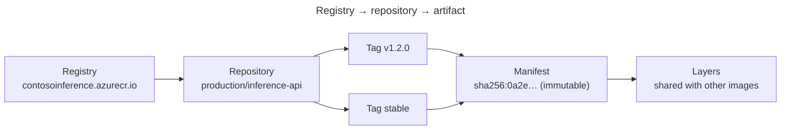
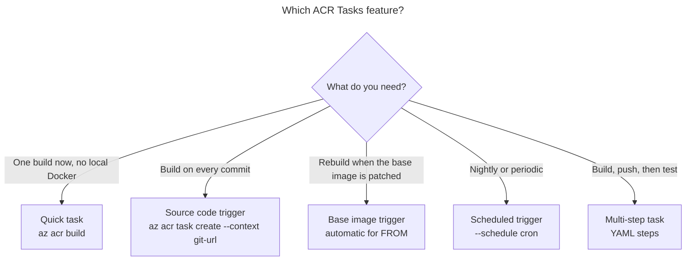
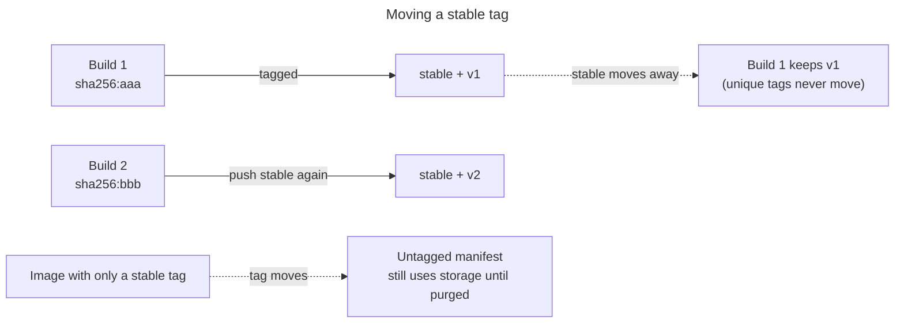

# LP1 · M1: Store and manage containers in Azure Container Registry

> **Learning path 1:** Implement container application hosting on Azure · **Skill area 1:** Develop and deploy containerized solutions · about 66 min on Microsoft Learn  
> Study it interactively at [aryantripathi.dev/ai-200](https://aryantripathi.dev/ai-200/lp-1/store-manage-containers-azure-container-registry)

Every container you run on Azure starts in a registry. This module shows how Azure Container Registry organizes images, how ACR Tasks builds them in the cloud, and how tags and digests decide exactly which image runs in production.

**In this lesson**

1. [Registries, repositories, and artifacts](#registries-repositories-and-artifacts)
2. [Build and run images with ACR Tasks](#build-and-run-images-with-acr-tasks)
3. [Tag and version images](#tag-and-version-images)

## Registries, repositories, and artifacts

📘 Microsoft Learn: [Registries, repositories, and artifacts](https://learn.microsoft.com/en-us/training/modules/store-manage-containers-azure-container-registry/2-image-storage)

Think of ACR as a **private warehouse for container images**. The **registry** is the building (with its own address, `name.azurecr.io`), a **repository** is one shelf for all versions of one image, and an **artifact** is one box on that shelf. A **tag** is a sticky label you can move to another box; a **digest** is the box's serial number, which never changes.

<!-- widget: RegistryHierarchy -->

**Key facts**

- Azure Container Registry is a **managed, private Docker registry** for container images and related artifacts: Docker images, **Helm charts** and **OCI artifacts** in one registry.
- It integrates directly with **AKS**, **Azure Container Apps** and **App Service**, and supports **geo-replication** so images sit close to the regions that pull them.
- Tiers: **Basic** (development and learning), **Standard** (more storage and throughput for production), **Premium** (geo-replication, **private endpoints**, **content trust**). Most developer workflows work the same in every tier.
- Hierarchy: **registry** (top-level resource, login server `<name>.azurecr.io`) → **repository** (images with the same name, different tags) → **artifact** (the image itself: tags, layers, manifest).
- Repositories support **namespaces** with forward slashes, such as `production/inference-api`. Namespaces help with access control: a team can push only to its own namespace.
- **Tags** (`repository:tag`) are **mutable**; pushing an existing tag moves it to the new image. No tag means `latest`. One artifact can carry several tags.
- **Layers** map to Dockerfile instructions and are content-addressable. ACR **shares common layers** across images, so a shared base layer is stored once.
- Each artifact has a **manifest** identified by a **SHA-256 digest**. Digests are **immutable**: pull by digest (`registry/repo@sha256:…`) for guaranteed reproducibility.
- Best practices: use namespaces, plan repository structure, enable geo-replication for global deployments, monitor storage and remove untagged manifests.

| Term | What it is | Example |
|---|---|---|
| Registry | Top-level resource with a login server | contosoinference.azurecr.io |
| Repository | Images with the same name, different tags | production/inference-api |
| Tag | Mutable, human-readable version label | inference-api:v1.2.0 |
| Digest | Immutable SHA-256 id of the manifest | inference-api@sha256:0a2e… |

> [!WARNING]
> **Exam traps**
>
> - Geo-replication, private endpoints and content trust need the **Premium** tier.
> - A tag can move; a digest can't. "Exact same image on every node" means **pull by digest** (or a unique tag).
> - Namespaces are part of the **repository** name (`team/image`), not separate registries.

## Build and run images with ACR Tasks

📘 Microsoft Learn: [Build and run images with ACR Tasks](https://learn.microsoft.com/en-us/training/modules/store-manage-containers-azure-container-registry/3-build-run-acr-tasks)

ACR Tasks is a **build server inside your registry**. You hand it your source code and it builds the image in Azure, so nobody needs Docker on their laptop. It can build **once on demand** (quick task), **automatically** when code, a base image or a clock says so, or run a **whole recipe** of steps (multi-step YAML).

**Key facts**

- ACR Tasks offloads image builds to Azure: **consistent builds**, **no local Docker needed**, CI/CD integration with **GitHub** and **Azure DevOps**, and builds for Linux, Windows and **ARM64**.
- Three scenarios: **quick tasks** (on demand), **automatically triggered tasks** and **multi-step tasks**.
- Quick task: `az acr build --registry myregistry --image inference-api:v1.0.0 .` uploads the context, builds and pushes, like docker build + docker push in Azure. The `.` is the build context.
- Build context locations: a **local directory**, a **Git repository** (GitHub or Azure DevOps, public or private), or a **remote tarball** URL.
- **Source code triggers** build on commits or pull requests; ACR creates a **webhook** in the repo. Created with `az acr task create … --git-access-token $PAT`; store the PAT in **Key Vault**.
- **Base image triggers** rebuild app images when the base image in their FROM line updates. Works for base images in the same registry or Docker Hub/public registries; private base images should be in the **same registry**.
- **Scheduled triggers** use cron (`--schedule "0 0 * * *"`) for nightly builds, periodic rebuilds, security scans and cleanup.
- **Multi-step tasks** are defined in YAML (`build`, `push`, `cmd` steps), with dependencies, parallel steps and conditional logic.
- `az acr run --cmd '<image> <command>' /dev/null` runs a command in a registry image; `/dev/null` means no source context is needed.
- Best practices: tag with `{{.Run.ID}}` or `{{.Run.Date}}`, keep PATs in Key Vault, read `az acr task logs`, use `.dockerignore`, and put frequently changing Dockerfile instructions late for layer caching.

| Need | ACR Tasks feature | Command / setting |
|---|---|---|
| One build now, no local Docker | Quick task | az acr build |
| Build on every commit | Source code trigger | az acr task create --context `<git url>` --git-access-token |
| Rebuild when the base image is patched | Base image trigger | Automatic for the FROM image |
| Nightly build | Scheduled trigger | --schedule "`0 0 * * *`" |
| Build, push, then test | Multi-step task | YAML file with build/push/cmd steps |
| Run a command in an existing image | Run | az acr run --cmd … /dev/null |

> [!WARNING]
> **Exam traps**
>
> - Private base image triggers work when base and app images are in the **same registry**.
> - `{{.Run.ID}}` gives each triggered build a **unique tag**.
> - `/dev/null` as the context means "no source files", used with az acr run and cleanup tasks.

## Tag and version images

📘 Microsoft Learn: [Tag and version images](https://learn.microsoft.com/en-us/training/modules/store-manage-containers-azure-container-registry/4-tag-version-images)

Stable tags (`v1`, `latest`) are like a **"current edition" sign** that moves to each new print. Unique tags (`v1.2.0-build456`) are like an **ISBN**: one book only. Use the sign where you want updates to flow in, and the ISBN in production so every node runs the same thing.

<!-- widget: TagMover -->

**Key facts**

- **Stable tags** (v1, v1.2, latest) are reused; the tag moves to the new image and the old image stays in the registry. Good for **base images receiving security updates**, development and continuous delivery.
- **Unique tags** (v1.2.0-build456, 20260102-abc123) are never reused. Good for **production**, audit trails, rollback and compliance. Tradeoff: you update deployment configs for each release.
- **Semantic versioning** MAJOR.MINOR.PATCH: MAJOR = breaking changes, MINOR = backward-compatible features, PATCH = bug fixes and security patches.
- Combine: `inference-api:1` (latest 1.x.x), `:1.1` (latest 1.1.x), `:1.1.0` (that exact patch).
- Unique tag sources: **build ID** (links to the pipeline run), **Git commit SHA** (links to source code), **timestamp** (shows age), or a **combined** tag like `v1.2.0-build4567-abc123f`.
- Avoid `latest` in production: inconsistent deployments, unpredictable updates, hard troubleshooting.
- **Lock** an image with `az acr repository update --image … --write-enabled false`: it can't be deleted or overwritten and survives retention policies.
- Pushing to an existing stable tag leaves the old image **untagged**. Clean up with `acr purge --untagged --ago 30d` (runs as a container in ACR Tasks), on demand or on a schedule.
- **Retention policies** (Premium tier) remove untagged manifests after a set number of days, registry-wide, without scheduled tasks.

| Tag | Type | Use it for |
|---|---|---|
| latest, v1, v1.2 | Stable (moves) | Base images, development, continuous delivery |
| 1.1.0 | Unique (semantic patch) | Pinning one exact version |
| build-4567 | Unique (build ID) | Link to the pipeline run and its logs |
| abc123f | Unique (Git SHA) | Link to the exact source code |
| 20260102-143022 | Unique (timestamp) | See image age and build order at a glance |

> [!WARNING]
> **Exam traps**
>
> - A locked image (`--write-enabled false`) can't be deleted or overwritten, and retention policies skip it.
> - Retention policies need **Premium**; in other tiers, schedule an **acr purge** task.
> - Learn recommends **stable tags for base images** and **unique tags for production deployments**.

## Check yourself

- **Practice questions:** [lp1m1 on GitHub](../../practice/lp1m1.md), or [on the site](https://aryantripathi.dev/ai-200/lp-1/store-manage-containers-azure-container-registry) with hints and saved progress
- **Cheat sheet:** [Learning path 1](../cheatsheets/lp1.md)
- **Microsoft Learn exercise:** [Build and manage a container image with ACR Tasks](https://learn.microsoft.com/en-us/training/modules/store-manage-containers-azure-container-registry/5-exercise-build-manage-acr-tasks)
- **Hands-on lab:** [labs/](../../labs/README.md) has a lab for this learning path

---

Part of **AI-200 Prep**, a free course by Aryan Tripathi · [aryantripathi.dev/ai-200](https://aryantripathi.dev/ai-200) · Written from the public Microsoft Learn course AI-200T00. Not affiliated with Microsoft.
