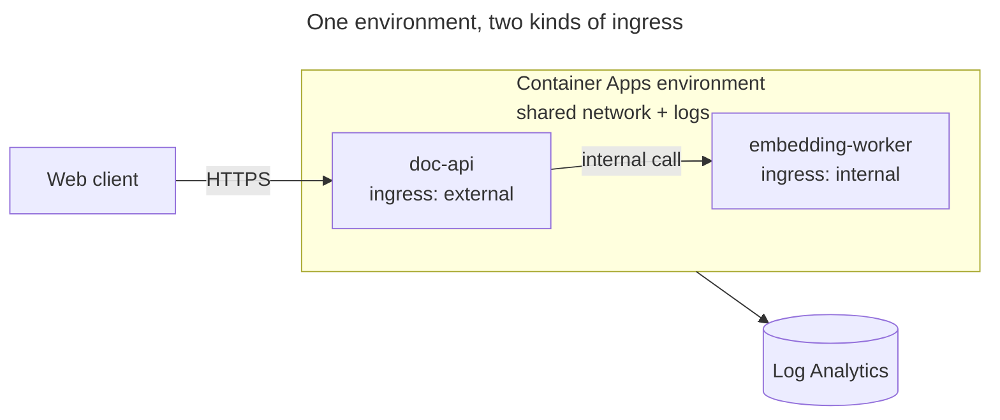
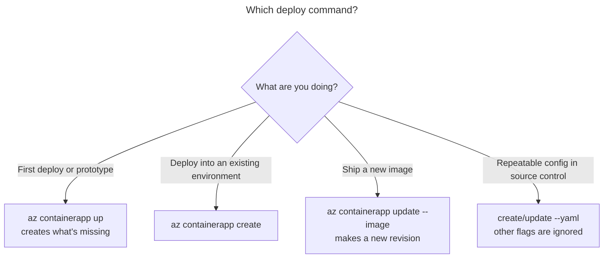
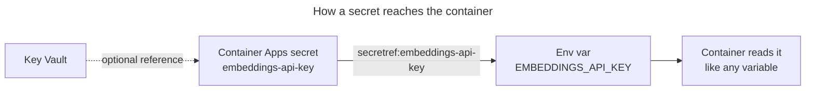
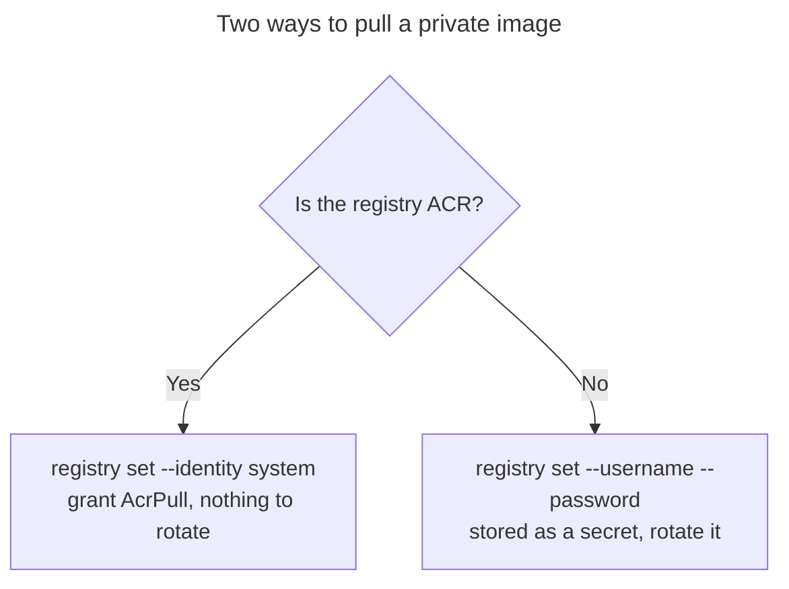
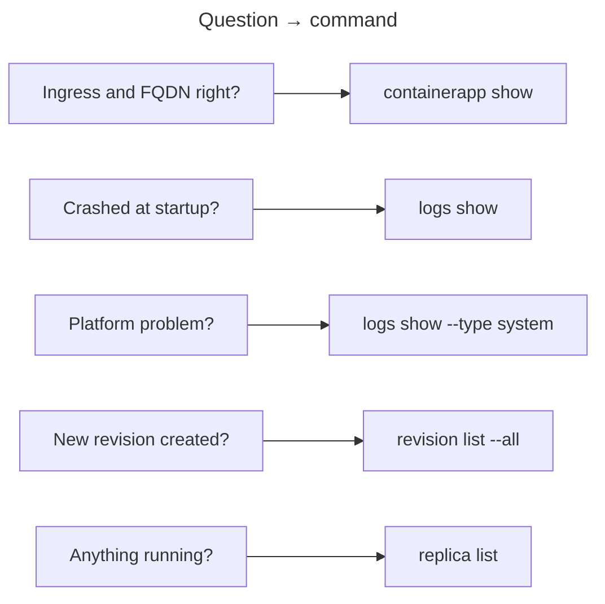

# LP2 · M1: Deploy containers to Azure Container Apps

> **Learning path 2:** Deploy and manage apps on Azure Container Apps · **Skill area 1:** Develop and deploy containerized solutions · about 72 min on Microsoft Learn  
> Study it interactively at [aryantripathi.dev/ai-200](https://aryantripathi.dev/ai-200/lp-2/deploy-containers-azure-container-apps)

Azure Container Apps runs containers without you managing Kubernetes. This module covers environments, deploying with the CLI and YAML, runtime settings and secrets, pulling from private registries, and checking that a deployment really works.

**In this lesson**

1. [Explore Container Apps environments](#explore-container-apps-environments)
2. [Deploy a container app using the Azure CLI and YAML](#deploy-a-container-app-using-the-azure-cli-and-yaml)
3. [Configure runtime settings with environment variables and secrets](#configure-runtime-settings-with-environment-variables-and-secrets)
4. [Configure image pull authentication for private registries](#configure-image-pull-authentication-for-private-registries)
5. [Verify deployments with logs and status](#verify-deployments-with-logs-and-status)

## Explore Container Apps environments

📘 Microsoft Learn: [Explore Container Apps environments](https://learn.microsoft.com/en-us/training/modules/deploy-containers-azure-container-apps/2-container-apps-environments)

A Container Apps **environment** is like an **office floor**: the apps on the same floor share the internal network and the same logging setup. Put services that talk privately on the same floor, and give dev, test and production their own floors.

**Key facts**

- An **environment** is a logical boundary where one or more container apps run. It scopes **shared networking** and **observability integration**.
- Group related services (an AI API and a background processor) in one environment; use separate environments for **development, test and production**.
- Create explicitly with `az containerapp env create` (more control over naming and lifecycle), or let `az containerapp up` create one. Inspect with `az containerapp env show`.
- Commands may need the extension: `az extension add --name containerapp --upgrade` (add `--allow-preview true` for preview features).
- Ingress: `--ingress external` for a public API a web client calls; `--ingress internal` for a service called only by other services **in the environment**.
- Environments commonly integrate with **Azure Monitor logs**, so you can query container logs and system logs in one place. Plan logging early.
- Best practices: separate environments by lifecycle, align them to networking boundaries, standardize naming, plan observability before production traffic.

| Ingress | Who can call it | Example |
|---|---|---|
| external | Callers outside the environment, such as a web client | Public AI API |
| internal | Only other services in the same environment | Embedding worker called by the API |

> [!WARNING]
> **Exam traps**
>
> - Internal ingress = reachable **only within the environment**.
> - Separate environments per lifecycle reduce the blast radius of new revisions.

## Deploy a container app using the Azure CLI and YAML

📘 Microsoft Learn: [Deploy a container app using the Azure CLI and YAML](https://learn.microsoft.com/en-us/training/modules/deploy-containers-azure-container-apps/3-deploy-container-app)

There are two ways to ship: the **quick start button** (`az containerapp up`, which creates what's missing) and the **recipe card** (a YAML file in source control that says exactly how the app should look). Every update creates a new **revision**, a numbered snapshot of the app's setup.

**Key facts**

- Setup: `az login`, `az upgrade`, `az extension add --name containerapp --upgrade`, and register **Microsoft.App** and **Microsoft.OperationalInsights** providers.
- `az containerapp up` is the **fastest** way to deploy a first version; it can create the environment and supporting resources and returns the app's **FQDN**. Good for prototypes.
- Keep the image **repository name lower case**; otherwise pulls can fail with errors that look like authentication problems.
- `az containerapp create` is more explicit: deploy into an existing environment and resource group with consistent defaults.
- Updates such as `az containerapp update --image …:v2` usually create a **new revision**, so you can validate it before shifting all traffic.
- YAML: `az containerapp create/update --yaml ./containerapp.yml`. With **--yaml, other flags are ignored**; the YAML is the source of truth. Store it in source control for review and to reduce drift.
- Other options: **Bicep** (infrastructure as code), **GitHub Actions** (continuous deployment), the **Azure portal** (unplanned changes).

| Command | Use it when |
|---|---|
| az containerapp up | First deployment or prototype; create missing resources |
| az containerapp create | Deploy into an existing environment explicitly |
| az containerapp update --image | Ship a new image (new revision) |
| az containerapp create/update --yaml | Reviewable, repeatable config from source control |

> [!WARNING]
> **Exam traps**
>
> - With --yaml, every other flag on the command is **ignored**.
> - Upper-case repository names cause pull failures that look like auth errors.

## Configure runtime settings with environment variables and secrets

📘 Microsoft Learn: [Configure runtime settings with environment variables and secrets](https://learn.microsoft.com/en-us/training/modules/deploy-containers-azure-container-apps/4-configure-runtime)

Environment variables are the app's **settings dial**; secrets are the **locked drawer**. Instead of copying a key into a variable, you point the variable at the drawer with `secretref:`. For pulling private images, a managed identity is the **badge** that ACR recognises, so no registry password has to be stored.

**Key facts**

- Use **environment variables** for non-sensitive config (log levels, feature flags, dependency URLs, timeouts, batch sizes): `--env-vars` on create, `--set-env-vars` on update (adds or updates without removing existing ones).
- Store sensitive values as **Container Apps secrets**: `az containerapp secret set --secrets embeddings-api-key=…`. Rotate secrets without rebuilding or redeploying the image. A **Key Vault reference** format is supported when Key Vault is the system of record.
- Reference a secret from a variable with `EMBEDDINGS_API_KEY=secretref:embeddings-api-key` (in YAML: `secretRef`). Keep secret **values** out of YAML; store only names.
- Private registries: **username and password** (works broadly, more secret management) or **managed identity** for ACR (needs role assignments, fewer secrets to rotate).
- `az containerapp registry set --server myregistry.azurecr.io --username … --password …`, or `--identity system` for managed identity. Grant the identity **AcrPull**.
- The CLI can sometimes infer ACR credentials if you omit them, but prefer an explicit method in production.
- Check with `az containerapp registry list` and `registry show --server …`.
- Best practices: managed identity for ACR, least privilege (only **AcrPull**), fully qualified image names, validate auth by deploying a new revision and checking it starts.

| Value | Store as | How the app reads it |
|---|---|---|
| LOG_LEVEL=info | Environment variable | --env-vars / --set-env-vars |
| Embeddings API key | Container Apps secret (or Key Vault reference) | EMBEDDINGS_API_KEY=secretref:embeddings-api-key |
| Pull from ACR | Registry with --identity system | Identity needs AcrPull |
| Pull from another registry | Registry with --username/--password | Credentials managed as secrets |

> [!WARNING]
> **Exam traps**
>
> - **--set-env-vars** adds or updates without removing other variables.
> - secretref:`<secret-name>` uses the secret's **name**, so the value never appears in YAML or shell history.

## Configure image pull authentication for private registries

📘 Microsoft Learn: [Configure image pull authentication for private registries](https://learn.microsoft.com/en-us/training/modules/deploy-containers-azure-container-apps/5-connect-to-registries)

A private registry needs credentials or an identity before Container Apps can pull from it. Username and password works with any registry. Managed identity is better for ACR, because there's no long-lived password to store or rotate.

**Key facts**

- Configure a registry on an existing app with `az containerapp registry set`, using `--server` plus either `--username`/`--password` or `--identity system`.
- **Username and password** works broadly, including registries that don't support Azure-managed identities, but adds secrets to manage.
- **Managed identity** suits ACR in production: grant the identity the **AcrPull** role, and nothing needs rotating.
- Check what's configured with `az containerapp registry list` and `az containerapp registry show --server …`, which helps you spot drift between environments.
- Registry configuration is separate from app configuration. After a registry change, image pull failures in the logs can look like authentication or permission errors.
- Best practices: prefer managed identity for ACR, grant only AcrPull, use fully qualified image names (with the registry hostname), and validate by deploying a new revision.

| Option | Works with | Trade-off |
|---|---|---|
| Username and password | Any registry | Secrets to store and rotate |
| Managed identity (`--identity system`) | Azure Container Registry | Needs an AcrPull role assignment, with no stored secret |

> [!WARNING]
> **Exam traps**
>
> - The CLI can sometimes infer ACR credentials if you leave them out, but production scripts should still be explicit.
> - Least privilege means **AcrPull**, not AcrPush, for an identity that only pulls.

## Verify deployments with logs and status

📘 Microsoft Learn: [Verify deployments with logs and status](https://learn.microsoft.com/en-us/training/modules/deploy-containers-azure-container-apps/6-verify-deployment)

After you deploy, check three things: **what the app says** (console logs), **what the platform says** (system logs) and **what is actually running** (revisions and replicas).

**Key facts**

- Start with `az containerapp show` to confirm configuration and ingress (for example, internal when you expected external) and to get the **FQDN**.
- `az containerapp logs show` returns recent **console logs** (a limited number of lines by default); add `--follow --tail 30` to stream; use `--type system` for **platform** logs.
- Console logs show missing environment variables, connection failures, crashes, HTTP binding issues and auth failures to model providers.
- `az containerapp revision list` shows active revisions; add `--all` to include **inactive** ones. Use it to confirm an update created a new revision that became healthy.
- `az containerapp replica list` lists running instances of the latest revision, or of one revision with `--revision`; use it to spot **scale to zero**, crash loops or missing traffic.
- Best practices: start with logs, use revisions for rollout validation, inspect replicas during incidents, use `--query` for automation-friendly output.

| Question | Command |
|---|---|
| Is ingress what I expected? What's the FQDN? | az containerapp show |
| Why did my app crash at startup? | az containerapp logs show |
| Is it a platform problem? | az containerapp logs show --type system |
| Did the update create a new revision? | az containerapp revision list (--all) |
| Is anything running right now? | az containerapp replica list |

> [!WARNING]
> **Exam traps**
>
> - Inactive revisions appear only with **--all**.
> - Zero replicas can mean **scale to zero**, not necessarily a failure.

## Check yourself

- **Practice questions:** [lp2m1 on GitHub](../../practice/lp2m1.md), or [on the site](https://aryantripathi.dev/ai-200/lp-2/deploy-containers-azure-container-apps) with hints and saved progress
- **Cheat sheet:** [Learning path 2](../cheatsheets/lp2.md)
- **Microsoft Learn exercise:** [Deploy a containerized backend API to Container Apps](https://learn.microsoft.com/en-us/training/modules/deploy-containers-azure-container-apps/7-exercise-deploy-backend-api)
- **Hands-on lab:** [labs/](../../labs/README.md) has a lab for this learning path

---

Part of **AI-200 Prep**, a free course by Aryan Tripathi · [aryantripathi.dev/ai-200](https://aryantripathi.dev/ai-200) · Written from the public Microsoft Learn course AI-200T00. Not affiliated with Microsoft.
