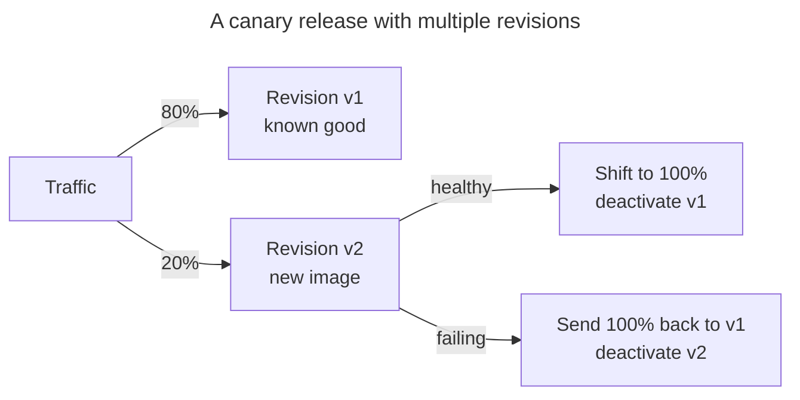
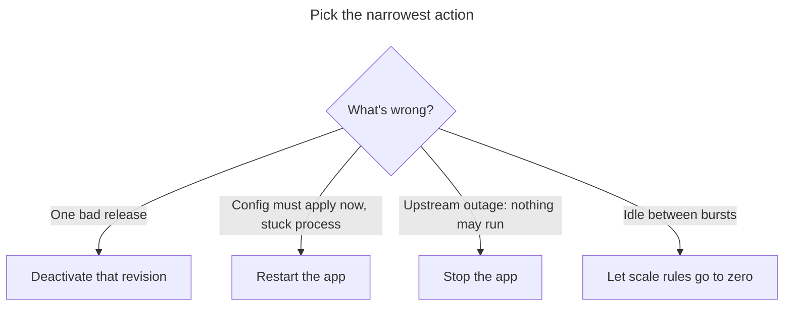
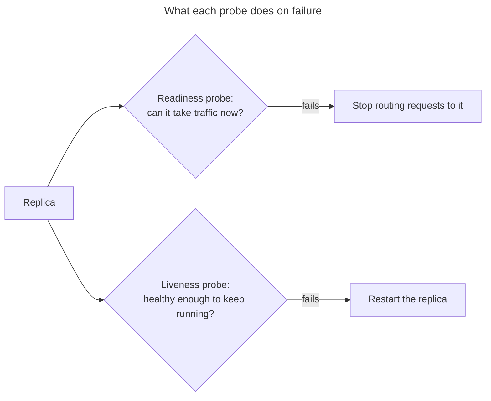

# LP2 · M2: Manage containers in Azure Container Apps

> **Learning path 2:** Deploy and manage apps on Azure Container Apps · **Skill area 1:** Develop and deploy containerized solutions · about 68 min on Microsoft Learn  
> Study it interactively at [aryantripathi.dev/ai-200](https://aryantripathi.dev/ai-200/lp-2/manage-containers-azure-container-apps)

Day-two operations: rolling out new images safely with revisions, stopping and restarting apps, reading logs, tuning health probes, and sizing CPU and memory for AI workloads.

**In this lesson**

1. [Update images and manage revisions safely](#update-images-and-manage-revisions-safely)
2. [Manage the container app lifecycle](#manage-the-container-app-lifecycle)
3. [Monitor logs and troubleshoot issues](#monitor-logs-and-troubleshoot-issues)
4. [Configure health probes and troubleshoot failures](#configure-health-probes-and-troubleshoot-failures)
5. [Optimize container resources and scaling](#optimize-container-resources-and-scaling)

## Update images and manage revisions safely

📘 Microsoft Learn: [Update images and manage revisions safely](https://learn.microsoft.com/en-us/training/modules/manage-containers-azure-container-apps/2-update-images-manage-revisions)

Each meaningful update makes a new **revision**, a numbered snapshot of the app. You check the new snapshot is healthy before sending users to it. If one goes bad, you **switch it off** (deactivate) rather than throwing it away, so you keep the evidence and a way back.

**Key facts**

- **Tags** (dev, staging) are convenient but can change. **Digests** are immutable and give strong traceability for production: you can prove which artifact served requests.
- Updating the image (`az containerapp update --image <registry>/<repo>@sha256:<digest>`) creates a **new revision** with the updated template. Confirm with `az containerapp show --query properties.template.containers`.
- **Single revision mode**: one active revision; simpler operations but no advanced rollouts. **Multiple revision mode**: canary rollouts and **traffic splitting**.
- **Active** means a revision can receive traffic. A revision can exist without being active; inactive revisions help investigation and rollback planning.
- Inspect with `az containerapp revision list` and `revision show --revision <name>` to compare a working and a failing revision.
- `az containerapp revision deactivate` is a safer first step than deletion: it preserves evidence and keeps rollback options.
- Container Apps **automatically purges inactive revisions when you exceed 100**; change the threshold with **--max-inactive-revisions**.

| Mode | Active revisions | Good for |
|---|---|---|
| Single revision | One | Simple operations |
| Multiple revision | Several | Canary rollouts, traffic splitting, testing a new model version on a small share |

> [!WARNING]
> **Exam traps**
>
> - Deactivate, don't delete, when investigating a bad revision.
> - Inactive revisions are purged automatically above **100** (adjust with --max-inactive-revisions).

## Manage the container app lifecycle

📘 Microsoft Learn: [Manage the container app lifecycle](https://learn.microsoft.com/en-us/training/modules/manage-containers-azure-container-apps/3-app-lifecycle-management)

Three levers: **scale to zero** happens on its own when there's no work, **stop** is you pulling the plug so nothing starts, and **restart** is turning it off and on again to clear a stuck state. Stop and restart act on the **whole app**, so for one bad release, deactivate that revision instead.

**Key facts**

- **Scale to zero** is driven by your scaling configuration: good for event-driven or intermittent workloads.
- **Stop** (`az containerapp stop`) is an explicit action that guarantees no replicas start while you mitigate an incident. **Start** brings it back.
- **Restart** (`az containerapp restart`) makes config changes take effect immediately or clears deadlocks and transient dependency issues. Restarting too often raises cold starts for apps that load large models. Pair restart with log inspection.
- Start and stop are **app-level** and can be too broad; for one bad release, **revision deactivation** is often safer.
- Failure checklist: **image pull failures**, **port mismatches** with ingress, **missing configuration**, **probe failures** (wrong path, too little startup time), **resource pressure** (killed at the memory limit or CPU throttling).
- Compare revisions quickly: `revision list --query "[].{name:name,active:properties.active,health:properties.healthState}"`.

| Action | Scope | Use when |
|---|---|---|
| Scale to zero | Automatic, from scale rules | Intermittent or event-driven work |
| Stop | Whole app | Guarantee no replicas run during an upstream outage |
| Restart | Whole app | Apply config now, clear a stuck process |
| Deactivate revision | One revision | Isolate a bad release |

> [!WARNING]
> **Exam traps**
>
> - Restart isn't a substitute for finding the root cause.
> - Stop affects every revision of the app.

## Monitor logs and troubleshoot issues

📘 Microsoft Learn: [Monitor logs and troubleshoot issues](https://learn.microsoft.com/en-us/training/modules/manage-containers-azure-container-apps/4-monitor-logs-troubleshoot)

Logs are your **black box recorder**. Stream them live while you reproduce a problem, and make every line carry the request id, revision, model version and timing, but never raw prompts or documents.

**Key facts**

- Container Apps integrates with **Azure Monitor**; you can also stream with `az containerapp logs show --follow`. Log access depends on the environment being connected to **Log Analytics** or a streaming workflow.
- Pair streaming with **structured logging** so you can filter by request and revision identifiers.
- Log **identifiers and metadata**, not raw documents or prompts. Recommended fields: **request id** (correlation ID), **revision or build id**, **model version**, **latency breakdown**.
- Revision failures: startup failures, probe failures, configuration errors, runtime exceptions.
- Incident workflow: confirm which revision is active and which is failing → stream logs while reproducing → compare config of working and failing revisions → targeted fix, validate the next revision becomes ready.

> [!WARNING]
> **Exam traps**
>
> - Don't log raw prompts or documents; log ids and metadata.
> - Compare a working revision's config with the failing one.

## Configure health probes and troubleshoot failures

📘 Microsoft Learn: [Configure health probes and troubleshoot failures](https://learn.microsoft.com/en-us/training/modules/manage-containers-azure-container-apps/5-health-probes)

A **readiness** probe is the bouncer asking "are you ready for guests?": if not, no traffic. A **liveness** probe is the doctor asking "are you still alive?": if not, restart. For AI apps that load big models, give both probes enough time, or the doctor will keep restarting a patient who's still waking up.

**Key facts**

- **Readiness**: can this replica receive traffic now? Failing → no requests routed to it. Use it to guard **model loading** and dependency readiness.
- **Liveness**: is the process healthy enough to keep running? Failing → the platform **restarts** the replica. It's a safety valve for deadlocks and runaway memory; overly aggressive settings cause needless restarts and cold starts.
- Common causes: wrong **port**, wrong **path**, timeouts too short for model loading or warmup, a startup dependency call that fails or is slow.
- Probes are configured in the container app **template** alongside the container definition.
- Troubleshoot with **revision status** (does the platform consider it healthy) plus **logs** (did the app start, which endpoint it exposed). Probe endpoints shouldn't depend on external systems that might be down.
- For slow model loads, tune **initialDelaySeconds** and **failureThreshold**. Liveness failures shortly after startup usually mean liveness is too aggressive or the app fails fast from misconfiguration.

| Probe | Question | On failure |
|---|---|---|
| Readiness | Can this replica receive traffic right now? | Stop routing requests to it |
| Liveness | Is the process healthy enough to keep running? | Restart the replica |

> [!WARNING]
> **Exam traps**
>
> - Readiness failure = **no traffic**; liveness failure = **restart**.
> - Slow model load → raise **initialDelaySeconds** / **failureThreshold**.

## Optimize container resources and scaling

📘 Microsoft Learn: [Optimize container resources and scaling](https://learn.microsoft.com/en-us/training/modules/manage-containers-azure-container-apps/6-optimize-container-settings)

Cost = **size of each replica × number of replicas**. Too little CPU makes the API slow (throttling); too little memory makes it crash and restart. An API that must answer fast may keep a minimum replica warm; a background worker can usually sleep at zero.

**Key facts**

- Container Apps scales by adding and removing **replicas**. Total cost combines **per-replica sizing** and the **number of replicas** at peak.
- Measure: APIs → latency under concurrency and **CPU throttling**; workers → throughput and **memory pressure** causing restarts.
- Change sizing with `az containerapp update --cpu <cores> --memory <size>`, then validate latency and stability.
- A synchronous API may use a **minimum replica count** to reduce cold starts; an event-driven background worker can often **scale to zero** if it drains work safely.
- Align scaling with probe settings: new revisions start new replicas, and slow warmup can make a rollout look like it failed.
- Best practices: size for the bottleneck (CPU for throttling, memory for OOM restarts), align concurrency with CPU, use minimum replicas intentionally (they raise **baseline cost**), reassess after model changes. Change **one variable at a time**.

> [!WARNING]
> **Exam traps**
>
> - Throttling → more **CPU**; out-of-memory restarts → more **memory**.
> - Minimum replicas cut cold starts but add baseline cost.

## Check yourself

- **Practice questions:** [lp2m2 on GitHub](../../practice/lp2m2.md), or [on the site](https://aryantripathi.dev/ai-200/lp-2/manage-containers-azure-container-apps) with hints and saved progress
- **Cheat sheet:** [Learning path 2](../cheatsheets/lp2.md)
- **Microsoft Learn exercise:** [Diagnose and fix a failing deployment](https://learn.microsoft.com/en-us/training/modules/manage-containers-azure-container-apps/7-exercise-diagnose-fix-failing-deployment)
- **Hands-on lab:** [labs/](../../labs/README.md) has a lab for this learning path

---

Part of **AI-200 Prep**, a free course by Aryan Tripathi · [aryantripathi.dev/ai-200](https://aryantripathi.dev/ai-200) · Written from the public Microsoft Learn course AI-200T00. Not affiliated with Microsoft.
