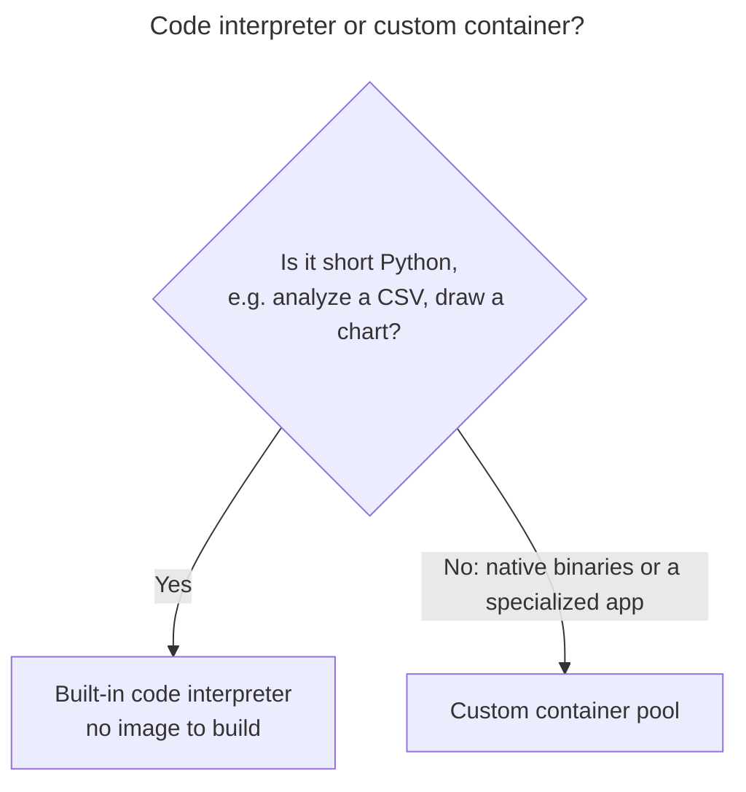
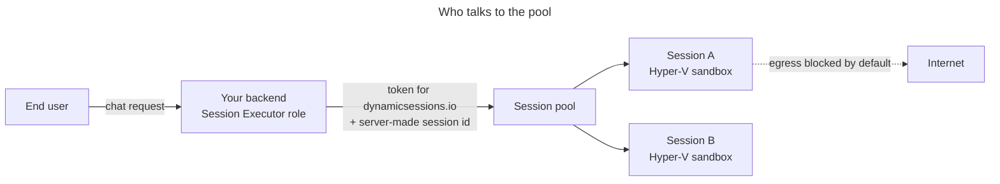
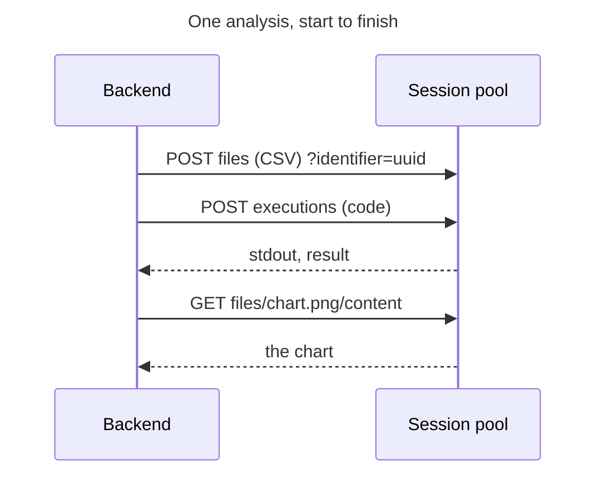
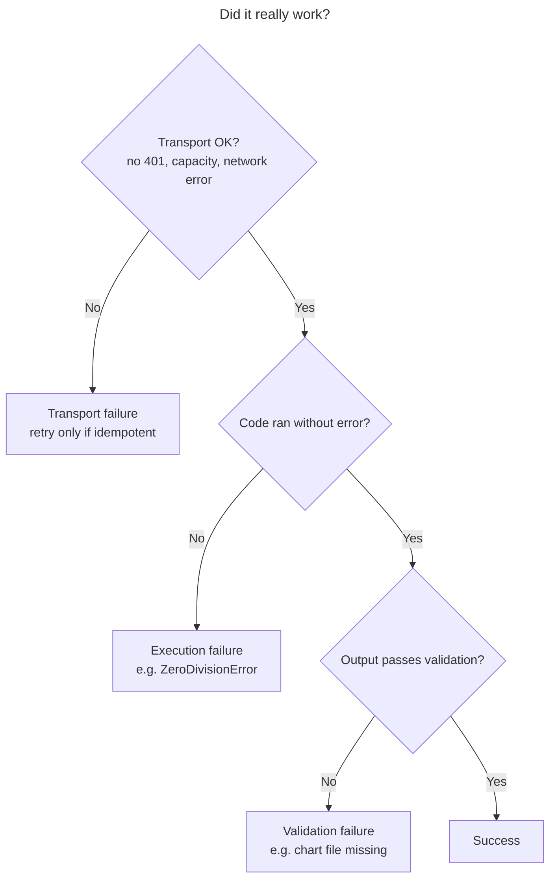

# LP2 · M4: Run AI-generated code securely in Azure Container Apps dynamic sessions

> **Learning path 2:** Deploy and manage apps on Azure Container Apps · **Skill area 1:** Develop and deploy containerized solutions · about 84 min on Microsoft Learn  
> Study it interactively at [aryantripathi.dev/ai-200](https://aryantripathi.dev/ai-200/lp-2/dynamic-sessions-azure-container-apps)

AI agents write code, and running that code next to your API is risky. Dynamic sessions run it in isolated sandboxes. You'll learn to pick a pool type, configure it securely, exchange files, and handle session lifecycle and failures.

**In this lesson**

1. [Choose a dynamic session pool](#choose-a-dynamic-session-pool)
2. [Configure a secure session pool](#configure-a-secure-session-pool)
3. [Execute code and exchange files](#execute-code-and-exchange-files)
4. [Manage lifecycle and execution failures](#manage-lifecycle-and-execution-failures)

## Choose a dynamic session pool

📘 Microsoft Learn: [Choose a dynamic session pool](https://learn.microsoft.com/en-us/training/modules/dynamic-sessions-azure-container-apps/2-choose-dynamic-session-pool)

A session pool is a **rack of ready-made sandboxes**. When your AI agent wants to run code, the backend grabs one in milliseconds, runs the code inside it (isolated by Hyper-V), and later the sandbox is thrown away. Use the **built-in code interpreter** when Python is enough; bring a **custom container** when you need your own tools or protocol.

**Key facts**

- A **session pool** holds **prewarmed** environments allocated in **milliseconds**. Each session runs in its own **Hyper-V-isolated sandbox**, separate from the host and from other sessions.
- The **backend** authenticates to the pool and submits work for the user. End users never get pool tokens or pick identifiers. Durable inputs and results live **outside** the pool.
- Running generated code beside the API lets it compete for CPU and memory and reach files, environment variables or credentials. A container app per request adds startup and lifecycle work the pool already handles.
- **Built-in code interpreter**: platform-managed runtime and API; no image to build. Operations: `POST …/executions`, `POST …/files`, `GET …/files/<name>/content`, each with `identifier=<SESSION_ID>`. Good for CSV analysis, calculations, charts, short agent scripts.
- Not suitable for an unsupported language, native executables, proprietary libraries or custom protocols.
- Integration: direct **REST** calls (full control of auth, identifiers, executions, files) or the LangChain **langchain-azure-dynamic-sessions** package with **SessionsPythonREPLTool** (same pool type and security boundary).
- **Custom container** pool: your image defines runtime and API; still pool, fast allocation, Hyper-V isolation and cleanup. Requires a **workload profiles-enabled** environment. You own image maintenance, ingress on the target port, logging to stdout/stderr, and health checks (startup and liveness probes).
- Requests to the pool management endpoint are forwarded to the container's target port with the same path (`/api/convert` → `/api/convert`).
- Choose the **least complex** option that meets the execution contract; isolation alone doesn't require a custom image. Treat sessions as **ephemeral**.

| Scenario | Pool type |
|---|---|
| Analyze an uploaded CSV and draw a chart | Built-in Python code interpreter |
| Run a proprietary converter with native binaries | Custom container |
| Isolated tenant workspace with a specialized app | Custom container |
| Execute an agent's short calculation code | Built-in code interpreter |

> [!WARNING]
> **Exam traps**
>
> - Both pool types give **Hyper-V isolation**; choose by runtime and protocol needs.
> - Custom container pools need a **workload profiles** environment.
> - SessionsPythonREPLTool uses the **same** code interpreter pool; it isn't a different security boundary.

## Configure a secure session pool

📘 Microsoft Learn: [Configure a secure session pool](https://learn.microsoft.com/en-us/training/modules/dynamic-sessions-azure-container-apps/3-configure-secure-session-pool)

Three dials: **how many** sessions can run at once (cost and safety cap), **how long** an idle session lives (cooldown), and **whether code can reach the internet** (egress, off by default). Remember: the sandbox keeps sessions apart, but code inside a session can read **everything you put in it**.

**Key facts**

- **Maximum concurrent sessions** caps allocated sessions running at once. Size it from **concurrent** use (10 analyzing at once, not 50 online), and it also caps cost and downstream load.
- Custom container pools can keep **ready session instances** (`readySessionInstances`) to cut allocation latency, at the cost of compute while idle. Probes make only healthy environments count as ready.
- The **cooldown** removes a session after no requests for the set period; **every request resets** the timer. Longer = more reuse; shorter = capacity and data released sooner (better for untrusted code). Don't rely on it for retention.
- Sessions **block outbound network traffic by default**. Enable egress only for a justified dependency; it's a **pool-level** setting that affects every session, so separate trusted and untrusted workloads into different pools.
- `az containerapp sessionpool create --container-type PythonLTS …`; get `properties.poolManagementEndpoint` with `sessionpool show`.
- Code inside a session can access that session's files, environment variables and credentials. Only put secrets or documents there if the code may access them.
- The **backend** uses the **Azure ContainerApps Session Executor** role to call the pool API; end users and generated code never get that token.
- A custom pool's managed identity for **runtime** access is risky (untrusted code can request tokens). Use a separate, narrowly scoped identity, never the backend's.
- Practices: separate trust levels, minimize session data, constrain concurrency, prefer disabled egress, narrow identities, monitor executing/creating/ready counts.

| Setting | Raise it | Lower it |
|---|---|---|
| maxConcurrentSessions | More users at once | Protect cost and downstream systems |
| readySessionInstances (custom) | Faster allocation | Less idle compute |
| Cooldown | More time to reuse files and state | Release capacity, delete data sooner |
| Egress | Only for a justified external dependency | Default: blocked |

> [!WARNING]
> **Exam traps**
>
> - Egress is **pool-wide**; don't weaken a shared pool for one workload.
> - Hyper-V isolation separates sessions but doesn't protect data **inside** a session from its own code.

## Execute code and exchange files

📘 Microsoft Learn: [Execute code and exchange files](https://learn.microsoft.com/en-us/training/modules/dynamic-sessions-azure-container-apps/4-execute-code-exchange-files)

The backend shows a **badge** (an Entra token for `https://dynamicsessions.io`) and a **locker number** (the session identifier). Same locker number = same sandbox, with your uploaded files still in `/mnt/data`. The locker number is made by the server, never chosen by the user.

**Key facts**

- Every management API call needs a **Microsoft Entra bearer token**. The caller needs the **Azure ContainerApps Session Executor** role on the pool; token audience **https://dynamicsessions.io** (scope `https://dynamicsessions.io/.default`).
- Assign the role at the **session pool scope**. Use **DefaultAzureCredential**: developer credential locally, managed identity in Azure; it handles token caching and renewal.
- The **session identifier** routes to an existing session or allocates a new one; reusing it keeps files and state. Treat it as **sensitive**.
- Generate an **unpredictable identifier on the server** (a random **UUID**) per user or conversation, keep the mapping server-side, and **never accept** an identifier from the client. The identifier doesn't authenticate anyone by itself.
- Validate code against policy before submitting; isolation limits impact but doesn't decide whether an action is appropriate. Use `raise_for_status()` and still inspect the execution result for Python errors.
- Keep the data-plane **API version** in configuration.
- Uploaded files land in **/mnt/data**. URL-encode service file names; validate names before writing locally (path traversal). Upload limit: **128 MB**.
- Same identifier before expiry = same environment (upload once, analyze, chart again). Session reuse isn't durable storage.
- SessionsPythonREPLTool creates a random identifier per tool instance. **Don't share one tool instance** across users; create one per user or conversation.

| Item | Value |
|---|---|
| Role for the backend | Azure ContainerApps Session Executor (pool scope) |
| Token audience | https://dynamicsessions.io |
| Uploaded file location | /mnt/data |
| File upload limit | 128 MB |
| Session identifier | Server-generated random UUID per user or conversation |

> [!WARNING]
> **Exam traps**
>
> - Never take the session identifier from the client.
> - An HTTP 200 doesn't mean the Python code succeeded.
> - One shared SessionsPythonREPLTool instance mixes users' files and state.

## Manage lifecycle and execution failures

📘 Microsoft Learn: [Manage lifecycle and execution failures](https://learn.microsoft.com/en-us/training/modules/dynamic-sessions-azure-container-apps/5-manage-lifecycle-failures)

Sessions are **temporary**: after the cooldown they vanish with their files, and the same identifier may then get a fresh, empty sandbox. So keep originals in your own storage, sort failures into clear buckets, retry only what's safe to repeat, and tidy up when you're done.

**Key facts**

- Each request resets the cooldown; after it passes with no activity the session and its files are **destroyed**. A later request with the same identifier may get a **new empty session**.
- Query session info with `GET …/session?identifier=…` (creation, last access, expiry), but still handle the session vanishing right after.
- If code reports a missing file such as `/mnt/data/operational-data.csv`, re-upload from durable storage and rerun an **idempotent** step.
- Failure categories: **transport** (auth, authorization, malformed request, capacity, network, service), **execution** (code raises, exceeds a limit, unsuccessful result), **validation** (wrong schema, missing artifact, rule violation), **success** (all three pass).
- An HTTP success doesn't mean a valid business result. Don't expose stack traces, tokens or sensitive content to users; return a correlation value.
- Set your own HTTP **deadline** shorter than the caller's. A client timeout doesn't stop remote execution, so don't assume no effects. Dynamic sessions return a **trace ID** in the structured error body.
- Retry only **idempotent** operations you can verify; a response timeout is ambiguous. Good candidates: file metadata reads, session status queries. Don't auto-repeat code that sends messages, writes externally or creates uniquely named artifacts. Transient codes: `**429, 500, 502, 503, 504**`. Use bounded retries with backoff and jitter.
- Delete early with `DELETE …/session?identifier=…`; **204 No Content** confirms it's gone. Don't delete while another request for that conversation runs. Report failed deletes in telemetry.
- Practices: validate before execution, authorize every operation, persist durable data elsewhere, classify failures, retry with evidence, clean up intentionally, log safely.

| Category | Example |
|---|---|
| Transport failure | 401 from the pool API, capacity reached, network error |
| Execution failure | Python raises ZeroDivisionError |
| Validation failure | Code finished but the chart file is missing |
| Successful result | Transport OK, no execution error, output passes validation |

> [!WARNING]
> **Exam traps**
>
> - Same identifier after expiry → possibly a **new, empty** session.
> - A timeout doesn't prove the code didn't run.
> - DELETE success is **204 No Content**.

## Check yourself

- **Practice questions:** [lp2m4 on GitHub](../../practice/lp2m4.md), or [on the site](https://aryantripathi.dev/ai-200/lp-2/dynamic-sessions-azure-container-apps) with hints and saved progress
- **Cheat sheet:** [Learning path 2](../cheatsheets/lp2.md)
- **Microsoft Learn exercise:** [Execute AI-generated code securely in Azure Container Apps dynamic sessions](https://learn.microsoft.com/en-us/training/modules/dynamic-sessions-azure-container-apps/6-exercise-execute-code-dynamic-session)
- **Hands-on lab:** [labs/](../../labs/README.md) has a lab for this learning path

---

Part of **AI-200 Prep**, a free course by Aryan Tripathi · [aryantripathi.dev/ai-200](https://aryantripathi.dev/ai-200) · Written from the public Microsoft Learn course AI-200T00. Not affiliated with Microsoft.
