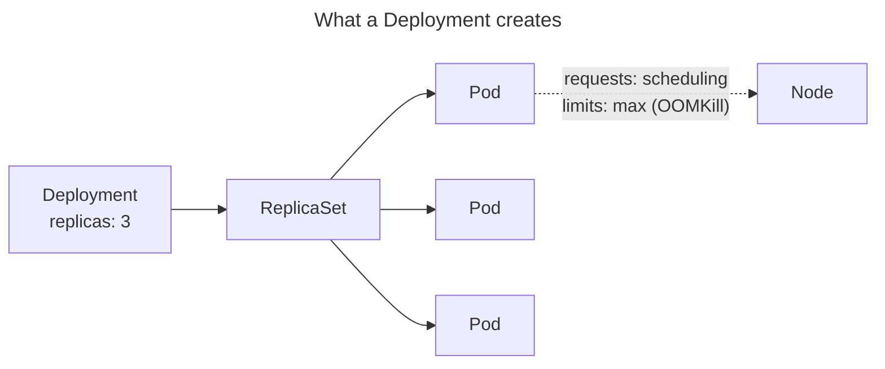
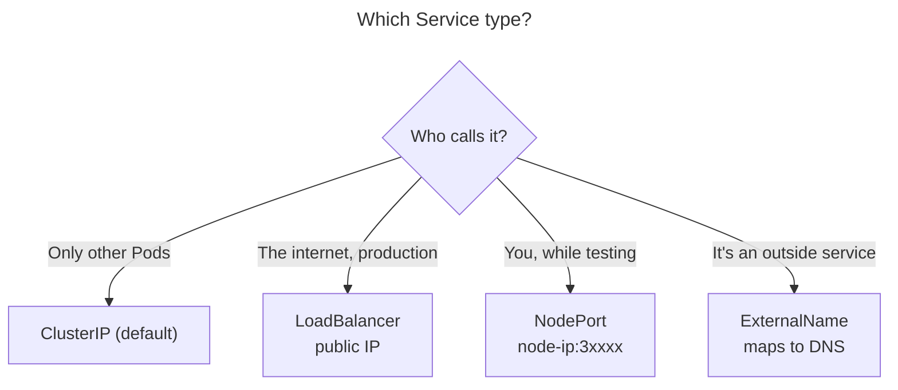
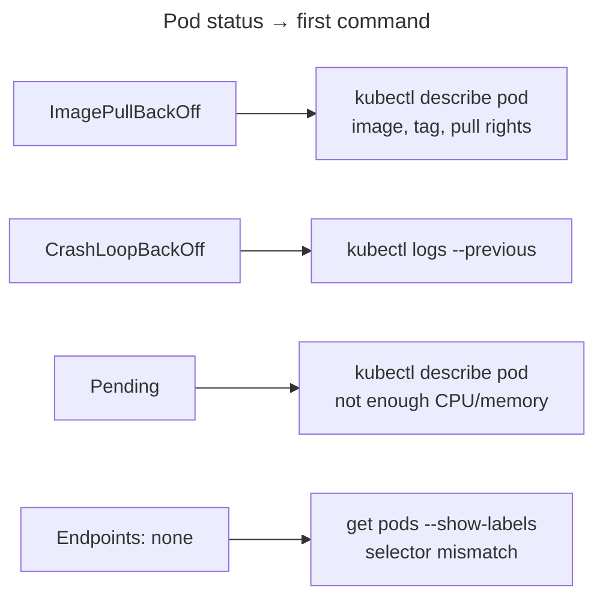

# LP3 · M1: Deploy applications to Azure Kubernetes Service

> **Learning path 3:** Deploy and monitor applications on Azure Kubernetes Service · **Skill area 1:** Develop and deploy containerized solutions · about 75 min on Microsoft Learn  
> Study it interactively at [aryantripathi.dev/ai-200](https://aryantripathi.dev/ai-200/lp-3/deploy-apps-azure-kubernetes-service)

On AKS, you describe what you want in YAML manifests, and Kubernetes keeps the cluster in that state. This module covers Deployments, Services, and how to deploy and verify an AI API.

**In this lesson**

1. [Create Kubernetes deployment manifests](#create-kubernetes-deployment-manifests)
2. [Expose applications in Azure Kubernetes Services](#expose-applications-in-azure-kubernetes-services)
3. [Deploy applications to Azure Kubernetes Services](#deploy-applications-to-azure-kubernetes-services)

## Create Kubernetes deployment manifests

📘 Microsoft Learn: [Create Kubernetes deployment manifests](https://learn.microsoft.com/en-us/training/modules/deploy-apps-azure-kubernetes-service/2-create-deployment-manifests)

A Deployment manifest is a **work order**: "run 2 copies of this image, each needs this much memory and CPU, with these settings". Kubernetes keeps that order true, restarting copies that crash.

**Key facts**

- A **Deployment** manifest (`apiVersion: apps/v1`, `kind: Deployment`) describes the **desired state**: image, number of copies, resources, environment variables. AKS pulls the image, launches Pods, monitors them and restarts crashed ones.
- Image path: `registryname.azurecr.io/imagename:tag`, for example `myregistry.azurecr.io/inference-api:v1.0`. The image must be built, pushed and accessible from the cluster.
- **replicas**: 2 = basic resilience (dev, noncritical); **3 = recommended for production APIs** serving external users; 4+ only for high traffic, since each replica costs resources.
- **Requests**: what the app needs; used for **scheduling**. A Pod requesting more memory than any node has free stays **Pending**.
- **Limits**: the maximum; exceeding the memory limit means Kubernetes terminates and restarts the container (**OOMKill**).
- Sizing for inference: model's documented memory **+ 20%** overhead; typically **1–2 CPU cores** per Pod. Refine from observed usage.
- Non-sensitive config: `env` with `name`/`value`. Sensitive data: a **Secret** referenced with `valueFrom`; create it with `kubectl create secret generic api-secrets --from-literal=api-key=…`. Never hardcode secrets in manifests.

| Field | Purpose |
|---|---|
| replicas | How many Pods run at once |
| image | registry.azurecr.io/name:tag |
| resources.requests | Scheduling: the node must have this much free |
| resources.limits | Maximum; memory over the limit → OOMKill |
| env / valueFrom | Settings and Secret references |

> [!WARNING]
> **Exam traps**
>
> - Requests drive **scheduling**; limits cap usage.
> - Learn recommends **3** replicas for production APIs.

## Expose applications in Azure Kubernetes Services

📘 Microsoft Learn: [Expose applications in Azure Kubernetes Services](https://learn.microsoft.com/en-us/training/modules/deploy-apps-azure-kubernetes-service/3-expose-applications)

Pods come and go with new IP addresses. A **Service** is the **fixed phone number** that always reaches whichever Pods currently carry the right label. The Service type decides **who can dial it**: only the cluster (ClusterIP), anyone who knows a node (NodePort) or the internet (LoadBalancer).

**Key facts**

- A **Service** gives a stable IP or DNS name and routes traffic to Pods whose labels match its **selector**, load balancing across them.
- **ClusterIP** (default): internal only; other Pods use the DNS name `servicename.namespace.svc.cluster.local`. For backend services such as a vector search service.
- **NodePort**: a port on every node (`node-ip:nodeport`, usually 30000+); for testing and simple external access.
- **LoadBalancer**: creates an **Azure Load Balancer** with a **public IP**; for production APIs reached from the internet. See it in the **EXTERNAL-IP** column of `kubectl get svc`.
- **ExternalName**: maps to an external DNS name, no load balancing.
- **port** = what clients connect to (usually 80 or 443); **targetPort** = what the container listens on (8080, 5000, 3000…).
- If Pod labels and the Service selector don't match, the Service has **no endpoints**.

| Type | Reachable from | Use for |
|---|---|---|
| ClusterIP (default) | Inside the cluster | Backend services, e.g. vector search |
| NodePort | node-ip:3xxxx | Testing and development |
| LoadBalancer | Public IP (Azure Load Balancer) | Production internet-facing API |
| ExternalName | Maps to an external DNS name | Representing an outside service |

> [!WARNING]
> **Exam traps**
>
> - ClusterIP is the **default** type.
> - port ≠ targetPort: clients use port; the container listens on targetPort.

## Deploy applications to Azure Kubernetes Services

📘 Microsoft Learn: [Deploy applications to Azure Kubernetes Services](https://learn.microsoft.com/en-us/training/modules/deploy-apps-azure-kubernetes-service/4-deploy-verify-results)

`kubectl apply` hands your work orders to the cluster and returns immediately; the real work happens in the background. Then you check: are Pods **Running**, does the Service have an address, does it answer? Each failure status points at a different cause.

**Key facts**

- `kubectl apply -f deployment.yaml` (and service.yaml) creates or updates resources; it's **asynchronous**. Kubernetes pulls images, schedules Pods, starts containers, creates the Service.
- `kubectl get pods`: **READY** 2/2 means both replicas run; STATUS **Running**, **Pending** (starting or waiting for resources), **CrashLoopBackOff** (app keeps crashing).
- `kubectl logs <pod>`; `--previous` shows logs from the crashed container.
- `kubectl get svc`: EXTERNAL-IP **`<pending>`** means the load balancer is still being provisioned.
- Test ClusterIP services from a debug Pod: `kubectl run -it --rm debug --image=alpine:latest --restart=Never -- sh`; test LoadBalancer services with curl to the public IP.
- **ImagePullBackOff**: image path, tag or registry wrong, image not pushed (`az acr repository list`) or missing pull credentials. Diagnose with `kubectl describe pod` events.
- **CrashLoopBackOff**: read logs for missing environment variables or config errors; test the image locally.
- **Pending**: `kubectl describe pod` shows Insufficient memory/cpu. Check `kubectl top nodes`, lower requests, or add nodes with `az aks scale --node-count 3`.
- **No endpoints**: compare `kubectl get pods --show-labels` with the Service selector.

| Status | Likely cause | First command |
|---|---|---|
| ImagePullBackOff | Wrong image/tag, not pushed, no pull rights | kubectl describe pod |
| CrashLoopBackOff | App crashes at startup | kubectl logs (--previous) |
| Pending | Not enough CPU or memory on nodes | kubectl describe pod |
| Endpoints: `<none>` | Labels and selector differ | kubectl get pods --show-labels |

> [!WARNING]
> **Exam traps**
>
> - EXTERNAL-IP `<pending>` = load balancer still provisioning; wait.
> - kubectl apply returns before the Pods are ready.

## Check yourself

- **Practice questions:** [lp3m1 on GitHub](../../practice/lp3m1.md), or [on the site](https://aryantripathi.dev/ai-200/lp-3/deploy-apps-azure-kubernetes-service) with hints and saved progress
- **Cheat sheet:** [Learning path 3](../cheatsheets/lp3.md)
- **Microsoft Learn exercise:** [Deploy an AI inference API to Azure Kubernetes Service](https://learn.microsoft.com/en-us/training/modules/deploy-apps-azure-kubernetes-service/5-exercise-deploy-ai-api)
- **Hands-on lab:** [labs/](../../labs/README.md) has a lab for this learning path

---

Part of **AI-200 Prep**, a free course by Aryan Tripathi · [aryantripathi.dev/ai-200](https://aryantripathi.dev/ai-200) · Written from the public Microsoft Learn course AI-200T00. Not affiliated with Microsoft.
