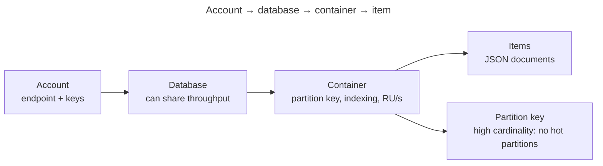
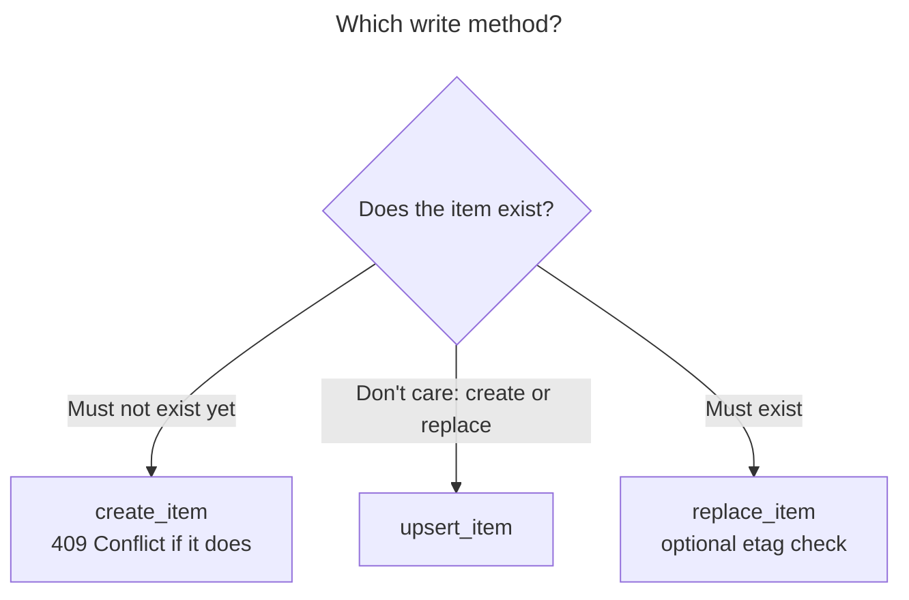
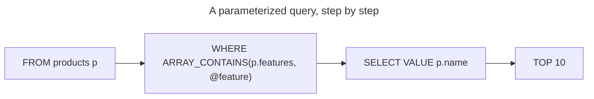

# LP4 · M1: Build queries for Azure Cosmos DB for NoSQL

> **Learning path 4:** Develop AI solutions with Azure Cosmos DB for NoSQL · **Skill area 2:** Develop AI solutions with Azure data services · about 72 min on Microsoft Learn  
> Study it interactively at [aryantripathi.dev/ai-200](https://aryantripathi.dev/ai-200/lp-4/build-query-azure-cosmos-db)

Cosmos DB for NoSQL stores JSON documents at any scale. You'll learn its resource model, partition keys and request units, the Python SDK, and how to write queries that stay cheap.

**In this lesson**

1. [Explore Azure Cosmos DB for NoSQL](#explore-azure-cosmos-db-for-nosql)
2. [Implement the Azure Cosmos DB for NoSQL SDK](#implement-the-azure-cosmos-db-for-nosql-sdk)
3. [Query Azure Cosmos DB for NoSQL](#query-azure-cosmos-db-for-nosql)

## Explore Azure Cosmos DB for NoSQL

📘 Microsoft Learn: [Explore Azure Cosmos DB for NoSQL](https://learn.microsoft.com/en-us/training/modules/build-query-azure-cosmos-db/2-explore-cosmos-db-nosql)

Cosmos DB is a stack of boxes: **account** (the address) → **database** (a label for a group of containers) → **container** (where JSON items live and the unit that scales) → **item**. The **partition key** decides which shelf each item lands on; pick one with lots of different values so no shelf gets crowded.

**Key facts**

- Hierarchy: **account** (endpoint `https://<account-name>.documents.azure.com:443/`; default consistency, geo-replication regions, network access) → **database** (logical namespace; scope for shared throughput) → **container** (unit of scalability, holds JSON items, schema-agnostic) → **items**.
- By default an account can hold up to **500 databases and containers combined**.
- The **partition key** is the most critical design decision: it must exist in every item and have **high cardinality** (e.g. `userId`, or `categoryId` if categories are similar in size). Nested paths like `/metadata/region` work.
- Avoid low cardinality or skew (a boolean `isActive` gives two partitions; dates can create **hot partitions**). You **can't change** a container's partition key without creating a new container and migrating.
- Capacity is in **request units per second (RU/s)**. Provision at the **database** level (shared across containers) or **container** level (dedicated, predictable).
- **Manual** throughput: fixed RU/s; minimum **400 RU/s** for a container, and 400 RU/s for a shared database that can share across up to **25 containers**. **Autoscale**: scales from **10%** to 100% of the max; smallest max is **1,000 RU/s**.
- Every item needs an **id**; **id + partition key value** uniquely identifies it. The SDK doesn't generate ids.
- System properties: **_rid**, **_self**, **_etag** (optimistic concurrency; changes on every update), **_ts** (last modified, Unix seconds), **_attachments** (legacy).
- Typical costs: **point read of a 1-KB item ≈ 1 RU**; writing a 1-KB item ≈ **5–10 RUs**; simple filtered query 3–5 RUs; big aggregates hundreds.
- RU factors: item size, indexing policy, consistency level (strong and bounded staleness cost more), query complexity, cross-partition queries. Read the cost from **x-ms-request-charge**.

| Throughput option | Minimum | Notes |
|---|---|---|
| Manual, container | 400 RU/s | Dedicated, predictable |
| Manual, shared database | 400 RU/s | Shared by up to 25 containers |
| Autoscale | Max ≥ 1,000 RU/s | Scales 10%–100% of the max |

> [!WARNING]
> **Exam traps**
>
> - Partition key is **permanent** for a container.
> - Uniqueness is **id + partition key**, not id alone.
> - Autoscale with max 4,000 runs between **400 and 4,000** RU/s.

## Implement the Azure Cosmos DB for NoSQL SDK

📘 Microsoft Learn: [Implement the Azure Cosmos DB for NoSQL SDK](https://learn.microsoft.com/en-us/training/modules/build-query-azure-cosmos-db/3-implement-cosmos-db-sdk)

Create **one CosmosClient** when the app starts and reuse it; it keeps warm connections. Sign in with **Entra ID** (DefaultAzureCredential) rather than an all-powerful key. To fetch one item you know, use a **point read**; it's the cheapest call there is.

**Key facts**

- **CosmosClient** is the entry point (connection pooling, routing, failover). SDKs for .NET, Python (`azure-cosmos`), JavaScript, Java and Go.
- **Account keys** (primary and secondary for rotation) grant **full access** to everything in the account. **Microsoft Entra ID** uses RBAC at account, database or container scope; preferred for production.
- **DefaultAzureCredential**: Azure CLI or Visual Studio login locally, managed identity when deployed; one code path.
- Built-in data roles: **Cosmos DB Built-in Data Reader** (read) and **Cosmos DB Built-in Data Contributor** (read/write).
- Reuse a **single CosmosClient** (singleton, created at startup in FastAPI or Flask). A client per request adds latency and can exhaust connections.
- `get_database_client()` and `get_container_client()` create handles **without network calls** or existence checks.
- `create_database()` / `create_container()` fail if the resource exists; `*_if_not_exists()` are **idempotent**. `offer_throughput=400` sets dedicated RU/s; `ThroughputProperties(auto_scale_max_throughput=4000)` sets autoscale.
- `create_item()` fails with **409 Conflict** if id + partition key exists; `upsert_item()` inserts or replaces; `replace_item()` requires the item to exist and supports an **etag** condition.
- `read_item(item=…, partition_key=…)` is a **point read** (≈1 RU for 1 KB). Missing item → **CosmosResourceNotFoundError**. `delete_item()` also needs id and partition key.
- Response headers: **x-ms-request-charge** (RU cost) and **x-ms-activity-id** (give to Azure support).

| Method | If the item exists | If it doesn't |
|---|---|---|
| create_item | Fails, 409 Conflict | Creates it |
| upsert_item | Replaces it | Creates it |
| replace_item | Replaces it (optional etag check) | Fails |
| read_item | Returns it (≈1 RU for 1 KB) | CosmosResourceNotFoundError |

> [!WARNING]
> **Exam traps**
>
> - get_container_client doesn't check the container exists; the first operation does.
> - Keys = full account access; prefer Entra ID + Data Reader/Contributor roles.

## Query Azure Cosmos DB for NoSQL

📘 Microsoft Learn: [Query Azure Cosmos DB for NoSQL](https://learn.microsoft.com/en-us/training/modules/build-query-azure-cosmos-db/4-query-cosmos-db-nosql)

Queries look like SQL, but over JSON. They're cheapest when they hit **one partition** (include the partition key), return **only the fields you need**, and use **parameters** for user input.

**Key facts**

- Queries run on **one container**: `SELECT p.id, p.name FROM products p WHERE …`. Projecting fewer properties reduces response size and can lower RUs.
- WHERE supports =, !=, <, >, AND/OR/NOT, **BETWEEN**, **IN** / NOT IN, and functions **CONTAINS**, STARTSWITH, ENDSWITH, UPPER/LOWER. String comparisons are **case-sensitive** by default.
- **Parameterized** queries (`@category` plus a parameters array) prevent injection and let Cosmos DB **cache query plans**.
- **Single-partition** queries include the partition key in WHERE or pass `partition_key=`. Otherwise set `enable_cross_partition_query=True`; cross-partition queries cost more RUs and add latency.
- **ORDER BY** (ASC default, DESC) adds overhead, especially across partitions. Paginate with **continuation tokens**; `max_item_count` sets page size.
- **SELECT VALUE** returns scalars or custom shapes without the wrapping object (e.g. a plain array of names).
- Aggregates: **COUNT, SUM, AVG, MIN, MAX**; they scan all matching items, so filter first.
- Arrays: **ARRAY_CONTAINS(p.features, "wifi")**; or **JOIN f IN p.features** to flatten and filter elements.
- Cost tips: filter early, project needed fields, use partition keys, **TOP** to limit results, tune indexes.

| Need | Query feature |
|---|---|
| Return a plain array of names | SELECT VALUE p.name |
| Item whose features array has "wifi" | ARRAY_CONTAINS(p.features, "wifi") |
| Filter on individual array elements | JOIN f IN p.features WHERE f IN (…) |
| Safe user input, cached plans | @parameters |
| Only the first 10 matches | TOP 10 |

> [!WARNING]
> **Exam traps**
>
> - String comparisons are case-sensitive; use UPPER/LOWER for case-insensitive matches.
> - No partition key in the filter → cross-partition query (enable_cross_partition_query=True).

## Check yourself

- **Practice questions:** [lp4m1 on GitHub](../../practice/lp4m1.md), or [on the site](https://aryantripathi.dev/ai-200/lp-4/build-query-azure-cosmos-db) with hints and saved progress
- **Cheat sheet:** [Learning path 4](../cheatsheets/lp4.md)
- **Microsoft Learn exercise:** [Build a RAG document store on Azure Cosmos DB for NoSQL](https://learn.microsoft.com/en-us/training/modules/build-query-azure-cosmos-db/5-exercise-build-rag-document-store)
- **Hands-on lab:** [labs/](../../labs/README.md) has a lab for this learning path

---

Part of **AI-200 Prep**, a free course by Aryan Tripathi · [aryantripathi.dev/ai-200](https://aryantripathi.dev/ai-200) · Written from the public Microsoft Learn course AI-200T00. Not affiliated with Microsoft.
