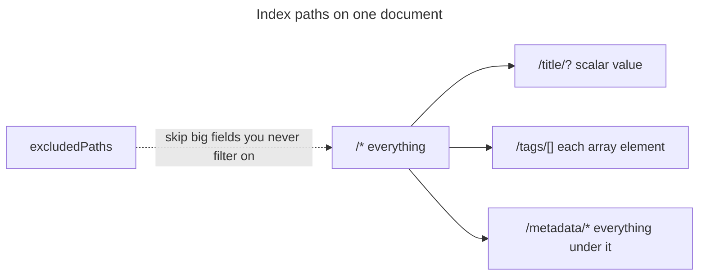
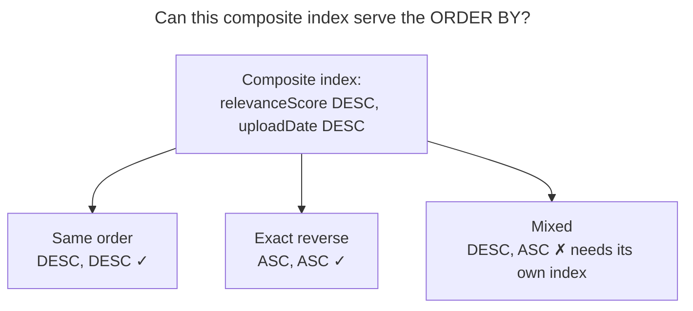
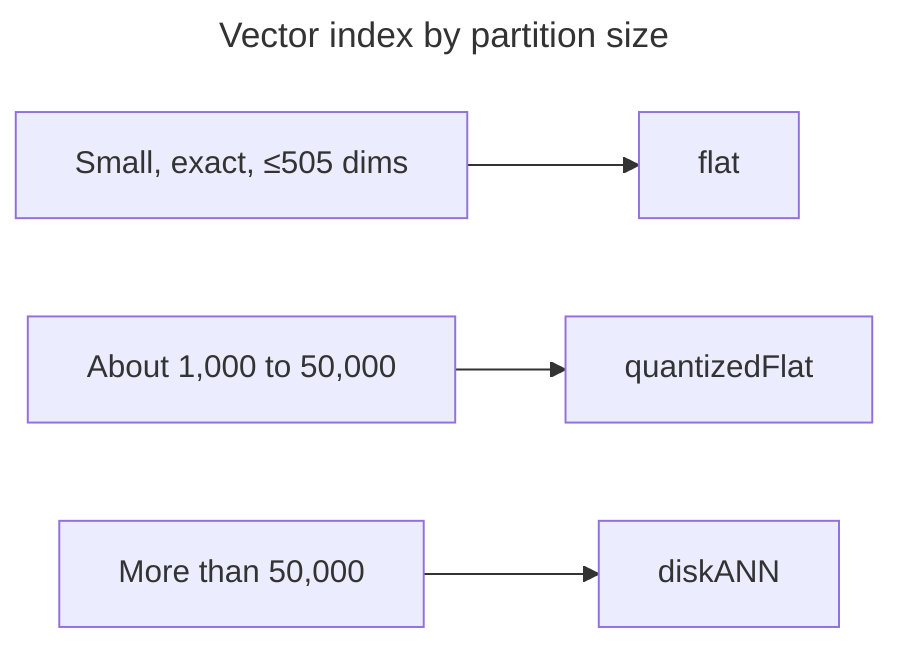

# LP4 · M3: Optimize query performance for Azure Cosmos DB for NoSQL

> **Learning path 4:** Develop AI solutions with Azure Cosmos DB for NoSQL · **Skill area 2:** Develop AI solutions with Azure data services · about 96 min on Microsoft Learn  
> Study it interactively at [aryantripathi.dev/ai-200](https://aryantripathi.dev/ai-200/lp-4/optimize-query-performance-azure-cosmos-db)

Indexes and consistency levels decide how fast and how expensive Cosmos DB is. You'll learn indexing policies, composite and vector index tuning, strategies to cut RUs, and how to choose a consistency level.

**In this lesson**

1. [Understand indexes in Azure Cosmos DB](#understand-indexes-in-azure-cosmos-db)
2. [Configure range and composite indexes](#configure-range-and-composite-indexes)
3. [Tune vector indexes for embedding workloads](#tune-vector-indexes-for-embedding-workloads)
4. [Reduce RU costs with strategic indexing](#reduce-ru-costs-with-strategic-indexing)
5. [Choose consistency levels for optimal performance](#choose-consistency-levels-for-optimal-performance)

## Understand indexes in Azure Cosmos DB

📘 Microsoft Learn: [Understand indexes in Azure Cosmos DB](https://learn.microsoft.com/en-us/training/modules/optimize-query-performance-azure-cosmos-db/2-understand-indexes-cosmos-db)

By default Cosmos DB **indexes everything**, which is easy but costs storage and slows writes. You tell it what to index with paths: `/*` is everything, `/title/?` is one value, `/tags/[]` is every element of an array. The more specific path wins when rules overlap.



**Key facts**

- Default policy: every property of every item gets a **range index**; easy, but each indexed property costs storage and write overhead.
- Index types: **range** (=, >, <, !=, ORDER BY on one property, CONTAINS/STARTSWITH/ENDSWITH/StringEquals, IS_DEFINED), **composite** (ORDER BY on 2+ properties, multi-property filters), **spatial** (ST_DISTANCE, ST_WITHIN, ST_INTERSECTS), **vector** (VectorDistance; flat, quantizedFlat, diskANN). Full-text and tuple indexes also exist.
- Indexing modes: **consistent** (default; updated synchronously with each write, so queries see the latest writes) and **none** (pure key-value store, point reads only; faster bulk writes). **Lazy** is deprecated.
- Index storage grows with the number of indexed paths, **high-cardinality** values and **array elements** (each element indexed). Embedding arrays in range indexes waste storage.
- The **partition key** (unless it's /id) isn't indexed automatically and should be included explicitly.
- Paths: `/*` all properties recursively; `/propertyName/?` a scalar value; `/arrayName/[]` all array elements; `/nested/path/*` everything under a path. On conflict, the **more specific path wins**.
- Default policy includes `/*` and excludes only `/"_etag"/?`. A selective policy puts `/*` in **excludedPaths** and includes only queried properties.
- **id** and **_ts** are always indexed in consistent mode; **_etag** is excluded by default.

| Path | Indexes |
|---|---|
| /* | Everything under the root, recursively |
| /title/? | The scalar value of title |
| /tags/[] | Every element of the tags array |
| /metadata/* | Everything under metadata |

> [!WARNING]
> **Exam traps**
>
> - Mode **none** = point reads only; queries do full scans.
> - Partition key isn't indexed automatically (unless it's /id).
> - Lazy indexing is deprecated; new containers can't use it.

## Configure range and composite indexes

📘 Microsoft Learn: [Configure range and composite indexes](https://learn.microsoft.com/en-us/training/modules/optimize-query-performance-azure-cosmos-db/3-configure-range-composite-indexes)

Sorting on two fields at once needs a **composite index** that lists those fields in the **same order and directions** (or exactly the reverse). For multi-field filters, put the **equality** fields first and at most **one range** field last.



**Key facts**

- Range indexes support filters by type, status, category, dates and thresholds; string functions can use them when the indexed property is the **first argument**.
- `ORDER BY` on 2+ properties **fails without a matching composite index**: same property sequence and sort directions.
- A composite index (A DESC, B DESC) also serves (A ASC, B ASC), the **exact opposite**, but not mixed orders like (A DESC, B ASC).
- Filter on one property and sort by another: add the filter property to ORDER BY (`ORDER BY c.documentType, c.uploadDate DESC`) so one composite index serves it.
- Multi-property filters: **equality filters first**, and each composite index supports **at most one range filter, which must be last**. Two range filters → two composite indexes (e.g. (name, age) and (name, timestamp)).
- **Tuple indexes** index property combinations inside array elements: `/chunks/[]/{position, tokens}/?`.
- Every index adds write latency and RUs: include only queried properties, base composites on query frequency, monitor RUs, use selective indexing.
- Policy changes run an **asynchronous transformation**. Added indexes help only after it completes; **removed indexes stop being used immediately**. To replace: add the new index, wait, then remove the old one.

| Composite index | Serves ORDER BY |
|---|---|
| (relevanceScore DESC, uploadDate DESC) | relevanceScore DESC, uploadDate DESC |
| (same) | relevanceScore ASC, uploadDate ASC (exact reverse) |
| (same) | Not relevanceScore DESC, uploadDate ASC (mixed) |

> [!WARNING]
> **Exam traps**
>
> - Only one range filter per composite index, and it goes **last**.
> - Removing an index takes effect **immediately**; adding one waits for the transformation.

## Tune vector indexes for embedding workloads

📘 Microsoft Learn: [Tune vector indexes for embedding workloads](https://learn.microsoft.com/en-us/training/modules/optimize-query-performance-azure-cosmos-db/4-tune-vector-indexes-embeddings)

Pick the vector index by size: **flat** when filters leave a small set and you need exact answers (≤505 dimensions), **quantizedFlat** for roughly 1,000–50,000 vectors per partition, **diskANN** for more. Defaults are usually fine; the vector policy itself can never change.



**Key facts**

- Vector indexes sit alongside range, composite and spatial indexes in the same policy, and need a **vector policy** first.
- **flat**: brute-force kNN, 100% accuracy, max **505 dimensions**; good when filters shrink the candidate set (e.g. a few hundred per category).
- **quantizedFlat**: compressed brute force; roughly **1,000–50,000** vectors per physical partition; up to 4,096 dims; slight accuracy loss.
- **diskANN**: approximate nearest neighbor (Microsoft Research); **more than 50,000** per partition; lowest latency and RU cost at scale; recommended for large production collections.
- quantizedFlat and diskANN need **at least 1,000 vectors**; below that, brute-force scans. Small start → flat first, migrate later.
- Tuning: **quantizationByteSize** (1–512 bytes; larger = more accuracy, more storage); **indexingSearchListSize** (diskANN only; default **100**, range 10–500; higher = better index quality, slower builds). Defaults usually suffice.
- Exclude embedding paths from range indexes (`/embedding/*` in excludedPaths), each one if there are several.
- Range/composite indexes on metadata enable **pre-filtering** before vector comparison, cutting RUs.
- Vector policies are **immutable**: changing to a model with different dimensions means a new container and migration.

| Vectors per partition | Index |
|---|---|
| Small, exact results needed, ≤505 dims | flat |
| About 1,000 to 50,000 | quantizedFlat |
| More than 50,000 | diskANN |

> [!WARNING]
> **Exam traps**
>
> - indexingSearchListSize applies to **diskANN only**.
> - Upgrading to a 3,072-dimension model means a **new container**.

## Reduce RU costs with strategic indexing

📘 Microsoft Learn: [Reduce RU costs with strategic indexing](https://learn.microsoft.com/en-us/training/modules/optimize-query-performance-azure-cosmos-db/5-reduce-ru-costs-strategic-indexing)

Indexed queries cost in proportion to **what they return**; scans cost in proportion to **everything stored**. Catalogue your real queries, index those fields, skip the rest, and measure with query metrics.

**Key facts**

- Indexed queries cost RUs proportional to **result size**; full scans cost RUs proportional to **data size**.
- Catalogue query patterns: filter properties (equality or range), sort properties and directions, combinations, frequency.
- Query metrics: **index utilization**, **retrieved document count**, **output document count**. A high retrieved-to-output ratio means inefficient filtering. Add the index, wait for transformation, measure again.
- Exclude fields that are only displayed: large text, binary data, embedding arrays.
- Include the partition key path (e.g. `/tenantId/?`) in selective policies.
- Prioritize composite indexes by frequency, data volume and filter complexity; focus on the **five to ten** most impactful patterns.
- **Write-heavy** (ingestion, frequent updates, streaming): minimal indexing. **Read-heavy** (many users searching, dashboards): comprehensive indexing. Most AI apps are read-heavy.
- Transformations on large containers can take **hours**; the portal shows progress as a percentage. Test with realistic, skewed data.

> [!WARNING]
> **Exam traps**
>
> - High retrieved count vs low output count = missing or unused index.
> - Don't create dozens of composite indexes for rare queries.

## Choose consistency levels for optimal performance

📘 Microsoft Learn: [Choose consistency levels for optimal performance](https://learn.microsoft.com/en-us/training/modules/optimize-query-performance-azure-cosmos-db/6-choose-consistency-levels-performance)

Five levels from strictest to loosest: **Strong → Bounded staleness → Session → Consistent prefix → Eventual**. Stricter means fresher reads but more latency and, for the top two, **double the read RUs**. Session ("you always see your own writes") fits most apps.

```mermaid
---
title: Consistency: stronger costs more
---
flowchart LR
    S["Strong<br/>2× read RU"] --> B["Bounded staleness<br/>2× read RU"]
    B --> SE["Session<br/>read your own writes"]
    SE --> CP["Consistent prefix<br/>never out of order"]
    CP --> E["Eventual<br/>cheapest, no ordering"]
```

**Key facts**

- **Strong**: linearizable; reads return the latest committed write in any region. Higher write latency in multi-region accounts; **not supported with multiple write regions**; reads cost **2×** (two replicas).
- **Bounded staleness**: reads lag by at most **K versions or T seconds**, whichever first. Best for single-region write accounts; reads 2×; not recommended for multi-region writes.
- **Session**: read-your-writes within a session via **session tokens**; the most popular choice; 1× reads; other sessions may see stale data.
- **Consistent prefix**: never out-of-order (A, A-B, A-B-C, never B without A); transactional batches visible together; may be stale.
- **Eventual**: weakest; no ordering; highest availability and throughput, lowest latency; for analytics and background work.
- Session tokens are **partition-bound**. The SDK manages them within one client instance; across services you **pass them explicitly**.
- Write RUs don't vary by level; all levels write to a local majority (3 of 4 replicas). Strong waits for global replication (latency).
- The Python SDK sets consistency on the **client**; create separate clients (e.g. Strong for critical reads, Eventual for analytics).
- Vector search usually tolerates eventual; use Session when users must find their just-uploaded content.
- **PBS** (Probabilistically Bounded Staleness) metrics under Metrics → Consistency show how often eventual reads return the latest data; >99% suggests eventual is safe.

| Level | Guarantee | Read RU |
|---|---|---|
| Strong | Latest committed write (linearizable) | 2× |
| Bounded staleness | At most K versions or T seconds behind | 2× |
| Session | Read your own writes in the session | 1× |
| Consistent prefix | Never out of order | 1× |
| Eventual | No ordering guarantee | 1× |

> [!WARNING]
> **Exam traps**
>
> - Strong isn't supported with multiple write regions.
> - Switching reads from Strong to Session halves read RU cost.
> - Session tokens must be passed between services that share a user flow.

## Check yourself

- **Practice questions:** [lp4m3 on GitHub](../../practice/lp4m3.md), or [on the site](https://aryantripathi.dev/ai-200/lp-4/optimize-query-performance-azure-cosmos-db) with hints and saved progress
- **Cheat sheet:** [Learning path 4](../cheatsheets/lp4.md)
- **Microsoft Learn exercise:** [Optimize query performance with vector indexes on Azure Cosmos DB for NoSQL](https://learn.microsoft.com/en-us/training/modules/optimize-query-performance-azure-cosmos-db/7-exercise-optimize-query-performance)
- **Hands-on lab:** [labs/](../../labs/README.md) has a lab for this learning path

---

Part of **AI-200 Prep**, a free course by Aryan Tripathi · [aryantripathi.dev/ai-200](https://aryantripathi.dev/ai-200) · Written from the public Microsoft Learn course AI-200T00. Not affiliated with Microsoft.
