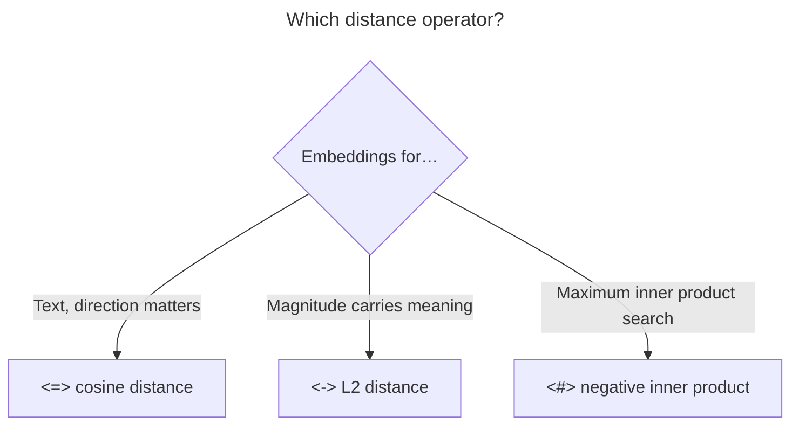
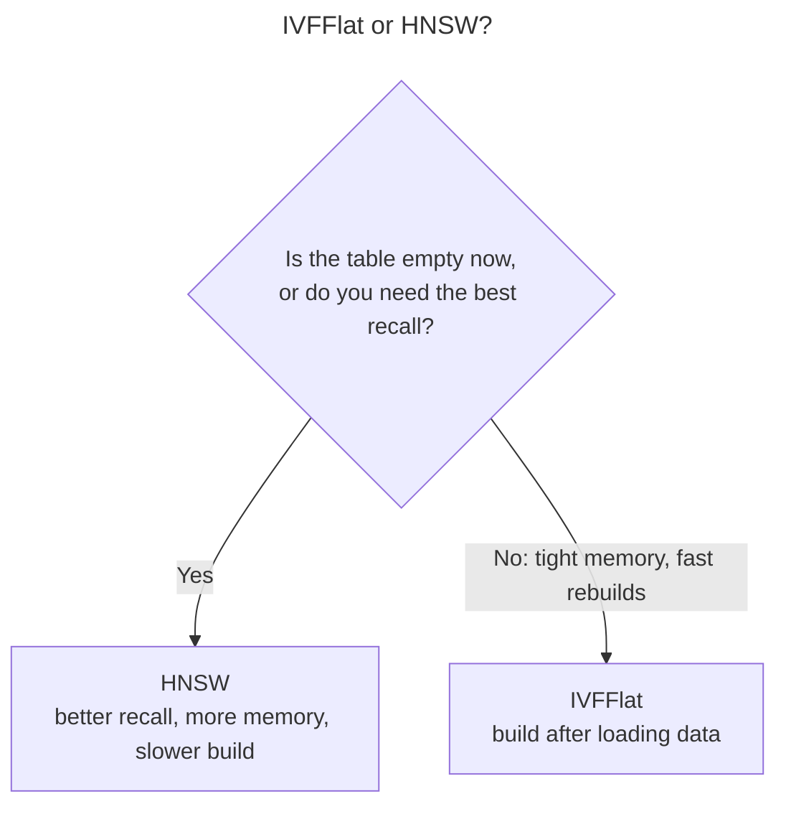
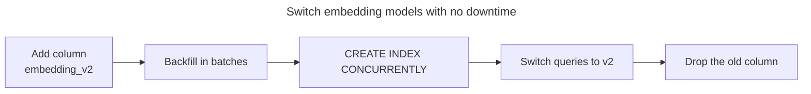
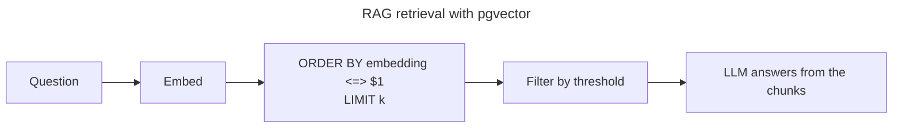

# LP5 · M2: Implement vector search with Azure Database for PostgreSQL

> **Learning path 5:** Develop AI solutions with Azure Database for PostgreSQL · **Skill area 2:** Develop AI solutions with Azure data services · about 94 min on Microsoft Learn  
> Study it interactively at [aryantripathi.dev/ai-200](https://aryantripathi.dev/ai-200/lp-5/implement-vector-search-azure-database-postgresql)

pgvector turns PostgreSQL into a vector store. You'll learn the vector types and operators, IVFFlat and HNSW indexes, managing vector data over time, and building semantic search and RAG retrieval.

**In this lesson**

1. [Store and query embeddings with pgvector](#store-and-query-embeddings-with-pgvector)
2. [Perform fast vector similarity search](#perform-fast-vector-similarity-search)
3. [Manage index lifecycle and embedding updates](#manage-index-lifecycle-and-embedding-updates)
4. [Run vector similarity search for semantic retrieval](#run-vector-similarity-search-for-semantic-retrieval)
5. [Implement retrieval patterns for RAG pipelines](#implement-retrieval-patterns-for-rag-pipelines)

## Store and query embeddings with pgvector

📘 Microsoft Learn: [Store and query embeddings with pgvector](https://learn.microsoft.com/en-us/training/modules/implement-vector-search-azure-database-postgresql/2-store-query-embeddings-pgvector)

pgvector adds a **vector** column type to PostgreSQL, so an embedding sits in the same row as the document's title and category. Three operators measure closeness: `<->` straight-line, `<=>` angle (cosine, the usual choice for text), `<#>` negative inner product. Smaller result = closer.

**Key facts**

- Enable with `CREATE EXTENSION IF NOT EXISTS vector;` (server admin or **azure_pg_admin** role). Check with `SELECT * FROM pg_extension WHERE extname = 'vector';`.
- `vector(n)`: n must match the model: sentence transformers often **384**, ada-002 **1,536**, text-embedding-3-large up to **3,072**. Wrong dimensions cause **insert errors**.
- Store embeddings in the same row as metadata (no joins); for large content, consider a separate table. Multiple vector columns (e.g. title_embedding vector(384)) are allowed.
- Insert vectors as string literals cast to vector (`'[…]'::vector`); use multi-row INSERT or **COPY** for batches. Update the embedding when content changes (or batch off-peak).
- Operators: **<->** L2/Euclidean; **<=>** cosine distance (0 = same direction, 2 = opposite; most common for text); **<#>** negative inner product. **Smaller = more similar** for all three.
- Types: **vector** (32-bit; a 1,536-dim vector ≈ **6 KB**), **halfvec** (16-bit; half the storage), **sparsevec** (only non-zero values; HNSW supports up to **1,000 non-zero elements**).
- Use vector by default; consider halfvec only after benchmarking search quality.

| Operator | Distance | Notes |
|---|---|---|
| <-> | L2 (Euclidean) | When magnitude carries meaning |
| <=> | Cosine | Most common for text embeddings; 0 to 2 |
| <#> | Negative inner product | Maximum inner product search |

> [!WARNING]
> **Exam traps**
>
> - Cosine **distance** (pgvector) is smaller-is-better, unlike Cosmos DB's cosine **similarity** score.
> - halfvec halves storage; sparsevec stores only non-zeros.

## Perform fast vector similarity search

📘 Microsoft Learn: [Perform fast vector similarity search](https://learn.microsoft.com/en-us/training/modules/implement-vector-search-azure-database-postgresql/3-perform-fast-vector-similarity-search)

Without an index, every query measures distance to every row: exact but slow. **IVFFlat** groups vectors into clusters and searches the nearest few (needs data first). **HNSW** builds a layered graph and hops toward the answer: faster and better recall, more memory. The index's operator class must match the query's operator, or PostgreSQL ignores it.

**Key facts**

- No index = **exact** search (cost grows linearly; fine under ~10,000 rows). **ANN** (approximate) trades a little accuracy for speed; quality is measured by **recall** (95–99% is typical).
- **IVFFlat**: k-means into **lists**; query searches the nearest **probes** clusters. This unit suggests lists = **rows/1000** up to 1M rows and **sqrt(rows)** above, with probes starting at sqrt(lists); the next module gives a different sizing table, so treat all of these as starting points to benchmark. Set probes with `SET ivfflat.probes = 10`.
- IVFFlat needs **existing data** to train; an index on an empty table isn't usable. Rebuild if data distribution changes.
- **HNSW**: multi-layer graph; better query performance and recall, more memory and slower builds; **can be created on empty tables** and updates incrementally.
- HNSW params: **m** (connections per node, default **16**; 32–64 for high recall), **ef_construction** (build width; 100–200 for production quality), **hnsw.ef_search** (query width, default **40**; 100–200 for 99%+ recall).
- Operator class must match the operator: **vector_l2_ops** ↔ <->, **vector_cosine_ops** ↔ <=>, **vector_ip_ops** ↔ <#>. Mismatch → sequential scan.
- Verify with `EXPLAIN ANALYZE`: look for **Index Scan**. Seq Scan → check operator class, index validity, table size, and the **LIMIT** clause.
- Start with **HNSW** for most production apps; IVFFlat when memory is tight or builds must be fast for changing data. Azure also supports **DiskANN**.

| Factor | IVFFlat | HNSW |
|---|---|---|
| Query performance | Good | Better |
| Build time | Faster | Slower |
| Memory | Lower | Higher |
| Empty table | No | Yes |
| Recall at same latency | Lower | Higher |

> [!WARNING]
> **Exam traps**
>
> - Index built with vector_l2_ops but query uses <=> → **no index use**.
> - IVFFlat on an empty table isn't usable; load data first.

## Manage index lifecycle and embedding updates

📘 Microsoft Learn: [Manage index lifecycle and embedding updates](https://learn.microsoft.com/en-us/training/modules/implement-vector-search-azure-database-postgresql/4-manage-index-lifecycle-embedding-updates)

Vector indexes age: lots of new or different data makes them less accurate. Rebuild them **without downtime** using CREATE INDEX CONCURRENTLY. Keep embeddings in step with content (now, or in batches via a "stale" flag), and switch embedding models with a **parallel column**.

**Key facts**

- **pg_stat_user_indexes**: zero scans on a vector index often means an operator-class mismatch or a small table. Track latency with EXPLAIN ANALYZE.
- **pg_stat_progress_create_index** shows build phase and percentage (HNSW: initializing, loading tuples; IVFFlat adds k-means phases).
- Rebuild signals: latency up without more data, less relevant results, or **more than 20–30% new data** (especially a new domain).
- No downtime: **CREATE INDEX CONCURRENTLY** with a temporary name → verify with EXPLAIN ANALYZE → drop old → rename. **REINDEX INDEX** is simpler but **blocks writes**.
- Occasional updates: update embedding in the same transaction as content. Frequent updates: mark **embedding_stale = TRUE** and process in batches asynchronously (cheaper, faster, resilient to embedding outages).
- Model changes: can't mix models in one column. **Parallel column** strategy: add embedding_v2 → index it → backfill in batches → compare and switch queries → drop old column and rename.
- Example: 500,000 docs, 3,000 requests/min, batches of 100 ≈ **28 hours** of backfill.
- Storage: dimensions × 4 bytes × rows (1M × 1,536 ≈ 6 GB). This unit estimates index overhead at about 1.5–2× the vector data for HNSW and 1–1.5× for IVFFlat; the next module estimates HNSW at about +50% (m = 16). Measure with `pg_indexes_size`.
- MVCC leaves dead tuples after updates: **VACUUM** (concurrent) or **VACUUM FULL** (locks the table). Tune autovacuum, e.g. `autovacuum_vacuum_scale_factor = 0.05` (5% instead of the default 20%).

| Task | Approach |
|---|---|
| Rebuild with no downtime | CREATE INDEX CONCURRENTLY, then swap |
| Rebuild during a quiet window | REINDEX INDEX (blocks writes) |
| Frequent content edits | Stale flag + async batch re-embedding |
| Switch embedding model | Parallel column (embedding_v2), backfill, switch, drop |
| Reclaim space without locking | VACUUM |

> [!WARNING]
> **Exam traps**
>
> - VACUUM FULL locks the table.
> - Default autovacuum triggers at 20% changed rows.

## Run vector similarity search for semantic retrieval

📘 Microsoft Learn: [Run vector similarity search for semantic retrieval](https://learn.microsoft.com/en-us/training/modules/implement-vector-search-azure-database-postgresql/5-run-vector-similarity-search-semantic-retrieval)

Real searches add **filters** (category, date), a **quality floor** (distance threshold, so you return nothing rather than junk) and sometimes **keywords** (exact case names), mixing vector and full-text scores into one hybrid score.

**Key facts**

- Add WHERE filters; PostgreSQL finds matching rows, then computes distances. Selective filters shrink the search space. Create **B-tree** (or composite) indexes on filter columns and run **ANALYZE** after loading data.
- The planner picks vector index, metadata indexes or both; with very selective filters it may skip the vector index. Check with EXPLAIN ANALYZE.
- **Distance thresholds**: `WHERE embedding <=> $1 < 0.4` plus LIMIT. Empty results can be the right answer. Pick thresholds from distance distributions; cosine with OpenAI embeddings is typically **0.3 (strict) to 0.6 (lenient)**.
- Return everything the app needs (title, content, metadata, distance) in **one round trip**.
- Multi-vector: **average** vectors when examples describe the same concept; **query separately and combine** when they're different aspects (e.g. mergers AND environmental compliance).
- Hybrid: combine `1 - (embedding <=> $1)` with **ts_rank** on `to_tsvector`/`plainto_tsquery` using weights. Speed it with a **GIN** index on the tsvector (or a generated column). Use when exact terms, jargon or codes matter.

> [!WARNING]
> **Exam traps**
>
> - Average vectors only for related examples; different aspects → separate queries.
> - Thresholds stop irrelevant results; LIMIT controls resources. Use both.

## Implement retrieval patterns for RAG pipelines

📘 Microsoft Learn: [Implement retrieval patterns for RAG pipelines](https://learn.microsoft.com/en-us/training/modules/implement-vector-search-azure-database-postgresql/6-implement-retrieval-patterns-rag-pipelines)

In RAG, PostgreSQL is the **librarian**: it finds the right passages (chunks) and hands them, with citations, to the language model. Split documents into chunks, keep a link back to the source, sometimes grab the neighbouring chunks too, and measure how good retrieval is with precision, recall and MRR.

**Key facts**

- RAG: **query embedding → retrieval → generation**. PostgreSQL is the retriever; poor retrieval means poor answers.
- Two tables: **source_documents** and **document_chunks** (FK with ON DELETE CASCADE, chunk_index, content, embedding, section titles, page numbers).
- Indexes: vector index plus B-tree on **document_id** and composite **(document_id, chunk_index)** for context-window retrieval.
- **Context-window** retrieval fetches adjacent chunks (46 and 48 around 47) when concepts span paragraphs; track cumulative **tokens** to stay in the context budget.
- Chunking: **fixed-size** (predictable tokens, may cut sentences), **semantic** (paragraphs, sections; good for legal clauses), **overlapping** (e.g. 200 characters between 1,000-character chunks).
- Ingest: insert the source document first to get its ID, then all chunks in one multi-row INSERT. Updates: delete and reingest (CASCADE). HNSW handles deletions; IVFFlat may need rebuilding.
- Citations: return title, URL/ID, section, page and distance; **group chunks by document**.
- Metrics: **precision** (retrieved that are relevant), **recall** (relevant that were retrieved), **MRR** (how high the first relevant result ranks). Build an evaluation set of **20–50** real queries with expert labels.
- Tuning: smaller chunks → precision; larger → recall; higher ef_search/probes → recall; tighter thresholds → precision.

| Problem | Lever |
|---|---|
| LLM gets irrelevant chunks (low precision) | Tighter threshold, fewer chunks, smaller chunks |
| LLM misses facts (low recall) | Looser threshold, more chunks, higher ef_search/probes |
| First relevant result ranks low (MRR) | Better embedding model or query preprocessing |

> [!WARNING]
> **Exam traps**
>
> - Recall = share of the relevant chunks you actually retrieved.
> - Composite (document_id, chunk_index) supports fetching neighbours.

## Check yourself

- **Practice questions:** [lp5m2 on GitHub](../../practice/lp5m2.md), or [on the site](https://aryantripathi.dev/ai-200/lp-5/implement-vector-search-azure-database-postgresql) with hints and saved progress
- **Cheat sheet:** [Learning path 5](../cheatsheets/lp5.md)
- **Microsoft Learn exercise:** [Implement vector search on Azure Database for PostgreSQL](https://learn.microsoft.com/en-us/training/modules/implement-vector-search-azure-database-postgresql/7-exercise-implement-vector-search)
- **Hands-on lab:** [labs/](../../labs/README.md) has a lab for this learning path

---

Part of **AI-200 Prep**, a free course by Aryan Tripathi · [aryantripathi.dev/ai-200](https://aryantripathi.dev/ai-200) · Written from the public Microsoft Learn course AI-200T00. Not affiliated with Microsoft.
