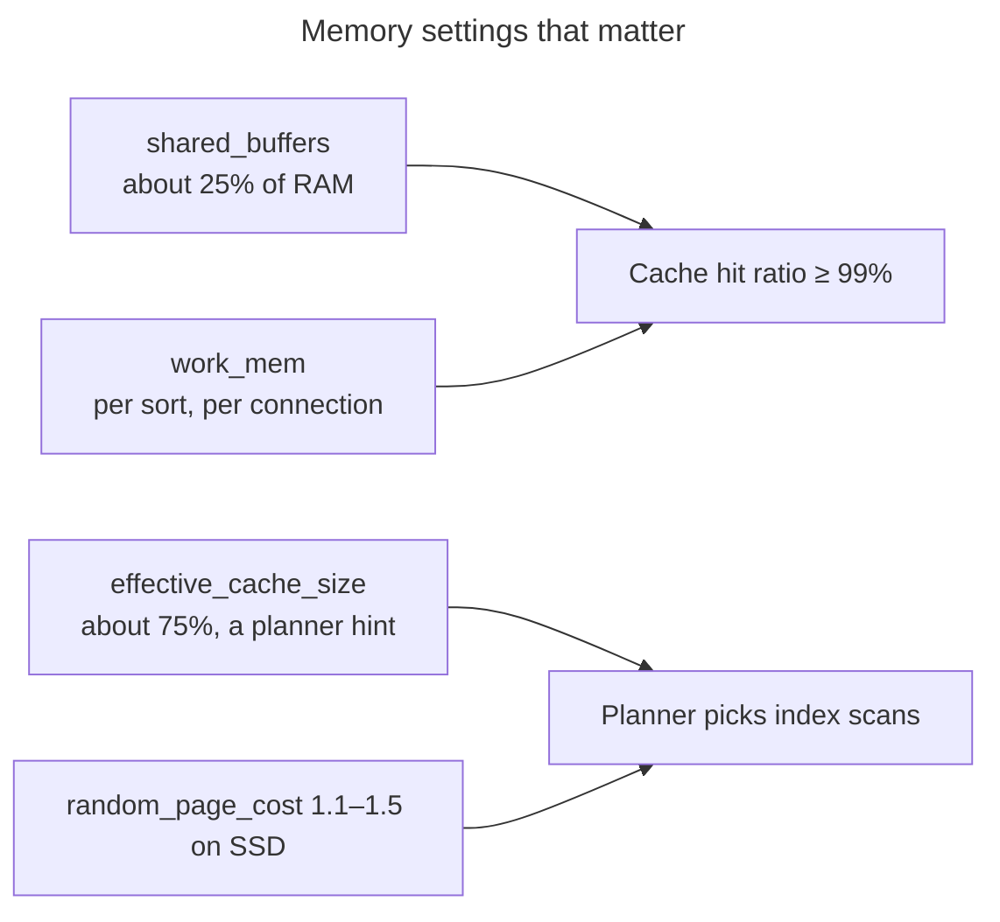
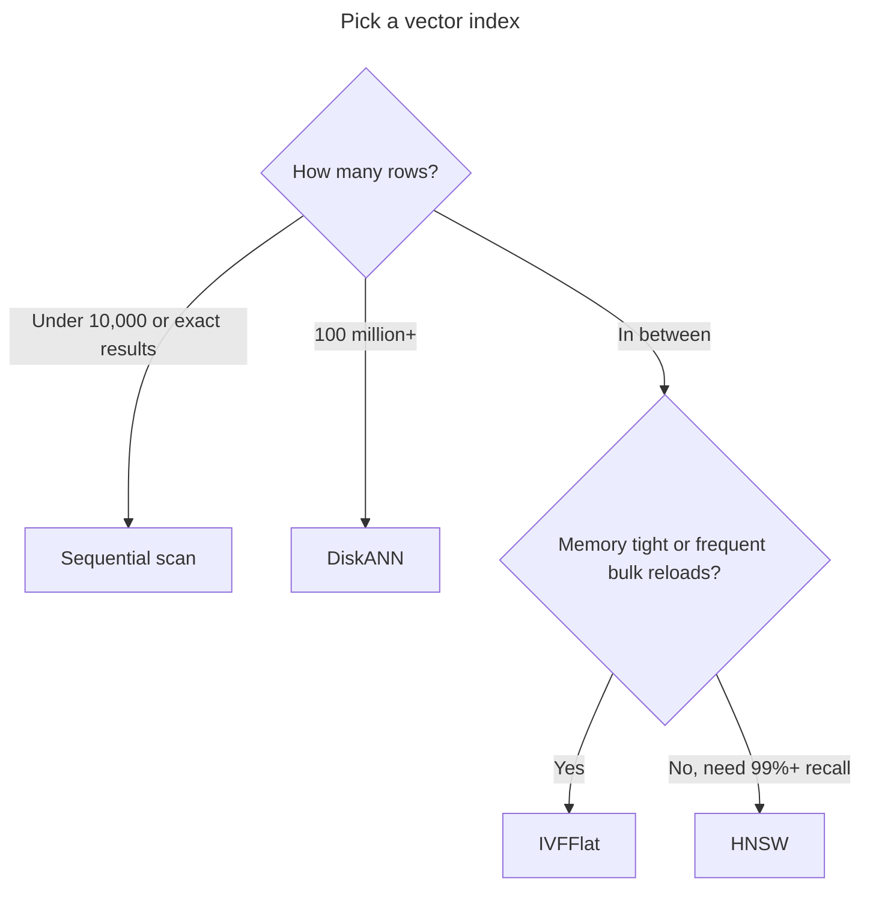
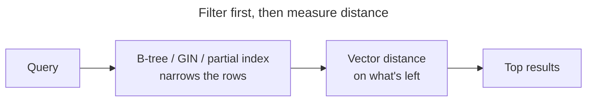
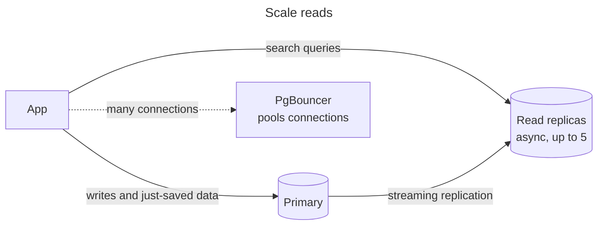

# LP5 · M3: Optimize vector search in Azure Database for PostgreSQL

> **Learning path 5:** Develop AI solutions with Azure Database for PostgreSQL · **Skill area 2:** Develop AI solutions with Azure data services · about 111 min on Microsoft Learn  
> Study it interactively at [aryantripathi.dev/ai-200](https://aryantripathi.dev/ai-200/lp-5/optimize-vector-search-azure-database-postgresql)

Vector search puts unusual load on PostgreSQL. You'll learn which server parameters matter, how to choose and tune indexes, how to design schemas for vectors, and how to scale and pool connections.

**In this lesson**

1. [Tune PostgreSQL for pgvector](#tune-postgresql-for-pgvector)
2. [Choose and configure vector indexes](#choose-and-configure-vector-indexes)
3. [Optimize data layout](#optimize-data-layout)
4. [Scale for high-volume workloads](#scale-for-high-volume-workloads)
5. [Connection optimization](#connection-optimization)

## Tune PostgreSQL for pgvector

📘 Microsoft Learn: [Tune PostgreSQL for pgvector](https://learn.microsoft.com/en-us/training/modules/optimize-vector-search-azure-database-postgresql/2-tune-postgresql-pgvector)

Vector search is **maths-heavy and memory-hungry**. Keep indexes in memory (shared_buffers), give sorts room (work_mem, per query), tell the planner the disks are SSDs (random_page_cost low) so it prefers indexes, and turn the accuracy dials (probes, ef_search). Measure first, change one thing at a time.

**Key facts**

- A 1,536-dim distance = 1,536 float operations; 1M vectors without an index ≈ 1.5 billion operations per query.
- Cost of operators: **L2 (<->)** most expensive; **cosine (<=>)** normalizes internally; **inner product (<#>)** fastest but needs pre-normalized vectors (then equivalent to cosine).
- **shared_buffers**: shared cache; should hold vector indexes plus hot data. Cache hit ratio **below 99%** suggests it's too small. Starting point ~**25%** of memory; Azure tunes it per tier within a range.
- **work_mem**: per operation, per connection (default ~4 MB). Raise per session (`SET work_mem = '256MB'`), not globally: 100 connections × work_mem × operations adds up.
- **effective_cache_size**: a planner hint (allocates nothing); ~**75%** of memory on dedicated servers; higher values encourage index scans.
- **random_page_cost**: default 4.0 (spinning disks). On Azure's SSDs use **1.1–1.5** so the planner uses index scans more readily. **effective_io_concurrency = 200** for SSD.
- Lower parallel_tuple_cost (default 0.1) and parallel_setup_cost (default 1000) to encourage parallel scans when indexes aren't used.
- **ivfflat.probes** default **1** (fast, may miss matches). **hnsw.ef_search** default **40**; 100–200 for high accuracy; as low as 20 for latency-critical apps.
- EXPLAIN ANALYZE: Index Scan vs Seq Scan, actual times, row counts. Index skipped? Large result share, stale statistics (run **ANALYZE**) or operator/class mismatch.
- Azure Monitor: CPU %, Memory %, **Storage IO %** (data not fitting in cache), active connections. Practices: baseline first, one change at a time, production-like data, watch regressions, document.

| Parameter | Effect | Starting point |
|---|---|---|
| shared_buffers | Shared cache for indexes and hot data | ~25% of memory; hit ratio ≥ 99% |
| work_mem | Memory per sort/hash per connection | Raise per session (e.g. 256MB) |
| effective_cache_size | Planner hint only | ~75% of memory |
| random_page_cost | Index vs sequential scan preference | 1.1–1.5 on SSD (default 4.0) |
| effective_io_concurrency | Parallel prefetch | 200 on SSD |

> [!WARNING]
> **Exam traps**
>
> - work_mem multiplies by connections and operations; don't raise it globally.
> - effective_cache_size doesn't allocate memory.

## Choose and configure vector indexes

📘 Microsoft Learn: [Choose and configure vector indexes](https://learn.microsoft.com/en-us/training/modules/optimize-vector-search-azure-database-postgresql/3-choose-configure-vector-indexes)

Small tables don't need a vector index; past a million rows it's essential. **HNSW** = higher recall and steady speed for read-mostly data, more memory, slower builds. **IVFFlat** = lighter and quicker to build, tunable at query time, lower recall ceiling. Build with **CONCURRENTLY** in production.

**Key facts**

- Exact (sequential) search guarantees true neighbours; ANN trades a little recall for 100–1000× speed. 95–99% recall is acceptable for most apps.
- Index benefit by size: **<10,000** rows limited; 10k–100k moderate; 100k–1M significant (usually required for interactive use); **>1M essential**.
- IVFFlat: k-means lists; searches nearest lists; probes tune recall at **query time without rebuilding**. Pros: fast builds, lower memory. Cons: needs training data, lower recall ceiling, rebuild after distribution changes.
- HNSW: layered graph from a fixed entry point; **m** start at 16 (32 for higher recall); **ef_construction ≥ 2 × m** (4 × m for high quality; affects build time and quality, not query time or size); **ef_search ≥ LIMIT**.
- HNSW pros: 99%+ recall, no training dependency, consistent latency. Cons: more memory, longer builds, changing m or ef_construction means **rebuilding**.
- Choose IVFFlat for tight memory, low build-time tolerance, 90–95% recall, frequent bulk updates, or fast dev iteration. Choose HNSW for ample memory, 99%+ recall, read-mostly workloads with small updates.
- Azure also offers **DiskANN** for very large datasets (100 million+ vectors).
- Sequential scans are fine for <10,000 rows, pre-filtered tiny subsets, exact 100% recall needs, or data that changes too often to index.
- Index creation locks writes by default; use **CREATE INDEX CONCURRENTLY**. Monitor with pg_stat_progress_create_index. Rough builds for 1M vectors: IVFFlat 5–15 min, HNSW 15–45 min (HNSW grows more than linearly). **REINDEX INDEX CONCURRENTLY** to rebuild.
- Low **idx_scan** in pg_stat_user_indexes = index unused; check the operator class.

| Need | Pick |
|---|---|
| 99%+ recall, read-mostly, ample memory | HNSW |
| Tight memory or frequent bulk reloads | IVFFlat |
| Tune recall without rebuilding | IVFFlat probes or HNSW ef_search |
| 100 million+ vectors | DiskANN (Azure) |
| Under 10,000 rows or exact results | Sequential scan |

> [!WARNING]
> **Exam traps**
>
> - ef_construction affects build time and graph quality, not query time or index size.
> - Changing HNSW m means rebuilding the index.

## Optimize data layout

📘 Microsoft Learn: [Optimize data layout](https://learn.microsoft.com/en-us/training/modules/optimize-vector-search-azure-database-postgresql/4-optimize-data-layout)

Store the fields you filter on as **real columns** with B-tree indexes; keep rare or changing attributes in **JSONB**. Filter first, then measure distance on the few rows left. For huge tables, **partition** by date or category so each piece has its own smaller index.

**Key facts**

- Storage per vector (single precision): 384 ≈ 1.5 KB, 768 ≈ 3 KB, **1536 ≈ 6 KB**, 3072 ≈ 12 KB. Explicit dimensions (`vector(768)`) validate inserts.
- Each vector column needs its **own index**; one index can't cover several vector columns.
- **Structured columns**: efficient B-tree indexes for equality and ranges, storage efficiency, type safety, accurate statistics. Use for frequently filtered attributes.
- **JSONB**: flexible, but extraction overhead; **GIN** indexes help containment (@>, <@, ?, ?|, ?&) but **not range queries**; less precise statistics. Mix: structured for hot filters, JSONB for dynamic ones.
- Composite B-tree (category_id, price) serves category_id = 5 and category_id = 5 AND price < 100, but **not price < 100 alone**.
- **Partial index**: `CREATE INDEX … (category_id) WHERE in_stock = true` when most queries share that filter.
- **Expression index** on `((attributes->>'price')::numeric)` enables range queries on a JSONB field.
- Filter first to shrink candidates; very unselective filters (price > 0) may be skipped by the planner. **Post-filtering**: fetch more vector candidates in a CTE, then filter.
- **Partitioning** for tens of millions of rows, natural partition keys, dropping old data, or slow index builds: range by date; list or hash by category or tenant. Indexes created on the parent are created on every partition. Costs: cross-partition queries, unique constraints need the partition key.

| Filter need | Best structure / index |
|---|---|
| category_id = 5 AND price BETWEEN 100 AND 500 | Structured columns + B-tree (category_id, price) |
| attributes @> '{"color":"red"}' | JSONB + GIN |
| Range on a JSONB price field | Expression index on ((attributes->>'price')::numeric) |
| Nearly every query has in_stock = true | Partial index WHERE in_stock = true |

> [!WARNING]
> **Exam traps**
>
> - GIN on JSONB doesn't accelerate range queries.
> - One vector index per vector column.

## Scale for high-volume workloads

📘 Microsoft Learn: [Scale for high-volume workloads](https://learn.microsoft.com/en-us/training/modules/optimize-vector-search-azure-database-postgresql/5-scale-high-volume-workloads)

First make the server bigger (**scale up**), especially with more memory per vCore so indexes stay cached. When one server can't take the query volume, add **read replicas** for similarity searches and **cache** repeatable answers in Redis. Watch CPU above 70% and plan before you hit the wall.

**Key facts**

- Memory per vCore: **Burstable 2 GB** (1–20 vCores), **General Purpose 4 GB** (2–96), **Memory Optimized 8 GB** (2–96; large working sets, vector workloads).
- Starting points: <1M vectors → General Purpose 4–8 vCores (scale up if CPU >70% at peak); 1–10M → Memory Optimized 8–16 vCores with memory ≥ index size + 50%; >10M → Memory Optimized 32+.
- **Scale up** when single-query latency is high, memory pressure causes disk IO, or you haven't hit tier limits. **Scale out** (replicas, caching) when total volume exceeds one server or for read-heavy workloads tolerant of staleness. Start by scaling up.
- **Read replicas**: physical streaming replication, **asynchronous**; up to **five per primary**; can be in other regions; each has its own endpoint, so the app must route queries. Similarity searches are good replica candidates; read-your-own-update queries go to the **primary**.
- Routing: application-level, DNS (Traffic Manager), or a connection proxy. Replicas can be sized independently.
- Caching (Azure Cache for Redis): good for popular embeddings, precomputed "similar items", user embedding lookups; poor for arbitrary similarity queries (infinite key space) and fast-changing data. TTL of **15–60 minutes** is often fine for recommendations; or event-driven invalidation, or background refresh.
- Alerts: e.g. CPU > 80% for 5 minutes (warning), memory > 90% for 5 minutes (critical). Track P95/P99 latency, throughput, cache hit ratio.
- Cost: average CPU <30% → consider scaling down; **reserved capacity** (1 or 3 years, up to 65% off) for the baseline; remove unused indexes; Burstable for development.

| Tier | Memory per vCore | Fits |
|---|---|---|
| Burstable | 2 GB | Dev, low traffic |
| General Purpose | 4 GB | Balanced production |
| Memory Optimized | 8 GB | Large working sets, vector workloads |

> [!WARNING]
> **Exam traps**
>
> - Read replicas are asynchronous; a user's just-saved preferences should be read from the primary.
> - Up to five read replicas per primary.

## Connection optimization

📘 Microsoft Learn: [Connection optimization](https://learn.microsoft.com/en-us/training/modules/optimize-vector-search-azure-database-postgresql/6-connection-optimization)

Opening a connection costs **50–200 ms**, so share them. PgBouncer in **transaction mode** lets many clients share a few server connections, but session tricks (plain SET, LISTEN/NOTIFY, named prepared statements) don't carry across transactions, so use **SET LOCAL**.

**Key facts**

- Connection setup: TCP handshake, TLS, authentication, backend process, session init: **50–200 ms**.
- Connection limits by tier, e.g. Burstable B1ms **50**, General Purpose 2 vCores 859, Memory Optimized 16 vCores 5,000.
- Built-in PgBouncer (General Purpose and Memory Optimized; port **6432**). Modes: **session** (all features, little reduction), **transaction** (connection held only during a transaction; best for most apps), **statement** (max reduction, no multi-statement transactions).
- Settings: pgbouncer.default_pool_size 20–50, pgbouncer.max_client_conn 5000+, pgbouncer.pool_mode **transaction**, pgbouncer.query_wait_timeout 30–120 s.
- Transaction mode effects: plain **SET doesn't persist** across transactions (use **SET LOCAL**); named prepared statements may fail; **LISTEN/NOTIFY doesn't work**.
- App pools: **psycopg_pool** ConnectionPool; Npgsql pools by default (one pool per unique connection string; Minimum/Maximum Pool Size, Connection Idle Lifetime, Connection Lifetime).
- Pool sizing: max per instance ≈ database limit ÷ number of app instances, with headroom (e.g. 1,000 connections, 10 instances → 100 each).
- `SET LOCAL work_mem = '256MB'` and `SET LOCAL hnsw.ef_search = 200` (or 20) per transaction; safe with pooling.
- Batch reads with `WHERE id = ANY(%s)`; load with **COPY**; run concurrent searches with **AsyncConnectionPool** and asyncio.gather.
- Resilience: retry OperationalError with exponential backoff plus **jitter** ((2 ** attempt) + random); timeouts (connect_timeout=10, statement_timeout); handle **PoolTimeout** with a clear "temporarily busy" error.

| PgBouncer mode | Holds a server connection | Trade-off |
|---|---|---|
| Session | Whole client session | All features; little reduction |
| Transaction | During each transaction | Best for most apps; no session state across transactions |
| Statement | Each statement | Maximum reduction; no multi-statement transactions |

> [!WARNING]
> **Exam traps**
>
> - In transaction mode use **SET LOCAL**, not SET.
> - LISTEN/NOTIFY needs persistent connections; it doesn't work with transaction pooling.

## Check yourself

- **Practice questions:** [lp5m3 on GitHub](../../practice/lp5m3.md), or [on the site](https://aryantripathi.dev/ai-200/lp-5/optimize-vector-search-azure-database-postgresql) with hints and saved progress
- **Cheat sheet:** [Learning path 5](../cheatsheets/lp5.md)
- **Microsoft Learn exercise:** [Optimize vector search performance in Azure Database for PostgreSQL](https://learn.microsoft.com/en-us/training/modules/optimize-vector-search-azure-database-postgresql/7-exercise-optimize-vector-search)
- **Hands-on lab:** [labs/](../../labs/README.md) has a lab for this learning path

---

Part of **AI-200 Prep**, a free course by Aryan Tripathi · [aryantripathi.dev/ai-200](https://aryantripathi.dev/ai-200) · Written from the public Microsoft Learn course AI-200T00. Not affiliated with Microsoft.
