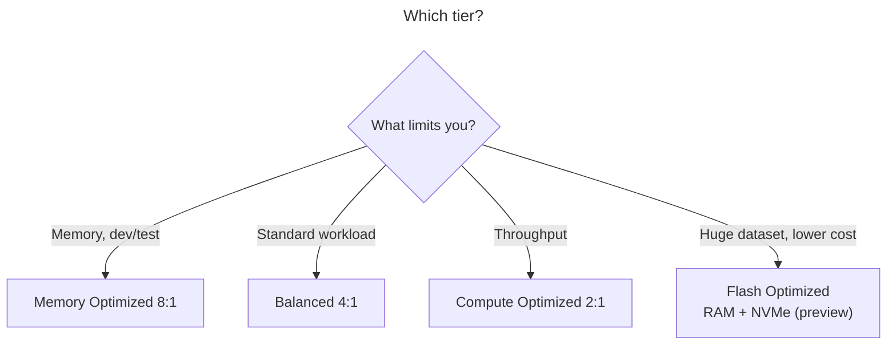
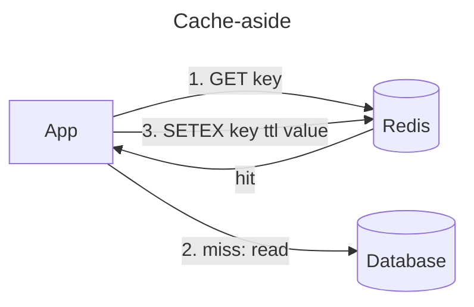

# LP6 · M1: Implement data operations in Azure Managed Redis

> **Learning path 6:** Enhance AI solutions with Azure Managed Redis · **Skill area 2:** Develop AI solutions with Azure data services · about 61 min on Microsoft Learn  
> Study it interactively at [aryantripathi.dev/ai-200](https://aryantripathi.dev/ai-200/lp-6/implement-data-operations-azure-managed-redis)

Azure Managed Redis keeps hot data in memory. You'll learn its tiers and caching patterns, client best practices, and the core data operations with redis-py.

**In this lesson**

1. [Explore Azure Managed Redis](#explore-azure-managed-redis)
2. [Client libraries and development best practices](#client-libraries-and-development-best-practices)
3. [Implement data operations](#implement-data-operations)

## Explore Azure Managed Redis

📘 Microsoft Learn: [Explore Azure Managed Redis](https://learn.microsoft.com/en-us/training/modules/implement-data-operations-azure-managed-redis/2-explore-azure-managed-redis)

Azure Managed Redis keeps **hot data in memory** so reads take well under a millisecond. Typical jobs: cache database results (**cache-aside**: look in Redis first, fetch from the database only on a miss), cache page fragments, and hold user sessions. Tiers trade memory against compute.

**Key facts**

- Azure Managed Redis is an in-memory store based on **Redis Enterprise**, operated by Microsoft and usable from inside or outside Azure.
- **Data cache**: **cache-aside** loads data into the cache only when requested: check Redis → on a miss, read the database and store the result. Invalidate or update entries on change; TTL and eviction policies manage memory; **Active-Active geo-replication** syncs regions.
- **Content cache**: static fragments (headers, footers, menus) served in sub-millisecond time; fewer web servers needed; Redis Output Cache Provider for ASP.NET.
- **Session store**: keep only a session id in the cookie and the session data in Redis (carts, preferences, tokens); automatic expiration and replication.
- Tiers (memory-to-vCPU): **Memory Optimized 8:1** (memory-heavy, lower throughput; good for dev/test), **Balanced 4:1** (standard workloads), **Compute Optimized 2:1** (maximum throughput).
- **Flash Optimized (preview)** moves less-used data from RAM to **NVMe**: lower performance, cost-effective for large datasets.

| Tier | Memory : vCPU | Use for |
|---|---|---|
| Memory Optimized | 8:1 | Memory-heavy, lower throughput; dev/test |
| Balanced | 4:1 | Standard workloads |
| Compute Optimized | 2:1 | Highest throughput |
| Flash Optimized (preview) | RAM + NVMe | Very large datasets at lower cost |

> [!WARNING]
> **Exam traps**
>
> - Cache-aside loads on demand; it doesn't preload whole databases.
> - Compute Optimized has the **lowest** memory-to-vCPU ratio.

## Client libraries and development best practices

📘 Microsoft Learn: [Client libraries and development best practices](https://learn.microsoft.com/en-us/training/modules/implement-data-operations-azure-managed-redis/3-client-libraries-best-practices)

Pick a client for your language, mind the **clustering policy** (it changes which multi-key commands work), keep values small, use **SCAN not KEYS**, put Redis in the same region as the app, connect by **hostname** over TLS, and scale when key metrics stay above **75%**.

**Key facts**

- Clients: **StackExchange.Redis** (.NET), **Lettuce** (Java), **node_redis** (Node.js), **redis-py** (Python). Use the latest version.
- Clustering policies: **Enterprise** (all client libraries work) and **OSS** (client must support clustered Redis).
- Multi-key commands can raise **CROSSSLOT**. With OSS clustering, all keys must map to the same hash slot. Enterprise clustering allows **DEL, MSET, MGET, EXISTS, UNLINK, TOUCH** across slots; in **Active-Active** databases only **MGET, EXISTS, TOUCH**.
- Blocked with Enterprise clustering: CLUSTER INFO, HELP, KEYSLOT, NODES, SLOTS. Blocked with active geo-replication: **FLUSHALL, FLUSHDB**.
- Data: smaller values (split big ones), pipelining, **don't use KEYS in production; use SCAN**.
- Network: same region as the app, use **hostnames** (IPs can change during scaling), TLS required (**1.2 and 1.3**).
- Scale when **Used Memory %**, CPU, Connected Clients or network bandwidth stay above **75%**.
- Configuration: choose tier by testing, **high availability** for production, data persistence or import/export for protection.

| Clustering policy | Multi-key commands across slots |
|---|---|
| OSS | Not allowed: keys must share one hash slot |
| Enterprise | DEL, MSET, MGET, EXISTS, UNLINK, TOUCH |
| Active-Active (geo-replicated) | Only MGET, EXISTS, TOUCH |

> [!WARNING]
> **Exam traps**
>
> - FLUSHALL and FLUSHDB are blocked with active geo-replication.
> - Use SCAN, never KEYS, in production.

## Implement data operations

📘 Microsoft Learn: [Implement data operations](https://learn.microsoft.com/en-us/training/modules/implement-data-operations-azure-managed-redis/4-implement-data-operations)

Redis has a few building blocks: **strings** (SET/GET), **hashes** (a mini object per key), **lists** (queues and feeds), and **atomic counters** (INCR). Give keys an expiry (TTL) so stale data cleans itself up. Azure Managed Redis listens on port **10000**.

**Key facts**

- Strings: SET, GET, MSET, MGET. `decode_responses=True` returns strings; False for binary data such as pickled objects.
- Hashes: HSET, HGET, **HGETALL**; field-value pairs in one key, more memory-efficient than one key per field.
- Lists: LPUSH/RPUSH, LPOP/RPOP, LRANGE; stack (LIFO) or queue (FIFO).
- Numbers: **INCR, DECR, INCRBY, DECRBY** are **atomic**; good for counters and rate limiting without race conditions.
- Ports: **Azure Managed Redis and Enterprise caches 10000**; Azure Cache for Redis 6380. With the **OSS** clustering policy, use `redis.cluster.RedisCluster` instead of `redis.Redis`.
- Production auth: Microsoft Entra ID with the **redis-entraid** package and DefaultAzureCredential.
- Pipelines batch multiple commands (e.g. several HGETALL calls). EXISTS and DELETE work on any key type.
- Expiry: **SETEX** sets a string and TTL atomically (PSETEX in ms); for hashes or lists, write then **EXPIRE**. TTL returns **-1** (no expiry) or **-2** (key doesn't exist); PERSIST removes expiry.
- Invalidation: time-based (TTL), manual on update, cache-aside with expiry, pattern-based with **SCAN**.
- Suggested TTLs: frequently changing **1–5 min**; moderate **15–60 min**; stable **1–24 h**; static reference data **24 h+**.

| Need | Command |
|---|---|
| Store a user profile as fields | HSET user:1001 … |
| Count API calls without race conditions | INCR |
| Set a string with a 60-second expiry | SETEX key 60 value |
| Add expiry to an existing hash | EXPIRE key 3600 |
| Check whether a key has an expiry | TTL (−1 none, −2 missing) |

> [!WARNING]
> **Exam traps**
>
> - SETEX is for strings; for hashes, HSET then EXPIRE.
> - TTL −1 = no expiry; −2 = key doesn't exist.
> - Port 10000 for Azure Managed Redis.

## Check yourself

- **Practice questions:** [lp6m1 on GitHub](../../practice/lp6m1.md), or [on the site](https://aryantripathi.dev/ai-200/lp-6/implement-data-operations-azure-managed-redis) with hints and saved progress
- **Cheat sheet:** [Learning path 6](../cheatsheets/lp6.md)
- **Microsoft Learn exercise:** [Perform data operations in Azure Managed Redis](https://learn.microsoft.com/en-us/training/modules/implement-data-operations-azure-managed-redis/5-exercise-data-operations)
- **Hands-on lab:** [labs/](../../labs/README.md) has a lab for this learning path

---

Part of **AI-200 Prep**, a free course by Aryan Tripathi · [aryantripathi.dev/ai-200](https://aryantripathi.dev/ai-200) · Written from the public Microsoft Learn course AI-200T00. Not affiliated with Microsoft.
