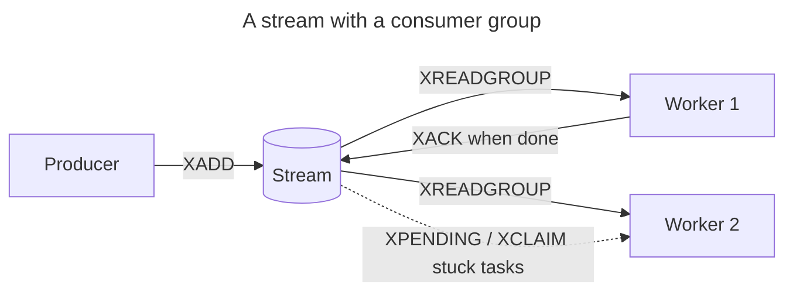
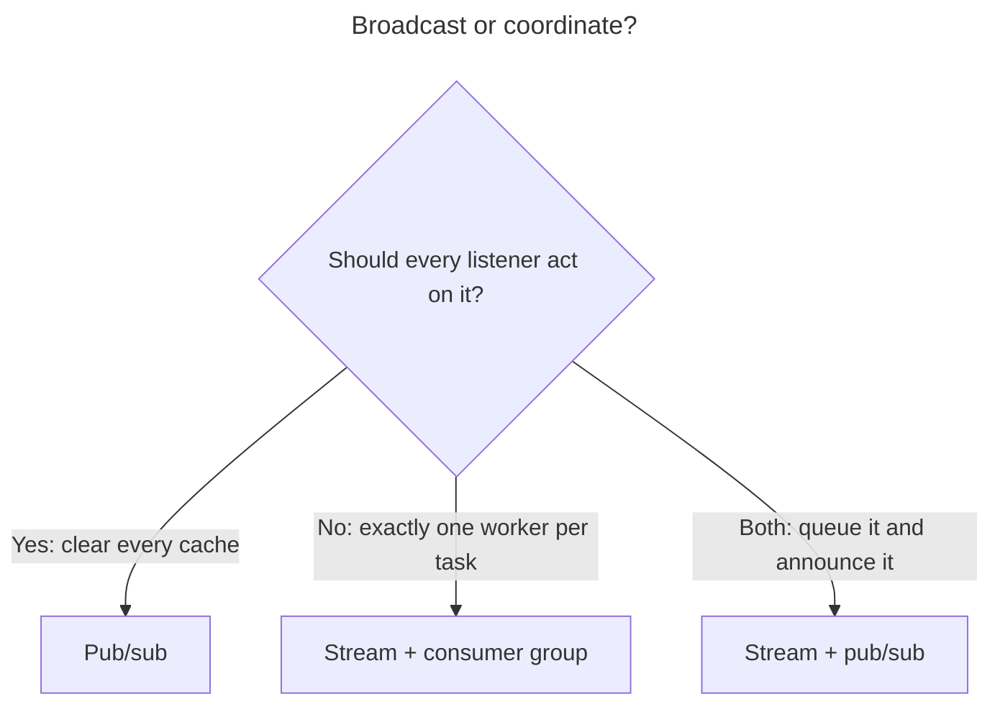

# LP6 · M2: Implement event messaging with Azure Managed Redis

> **Learning path 6:** Enhance AI solutions with Azure Managed Redis · **Skill area 2:** Develop AI solutions with Azure data services · about 81 min on Microsoft Learn  
> Study it interactively at [aryantripathi.dev/ai-200](https://aryantripathi.dev/ai-200/lp-6/implement-event-messaging-azure-managed-redis)

Redis can also move messages. You'll learn when pub/sub's fast broadcast fits, when Streams' durable queues fit, and how to coordinate several subscribers or workers.

**In this lesson**

1. [Publish and subscribe to events with Redis pub/sub](#publish-and-subscribe-to-events-with-redis-pubsub)
2. [Implement task queues with Redis Streams](#implement-task-queues-with-redis-streams)
3. [Choose between broadcast and coordinated distribution](#choose-between-broadcast-and-coordinated-distribution)

## Publish and subscribe to events with Redis pub/sub

📘 Microsoft Learn: [Publish and subscribe to events with Redis pub/sub](https://learn.microsoft.com/en-us/training/modules/implement-event-messaging-azure-managed-redis/2-redis-pub-sub)

Pub/sub is a **loudspeaker**: whoever is listening on a channel right now hears the announcement; anyone who isn't, misses it. Nothing is stored and the speaker never knows who heard. Great for instant "clear your cache" broadcasts, wrong for work that must not be lost.

```mermaid
---
title: Pub/sub: every subscriber gets it
---
flowchart LR
    P["Publisher"] -->|PUBLISH model-updated| CH(("Channel"))
    CH --> S1["API instance 1"]
    CH --> S2["API instance 2"]
    CH --> S3["API instance 3"]
    CH -.->|offline subscribers miss it| X["No history"]
```

**Key facts**

- Publishers send to named **channels**; Redis delivers immediately to all **active** subscribers. Available in Azure Cache for Redis and Azure Managed Redis.
- Characteristics: **at-most-once** delivery, **no persistence**, **fire-and-forget** (publisher doesn't know who received), high throughput.
- Channels are strings (e.g. `ai:conversations:123`); **pattern** subscriptions with **PSUBSCRIBE** (e.g. `ai:*`).
- Use cases: real-time coordination of AI components, model/embedding **cache invalidation**, event-driven microservices, monitoring channels.
- Limitations: messages are lost if nobody listens or a subscriber is disconnected; no delivery guarantees; memory-only (no durability, ordering or replay); **no backpressure**.
- Commands: **PUBLISH**, **SUBSCRIBE**, **PSUBSCRIBE**; in redis-py `pubsub = r.pubsub(); pubsub.subscribe(…); for m in pubsub.listen()`.
- Can be combined with **WebSockets** (e.g. FastAPI + redis.asyncio) to push AI updates to browsers.

> [!WARNING]
> **Exam traps**
>
> - A subscriber that restarts misses everything published while it was down.
> - Publishers get no delivery confirmation.

## Implement task queues with Redis Streams

📘 Microsoft Learn: [Implement task queues with Redis Streams](https://learn.microsoft.com/en-us/training/modules/implement-event-messaging-azure-managed-redis/3-redis-streams)

A Stream is a **to-do list that remembers**. The API adds a job (XADD) and returns at once; workers take jobs (XREADGROUP) and tick them off (XACK). If a worker crashes mid-job, the job stays on a **pending list** to be retried. The catch: the list keeps growing until you trim it.



**Key facts**

- Streams are append-only task queues: **XADD** adds, **XREADGROUP** pulls, **XACK** marks complete. Streams track which consumer has which task.
- Benefits: tasks survive crashes, automatic retry of unacknowledged tasks, built-in work distribution across workers, processing history and replay, simple async APIs (return a job id immediately).
- Each entry gets an auto-generated **ID** that orders tasks.
- Create a consumer group once: `xgroup_create('ai:inference:requests', 'workers', id='0', mkstream=True)` (catch the error if it exists).
- Use for: queuing inference requests from APIs, multi-step pipelines (each stage reads one stream, writes the next), horizontal scaling of workers, retrying long operations, processing history.
- **XPENDING** finds tasks pending too long; **XCLAIM** reassigns them. **XINFO** gives queue metrics.
- Trade-offs: **memory is your job**: trim with `xadd(…, maxlen=10000, approximate=True)` or **XTRIM**; a few ms more latency than pub/sub; more code (groups, acks, pending checks); entries **don't auto-expire**.

| Command | Purpose |
|---|---|
| XADD | Add a task (optionally with maxlen trimming) |
| XREADGROUP | Read tasks as a consumer in a group |
| XACK | Mark a task complete |
| XPENDING / XCLAIM | Find and reassign stuck tasks |
| XINFO | Queue health metrics |
| XTRIM | Trim old entries |

> [!WARNING]
> **Exam traps**
>
> - Acknowledged entries still use memory until trimmed.
> - Unacknowledged tasks stay pending; reclaim them with XCLAIM.

## Choose between broadcast and coordinated distribution

📘 Microsoft Learn: [Choose between broadcast and coordinated distribution](https://learn.microsoft.com/en-us/training/modules/implement-event-messaging-azure-managed-redis/4-coordinate-multiple-subscribers)

Three subscribers on a pub/sub channel = **three copies** of every message (good for "everyone, clear your cache", bad for "someone, do this job"). Three workers in a Stream consumer group = each job goes to **exactly one** worker. Big systems often use both.



**Key facts**

- **Pub/sub** broadcasts: every active subscriber gets every message.
- Broadcast is right for cache invalidation across API instances, config or feature-flag reloads, several monitoring systems, notifying different services (analytics, billing, recommendations).
- Broadcast is wrong for tasks that must run once (three workers = triple cost and inconsistent results), load balancing, or queue-like processing with acknowledgments.
- **Consumer groups** give each message to **exactly one** consumer in the group; work spreads automatically as workers are added or removed, with no code changes.
- Read ID **>** = new messages never delivered to any consumer; an ID such as **0** = this consumer's own pending messages (useful on restart).
- Failures: XPENDING (e.g. pending more than 5 minutes) + XCLAIM; workers can recover their own pending tasks at startup.
- Choose pub/sub when all subscribers need the same message and no guarantees are needed; Streams when each message must be processed once, with acknowledgments, scaling and failure handling.
- **Hybrid**: queue the work in a Stream and broadcast notifications with pub/sub.

| Need | Use |
|---|---|
| Every API instance clears its model cache | Pub/sub |
| Each inference request processed by one worker | Stream consumer group |
| Add workers to share load | Stream consumer group |
| Notify analytics, billing and recommendations of one event | Pub/sub |
| Queue the work and announce it | Hybrid: Stream + pub/sub |

> [!WARNING]
> **Exam traps**
>
> - Several workers subscribed to one channel = duplicate processing.
> - XREADGROUP with > gets new messages; with 0 gets your pending ones.

## Check yourself

- **Practice questions:** [lp6m2 on GitHub](../../practice/lp6m2.md), or [on the site](https://aryantripathi.dev/ai-200/lp-6/implement-event-messaging-azure-managed-redis) with hints and saved progress
- **Cheat sheet:** [Learning path 6](../cheatsheets/lp6.md)
- **Microsoft Learn exercise:** [Publish and subscribe to events in Azure Managed Redis](https://learn.microsoft.com/en-us/training/modules/implement-event-messaging-azure-managed-redis/5-exercise-publish-subscribe-events-redis)
- **Hands-on lab:** [labs/](../../labs/README.md) has a lab for this learning path

---

Part of **AI-200 Prep**, a free course by Aryan Tripathi · [aryantripathi.dev/ai-200](https://aryantripathi.dev/ai-200) · Written from the public Microsoft Learn course AI-200T00. Not affiliated with Microsoft.
