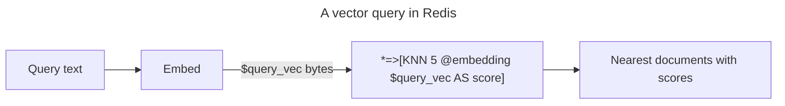
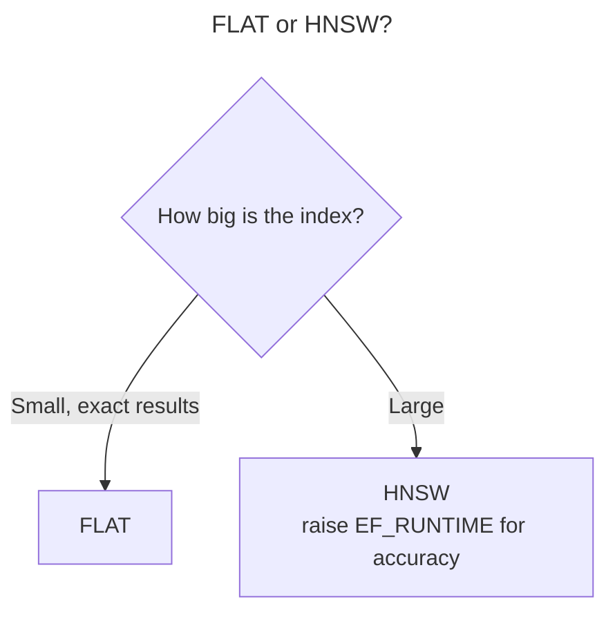
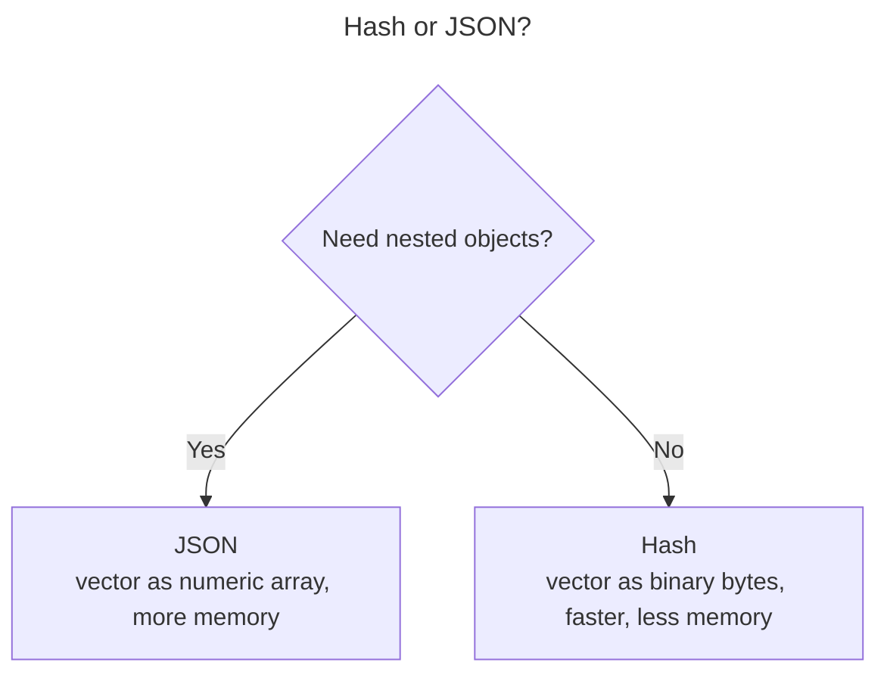

# LP6 · M3: Implement vector storage in Azure Managed Redis

> **Learning path 6:** Enhance AI solutions with Azure Managed Redis · **Skill area 2:** Develop AI solutions with Azure data services · about 80 min on Microsoft Learn  
> Study it interactively at [aryantripathi.dev/ai-200](https://aryantripathi.dev/ai-200/lp-6/implement-vector-storage-azure-managed-redis)

Redis can store and search vectors with very low latency. You'll learn to create vector indexes, choose index parameters, and pick between Hash and JSON storage.

**In this lesson**

1. [Index and query vector data](#index-and-query-vector-data)
2. [Choose vector types and indexing strategies](#choose-vector-types-and-indexing-strategies)
3. [Optimize Redis data structures for vector storage](#optimize-redis-data-structures-for-vector-storage)

## Index and query vector data

📘 Microsoft Learn: [Index and query vector data](https://learn.microsoft.com/en-us/training/modules/implement-vector-storage-azure-managed-redis/2-index-query-vector-data)

Tell Redis what your vectors look like (an **index schema**: field, dimensions, type, metric, algorithm) and which keys to watch (a **prefix** such as `doc:`). Store each vector as **bytes** in a hash with its metadata; Redis indexes it automatically. Then ask for the **K nearest**, optionally inside a category, or for everything within a distance.

**Key facts**

- Vector search in Azure Managed Redis uses **RediSearch**. The schema's **VectorField** sets the field name, **DIM** (must match the model exactly), **TYPE** (FLOAT32 standard), **DISTANCE_METRIC** (COSINE for text) and algorithm.
- Redis watches keys with the index's **prefix** and indexes new vectors automatically; no separate indexing step.
- Algorithms: **FLAT** (brute force, exact; under ~10,000 vectors) and **HNSW** (graph-based approximate; large datasets, <10 ms, 95–99% accuracy).
- Store vectors as **binary blobs**: NumPy `.tobytes()`, in a hash with metadata via `hset(…, mapping={…})`.
- Bulk ingestion with **pipelines** batches commands in one round trip: 10–100× higher throughput.
- KNN query: `*=>[KNN 5 @embedding $query_vec AS score]` with **.dialect(2)** (required). Lower scores = more similar; COSINE distance 0.0 identical, 2.0 opposite.
- Hybrid (filtered) query: put the filter **before** =>: `@category:{documentation}=>[KNN 3 @embedding $query_vec AS score]`.
- Range query: `@embedding:[VECTOR_RANGE 0.2 $query_vec]=>{$YIELD_DISTANCE_AS: score}` returns everything within the threshold.
- Dimension mismatch between index and query → error. Metrics: **COSINE** text; **L2** images and spatial data; **IP** only pre-normalized embeddings.
- **EF_RUNTIME** sets how many graph nodes HNSW explores per query (default typically 10); start at **50**, raise to 100–200 for accuracy.

| Query | Syntax |
|---|---|
| Top 5 nearest | *=>[KNN 5 @embedding $query_vec AS score] |
| Top 3 within a category | @category:{documentation}=>[KNN 3 @embedding $query_vec AS score] |
| Everything within distance 0.2 | @embedding:[VECTOR_RANGE 0.2 $query_vec]=>{$YIELD_DISTANCE_AS: score} |
| More accurate HNSW | …KNN 10 @embedding $query_vec EF_RUNTIME 200 AS score |

> [!WARNING]
> **Exam traps**
>
> - Vector queries need **dialect 2**.
> - In hybrid queries, the filter comes **before** =>.
> - Redis returns distances: lower = more similar.

## Choose vector types and indexing strategies

📘 Microsoft Learn: [Choose vector types and indexing strategies](https://learn.microsoft.com/en-us/training/modules/implement-vector-storage-azure-managed-redis/3-vector-types-index-strategy)

Three choices: **type** (FLOAT32 almost always), **metric** (COSINE for text, L2 for images) and **algorithm** (FLAT for small sets, HNSW for big ones). Then test EF_RUNTIME on your own data.

**Key facts**

- **FLOAT32**: 4 bytes per dimension (1,536 dims ≈ **6 KB**), ~7 decimal digits, enough for embeddings. **FLOAT64**: 8 bytes (≈12 KB), slower, rarely more accurate; only for specialized research.
- Common dimensions: 384, 768, 1024, 1536, 3072. DIM must match exactly, or ingestion or queries fail.
- Metrics: **COSINE** (angle; text and semantic similarity), **L2** (straight-line; images, spatial), **IP** (dot product; pre-normalized or special models). Use the metric the model was trained for.
- **FLAT**: exact; time grows linearly (10,000 vectors ≈ 10 ms; 1M ≈ 1,000 ms). For <10,000 vectors, prototyping, perfect accuracy.
- **HNSW**: multi-layer graph (highways to local streets); examines a small fraction; for >10,000 vectors in production.
- EF_RUNTIME: 10–50 = faster but may miss matches; 100–200 = better matches, slower.
- Quick guide: small text search FLOAT32/COSINE/FLAT; large text search FLOAT32/COSINE/HNSW; image similarity FLOAT32/**L2**/HNSW; recommendations FLOAT32/COSINE/HNSW.

| Use case | Type | Metric | Algorithm |
|---|---|---|---|
| Text search, small | FLOAT32 | COSINE | FLAT |
| Text search, large | FLOAT32 | COSINE | HNSW |
| Image similarity | FLOAT32 | L2 | HNSW |
| Recommendations | FLOAT32 | COSINE | HNSW |

> [!WARNING]
> **Exam traps**
>
> - FLOAT64 doubles memory without meaningful accuracy gains for embeddings.
> - FLAT is exact; HNSW is approximate.

## Optimize Redis data structures for vector storage

📘 Microsoft Learn: [Optimize Redis data structures for vector storage](https://learn.microsoft.com/en-us/training/modules/implement-vector-storage-azure-managed-redis/4-optimize-redis-data-structure)

Store vectors in a **Hash** (flat fields, vector as bytes: smallest and fastest) or in **JSON** (nested objects, vector as a number list: more flexible, a bit bigger and slower). Pick Hash unless your data really is nested.

**Key facts**

- **Hash**: flat field-value pairs under one key; vector as **binary bytes** (`tobytes()`); lowest memory, fastest queries. Index with IndexType HASH and a prefix.
- **JSON**: hierarchical documents; vector as a numeric **array** (`tolist()`); supports nested objects and **multiple vectors per item**. Index fields with **JSONPath** (`$.name`) and `as_name`.
- Comparison: memory Hash lower, JSON higher; query speed Hash faster; data Hash flat only, JSON nested.
- Switching structure means **re-ingesting** data, deleting the old index and creating a new one with the right IndexType.
- Choose Hash for flat fields, memory efficiency and max speed. Choose JSON for nested structures, multiple vectors per item, existing JSON apps, or flexibility over raw speed.

| Factor | Hash | JSON |
|---|---|---|
| Vector stored as | Binary bytes | Numeric array |
| Memory | Lower | Higher |
| Query speed | Faster | Slightly slower |
| Nested objects | No | Yes |

> [!WARNING]
> **Exam traps**
>
> - JSON index fields use $. paths with as_name.
> - Changing from Hash to JSON means re-ingesting and a new index.

## Check yourself

- **Practice questions:** [lp6m3 on GitHub](../../practice/lp6m3.md), or [on the site](https://aryantripathi.dev/ai-200/lp-6/implement-vector-storage-azure-managed-redis) with hints and saved progress
- **Cheat sheet:** [Learning path 6](../cheatsheets/lp6.md)
- **Microsoft Learn exercise:** [Implement semantic search in Azure Managed Redis](https://learn.microsoft.com/en-us/training/modules/implement-vector-storage-azure-managed-redis/5-exercise-semantic-search-azure-managed-redis)
- **Hands-on lab:** [labs/](../../labs/README.md) has a lab for this learning path

---

Part of **AI-200 Prep**, a free course by Aryan Tripathi · [aryantripathi.dev/ai-200](https://aryantripathi.dev/ai-200) · Written from the public Microsoft Learn course AI-200T00. Not affiliated with Microsoft.
