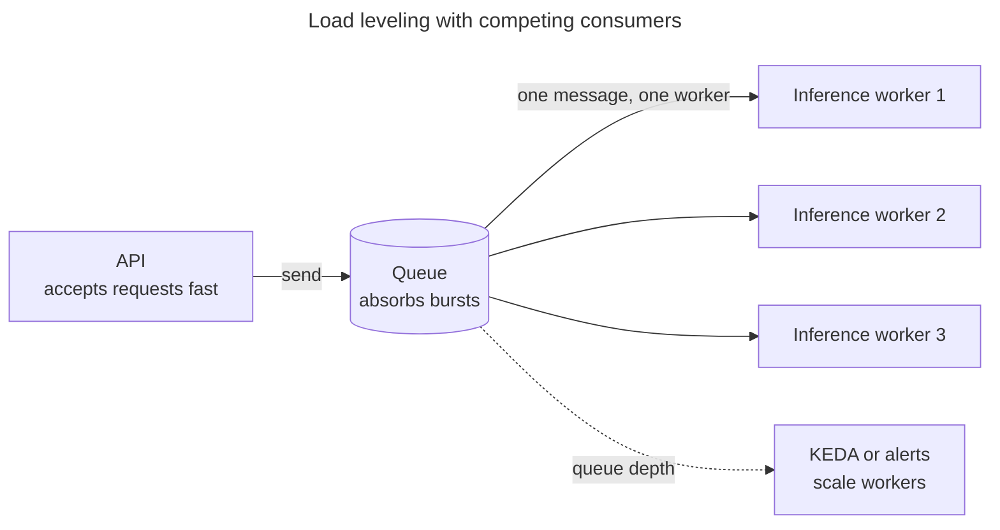
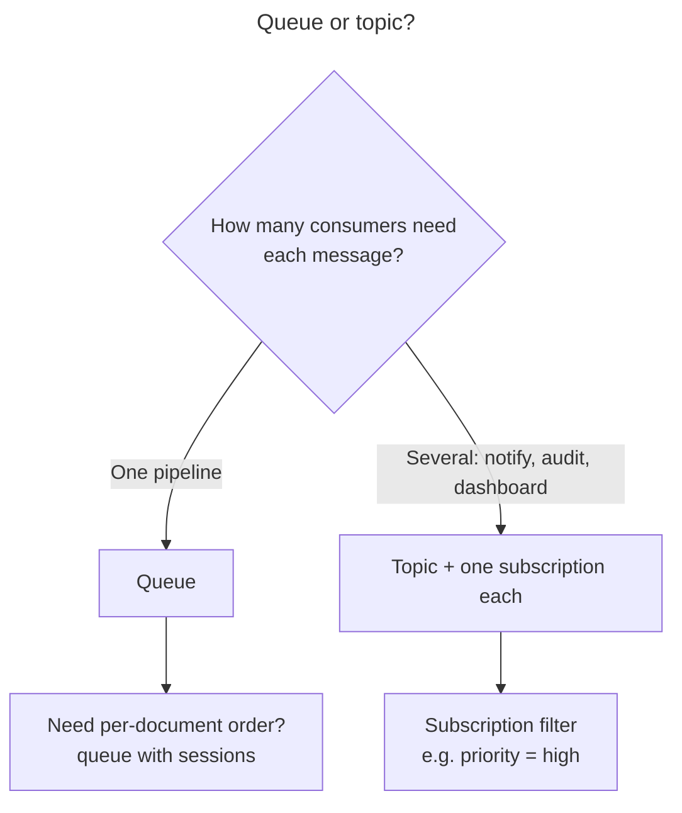
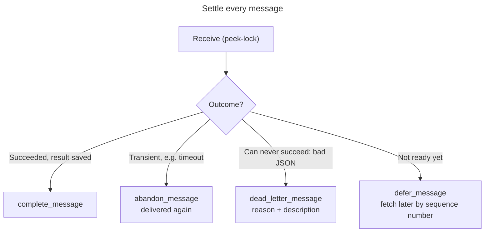

# LP7 · M1: Queue and process AI operations with Azure Service Bus

> **Learning path 7:** Integrate backend services for AI solutions · **Skill area 3:** Connect to and consume Azure services · about 81 min on Microsoft Learn  
> Study it interactively at [aryantripathi.dev/ai-200](https://aryantripathi.dev/ai-200/lp-7/queue-process-operations-service-bus)

Service Bus queues and topics decouple AI work from the API that accepts it. You'll learn the messaging concepts, queues and topics, sending with the Python SDK, and processing messages reliably.

**In this lesson**

1. [Explore Azure Service Bus concepts and messaging in AI architectures](#explore-azure-service-bus-concepts-and-messaging-in-ai-architectures)
2. [Choose between queues and topics with subscriptions](#choose-between-queues-and-topics-with-subscriptions)
3. [Structure messages for AI workloads](#structure-messages-for-ai-workloads)
4. [Process messages reliably](#process-messages-reliably)

## Explore Azure Service Bus concepts and messaging in AI architectures

📘 Microsoft Learn: [Explore Azure Service Bus concepts and messaging in AI architectures](https://learn.microsoft.com/en-us/training/modules/queue-process-operations-service-bus/2-explore-service-bus-concepts)

Service Bus is a **post office between your API and your AI workers**. The API drops a letter (message) in a queue and answers the user at once; workers pick letters up at their own pace. Spikes pile up in the queue instead of crashing the workers, and nothing is lost if a worker is offline.

**Key facts**

- Fully managed enterprise broker: **queues** (point-to-point) and **topics with subscriptions** (publish-subscribe), inside a **namespace** (`<name>.servicebus.windows.net`). Protocol: **AMQP 1.0**. Ordering, duplicate detection and transactions.
- Auth: SAS or **Microsoft Entra ID** with RBAC; managed identity is recommended (no connection strings or key rotation).
- Synchronous inference is fragile: unpredictable latency fills thread pools and causes cascading timeouts. Messaging decouples producers from consumers so each scales independently.
- **Load leveling**: the queue absorbs bursts; size processors for **average** throughput, not peak.
- **Competing consumers**: many workers on one queue; each message goes to **exactly one** consumer; add workers without code changes; unacknowledged messages are redelivered if a worker crashes.
- **Temporal decoupling**: producers and consumers needn't be online together; messages persist (triple-redundant across zones in zone-enabled namespaces).
- Use **queue depth** (active message count) as a scaling signal: Azure Monitor alerts, and **KEDA** scalers in Container Apps and Functions.
- Tiers: **Standard** (shared capacity, messages up to **256 KB**, variable throughput) and **Premium** (dedicated resources, up to **100 MB via AMQP** (1 MB HTTP), predictable latency, VNet integration, private endpoints, availability zones).

| Pattern | Problem it solves |
|---|---|
| Load leveling | Bursts would overwhelm processors; size for average load |
| Competing consumers | Scale processing horizontally; one message → one worker |
| Temporal decoupling | Workers offline for deployments without losing requests |
| Queue depth monitoring | Know when to scale (KEDA, alerts) |

> [!WARNING]
> **Exam traps**
>
> - Standard max message size: **256 KB**; Premium: **100 MB** (AMQP).
> - Private endpoints and VNet integration need **Premium**.

## Choose between queues and topics with subscriptions

📘 Microsoft Learn: [Choose between queues and topics with subscriptions](https://learn.microsoft.com/en-us/training/modules/queue-process-operations-service-bus/3-choose-queues-topics-subscriptions)

A **queue** is one inbox: each message goes to one worker. A **topic** is a newsletter: every **subscription** gets its own copy, and filters let each subscription pick only the messages it cares about. Add subscribers later without touching the sender.

**Key facts**

- **Queue**: each message to one competing consumer; scale by adding workers.
- Receive modes: **receive-and-delete** (removed on delivery) and **peek-lock** (default; lock, then complete, abandon or dead-letter; **at-least-once**). Peek-lock is recommended for AI.
- **Sessions**: FIFO and single-receiver per session ID, e.g. extraction before classification for one document.
- **Topic + subscriptions**: each subscription is an independent virtual queue with its own copy; failures in one don't affect others; add subscriptions without changing the producer.
- Filters (evaluated at the broker): **Boolean** (TrueFilter default, FalseFilter), **SQL** (expressions on application and system properties), **Correlation** (exact matches, more efficient than SQL).
- Tag messages with application properties (model_name, priority, document_type) and filter, e.g. priority = 'high' to a reserved GPU processor.
- SDK: one **ServiceBusClient**; `get_queue_sender` / `get_topic_sender`; `get_queue_receiver` / `get_subscription_receiver`. Use **context managers** (with) for cleanup.

| Need | Use |
|---|---|
| One pipeline handles each request | Queue |
| Notify, audit and update dashboards from one result | Topic with three subscriptions |
| Route high-priority requests to a dedicated processor | Subscription with a filter on priority |
| Exact-match routing on one property, efficiently | Correlation filter |
| Process one document's steps in order | Queue with sessions |

> [!WARNING]
> **Exam traps**
>
> - Correlation filters are more efficient than SQL filters for exact matches.
> - Default filter is TrueFilter (accept all).

## Structure messages for AI workloads

📘 Microsoft Learn: [Structure messages for AI workloads](https://learn.microsoft.com/en-us/training/modules/queue-process-operations-service-bus/4-structure-messages-ai-workloads)

A message is an **envelope**: the letter inside (body, usually JSON), labels on the outside you choose (application properties for routing), and stamps the post office adds (system properties such as message_id and TTL). Too big for the envelope? Put the file in Blob Storage and mail the **link** (claim-check).

**Key facts**

- Anatomy: **body** (payload), **application properties** (your key-value metadata for routing, filtering, tracking), **system properties** (message_id, correlation_id, content_type, time_to_live, session_id, sequence_number).
- Serialize prompts and parameters as JSON and set **content_type = application/json**.
- **message_id** uniquely identifies the message; with duplicate detection enabled, duplicates within the window are discarded, so always generate a unique ID per message.
- **correlation_id** tracks one request end to end (API → processor → results store); search logs and DLQs by it. Propagate OpenTelemetry trace context in application properties.
- **Claim-check**: upload the large payload to Blob Storage, send only the URI. Works in any tier, lowers broker throughput costs, allows separate access control.
- **time_to_live**: expire stale requests (e.g. 5 minutes for real-time classification); expired messages go to the DLQ when **dead-lettering on expiration** is enabled.
- **ServiceBusMessageBatch** reduces round trips; `add_message()` raises **MessageSizeExceededError** when full: send the batch and start a new one.

| Property | Use |
|---|---|
| message_id | Unique ID; used by duplicate detection |
| correlation_id | End-to-end request tracking |
| content_type | application/json |
| time_to_live | Expire time-sensitive requests |
| Application properties | model_name, priority, document_type for filters |

> [!WARNING]
> **Exam traps**
>
> - Reusing a message_id with duplicate detection on can silently drop distinct requests.
> - Claim-check works without upgrading to Premium.

## Process messages reliably

📘 Microsoft Learn: [Process messages reliably](https://learn.microsoft.com/en-us/training/modules/queue-process-operations-service-bus/5-process-messages-reliably)

In **peek-lock**, a worker borrows a message, does the work, then reports back: **complete** (done), **abandon** (try again), **dead-letter** (this will never work) or **defer** (later). Messages that fail too often land in the **dead-letter queue**. Long jobs must keep renewing their lock.

**Key facts**

- **Receive-and-delete**: removed on delivery; highest throughput; a crash loses the message. Fine for telemetry or noncritical logging.
- **Peek-lock** (default, recommended): message locked; settle within the lock duration; lock expiry makes it available again → **at-least-once**.
- Settlement: **complete_message()** (success, removed), **abandon_message()** (transient error; redelivered; delivery count +1), **dead_letter_message()** (will never succeed; reason + description), **defer_message()** (later; retrieve by **sequence number** with `receive_deferred_messages()`).
- **max_delivery_count** default **10**; exceeded → DLQ with reason **MaxDeliveryCountExceeded**. Lower (3–5) for permanent errors; higher for transient ones.
- The **DLQ** exists automatically for every queue and subscription; holds expired, over-delivered or explicitly dead-lettered messages; messages stay **until you receive and complete them**. Alert on dead-letter count.
- Read it with `sub_queue=ServiceBusSubQueue.DEAD_LETTER` (not a hand-built `$deadletterqueue` path). Reprocess: read, send a copy to the original queue, complete the DLQ message, but only after fixing the root cause.
- Lock duration: default **1 minute**, max **5 minutes**. Longer work: `renew_message_lock()` or **AutoLockRenewer**; or a two-phase approach (record, complete fast, process separately).

| Situation | Settlement |
|---|---|
| Inference succeeded, result saved | complete_message() |
| Model endpoint timed out (transient) | abandon_message() |
| Malformed JSON or unsupported model | dead_letter_message(reason, description) |
| Dependency not ready; handle later | defer_message() → receive_deferred_messages(sequence numbers) |

> [!WARNING]
> **Exam traps**
>
> - Lock default is **1 minute** (max 5); expiry causes duplicate processing.
> - DLQ messages don't expire on their own.
> - Deferred messages are retrieved by **sequence number** only.

## Check yourself

- **Practice questions:** [lp7m1 on GitHub](../../practice/lp7m1.md), or [on the site](https://aryantripathi.dev/ai-200/lp-7/queue-process-operations-service-bus) with hints and saved progress
- **Cheat sheet:** [Learning path 7](../cheatsheets/lp7.md)
- **Microsoft Learn exercise:** [Process messages with Azure Service Bus](https://learn.microsoft.com/en-us/training/modules/queue-process-operations-service-bus/6-exercise-process-messages)
- **Hands-on lab:** [labs/](../../labs/README.md) has a lab for this learning path

---

Part of **AI-200 Prep**, a free course by Aryan Tripathi · [aryantripathi.dev/ai-200](https://aryantripathi.dev/ai-200) · Written from the public Microsoft Learn course AI-200T00. Not affiliated with Microsoft.
