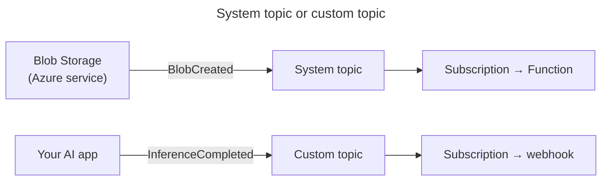
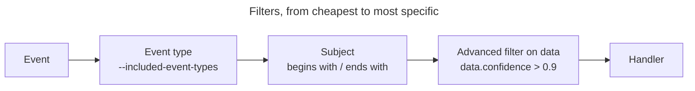
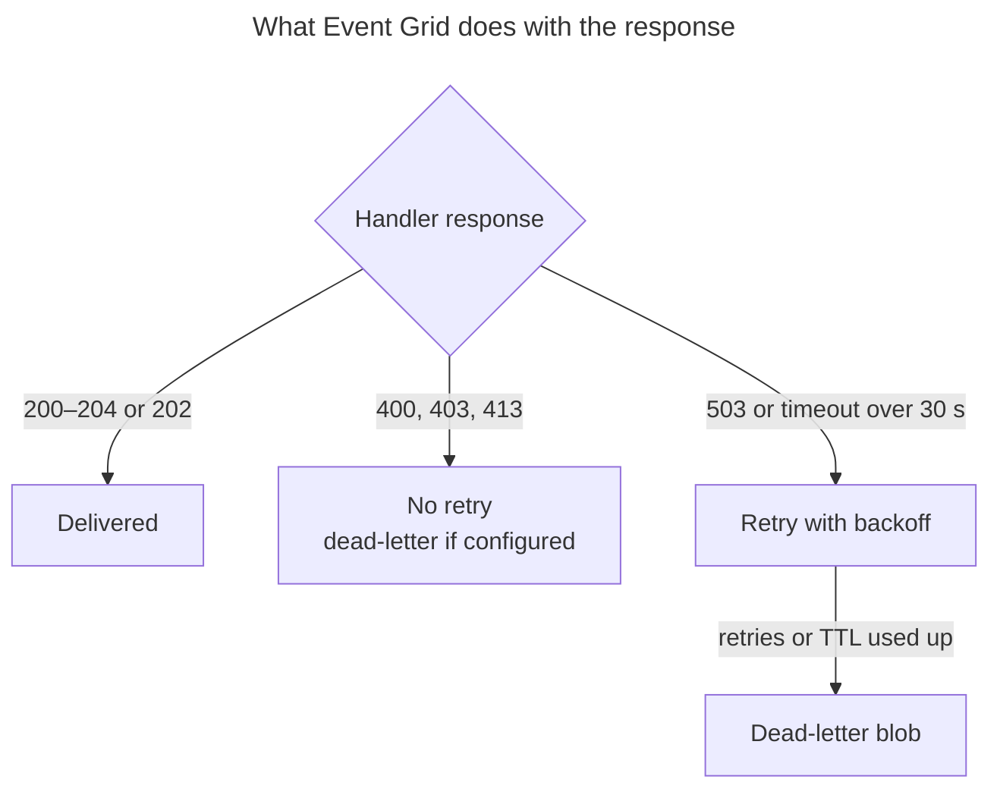

# LP7 · M2: Develop event-driven AI workflows with Azure Event Grid

> **Learning path 7:** Integrate backend services for AI solutions · **Skill area 3:** Connect to and consume Azure services · about 84 min on Microsoft Learn  
> Study it interactively at [aryantripathi.dev/ai-200](https://aryantripathi.dev/ai-200/lp-7/event-driven-workflows-event-grid)

Event Grid tells your services that something happened, such as a new blob. You'll learn its concepts, subscriptions and filters, reliable delivery, and publishing your own events.

**In this lesson**

1. [Understand Azure Event Grid concepts and event-driven patterns for AI solutions](#understand-azure-event-grid-concepts-and-event-driven-patterns-for-ai-solutions)
2. [Work with event schemas and properties](#work-with-event-schemas-and-properties)
3. [Configure delivery and retry policies for reliable event processing](#configure-delivery-and-retry-policies-for-reliable-event-processing)
4. [Publish custom events from AI applications](#publish-custom-events-from-ai-applications)

## Understand Azure Event Grid concepts and event-driven patterns for AI solutions

📘 Microsoft Learn: [Understand Azure Event Grid concepts and event-driven patterns for AI solutions](https://learn.microsoft.com/en-us/training/modules/event-driven-workflows-event-grid/2-understand-event-grid-concepts)

Event Grid is a **doorbell system**: when something happens (a blob lands, a model finishes training), it rings every handler that subscribed, instead of each one checking again and again. Azure services ring through **system topics**; your own app rings through **custom topics**.

**Key facts**

- Fully managed **event routing**: low latency, millions of events per second, **per-event pricing**. Removes polling.
- Delivery models: **push** (to a webhook, Function or Service Bus queue) and **pull** (the consumer reads at its own pace).
- Components: **events** (small notifications of a state change, not the full resource), **event sources**, **topics**, **event subscriptions** (filter + destination), **event handlers**.
- Topics: **system topics** (created automatically for Azure services such as Blob Storage, Key Vault, Container Registry; you can't publish to them), **custom topics** (you create and publish to), **namespace topics** (in an Event Grid namespace; push and pull; MQTT support).
- Handlers: **Azure Functions** (lightweight stateless), **Event Hubs** (high-throughput streaming), **Service Bus queues/topics** (ordering, transactions), **webhooks** (any HTTP endpoint), **Storage queues** (async workers).
- Several subscriptions on one topic fan events out; new consumers don't change producers. Retries give fault isolation.
- Patterns: **reactive data processing** (Microsoft.Storage.BlobCreated triggers a pipeline), **pipeline stage coordination** (custom events between stages), **model lifecycle** (training done, validation, promotion).

| Aspect | System topic | Custom topic |
|---|---|---|
| Source | Azure services | Your application code |
| Creation | Automatic when you subscribe | You create it before publishing |
| Who publishes | Only the Azure service | Your app (SDK or REST) |
| Schema | Predefined by the service | You define type and data |

> [!WARNING]
> **Exam traps**
>
> - You can't publish to a system topic.
> - Events are notifications; the subscriber fetches the full resource if needed.
> - Pull delivery needs a namespace topic.

## Work with event schemas and properties

📘 Microsoft Learn: [Work with event schemas and properties](https://learn.microsoft.com/en-us/training/modules/event-driven-workflows-event-grid/3-event-schemas-properties)

Use **CloudEvents**, the open standard envelope: **type** says what happened, **source** where, **id** which one, **subject** a path you can filter on. Subscriptions then pick events by **type**, by **subject** prefix or suffix, or by values **inside the data**.

**Key facts**

- Schemas: proprietary **Event Grid schema** and **CloudEvents v1.0** (CNCF, recommended for new work).
- Event Grid schema → CloudEvents conversion works on delivery; **CloudEvents → Event Grid schema conversion isn't supported** (extension attributes).
- Required: **specversion** ("1.0"), **type** (reverse-DNS, drives type filtering), **source**, **id** (unique; for deduplication).
- Optional: **subject** (hierarchical path for prefix/suffix filters), time (UTC), datacontenttype, data.
- Event types such as `com.contoso.ai.InferenceCompleted`, EmbeddingsRefreshed, ModelRetrained, AnomalyDetected. Keep payloads small: reference results, don't embed them.
- Type filtering: `--included-event-types` (space-separated list).
- Subject filtering: **subjectBeginsWith** (e.g. /pipelines/embeddings/) and **subjectEndsWith** (file type, version, status). Combined filters must all match.
- **Advanced filters** on data or extension attributes: StringContains, NumberGreaterThan, StringBeginsWith, BoolEquals, IsNotNull. Up to **25 conditions**; **AND between conditions**, **OR within a condition's values**.
- Custom topic `--input-schema cloudeventschemav1_0`; subscription `--event-delivery-schema` controls output format.

| Filter | Example |
|---|---|
| Event type | --included-event-types com.contoso.ai.InferenceCompleted |
| Subject prefix | subjectBeginsWith /pipelines/embeddings/ |
| Subject suffix | subjectEndsWith .pdf |
| Advanced (data) | data.confidence NumberGreaterThan 0.9 |

> [!WARNING]
> **Exam traps**
>
> - Advanced filters: AND across conditions, OR within one condition's values; max 25.
> - Can't convert CloudEvents to the Event Grid schema.

## Configure delivery and retry policies for reliable event processing

📘 Microsoft Learn: [Configure delivery and retry policies for reliable event processing](https://learn.microsoft.com/en-us/training/modules/event-driven-workflows-event-grid/4-delivery-retry-policies)

Event Grid knocks on your endpoint and waits **30 seconds**. No answer, or a temporary error? It knocks again later (10 s, 30 s, 1 min, 5 min…) for up to a day. Some answers (400, 403, 413) mean "stop trying". If it finally gives up, it can drop the event in a **Blob Storage dead-letter** container, but only if you set one.

**Key facts**

- Delivery = HTTP POST; success = **200, 201, 202, 203 or 204**. Event Grid waits **30 seconds**, then retries.
- One event per delivery by default (an array of one). **At-least-once**: handlers must be **idempotent**; dedupe on **id**.
- Not retried: **400** Bad Request, **413** Request Entity Too Large, **403** Forbidden; for webhooks also **401**. For Azure resource endpoints, 401 and 404 retry after 5+ minutes.
- Backoff schedule: 10 s, 30 s, 1 min, 5 min, 1 h, 3 h, 6 h, then every 12 h up to 24 h (randomized).
- Retry policy: **max attempts 1–30 (default 30)** and **event TTL 1–1,440 minutes (default 1,440 = 24 h)**; whichever is reached first stops retries. Only about **six attempts fit in the first 30 minutes**.
- **Dead-lettering is disabled by default**; enable it with a **Blob Storage container** (create it first). Properties: deadLetterReason (MaxDeliveryAttemptsExceeded, MaxRetryDurationExceeded), deliveryAttempts, lastDeliveryOutcome (NotFound, TimedOut, Busy, Forbidden), publishTime, lastDeliveryAttemptTime.
- Handler design: 200–204 on success, **503** when overloaded, never 400 for transient issues; for work over 30 s, return **202 Accepted** and process asynchronously.
- **Output batching**: max events per batch 1–5,000; preferred batch size 1–1,024 KB; **all-or-none** (one failure retries the whole batch).
- Metrics: delivery success/failure count, matched events, **dropped events** (exceeded retries without dead-lettering), dead-lettered events.

| Response | Event Grid does |
|---|---|
| 200–204 | Success |
| 400, 403, 413 (and 401 for webhooks) | No retry |
| 503 or timeout (> 30 s) | Retry with backoff |
| 202 Accepted | Treated as success; process asynchronously |

> [!WARNING]
> **Exam traps**
>
> - Returning 400 for a transient problem means the event is never retried.
> - Without a dead-letter container, events that exhaust retries are **dropped**.
> - A 30-minute TTL with 10 max attempts: TTL wins (~6 attempts).

## Publish custom events from AI applications

📘 Microsoft Learn: [Publish custom events from AI applications](https://learn.microsoft.com/en-us/training/modules/event-driven-workflows-event-grid/5-publish-custom-events)

Create a **custom topic** that accepts CloudEvents, give your app's managed identity the **Event Grid Data Sender** role, then send events with **EventGridPublisherClient** (or a plain HTTP POST). Keep each event short: what happened, IDs to correlate, and a link to the full result.

**Key facts**

- Create: `az eventgrid topic create … --input-schema cloudeventschemav1_0`; get the endpoint (and key) with `az eventgrid topic show`.
- Auth: access key (**aeg-sas-key** header), SAS token, or **Microsoft Entra ID** (recommended; managed identity with the **Event Grid Data Sender** role on the topic).
- Payload principles: include correlation identifiers (requestId, run ID), **reference** results in Blob Storage or a database, add operational metadata (processingDurationMs, modelVersion), and a short summary for quick routing.
- SDK: **EventGridPublisherClient** (azure-eventgrid) with **AzureKeyCredential** or **DefaultAzureCredential**; send **CloudEvent** objects; a list is sent in **one HTTP request**.
- Publish at checkpoints: inference done, stage transition, anomaly detected, model validated; not for internal state nobody needs.
- REST: POST to the topic endpoint with `Content-Type: application/cloudevents+json; charset=utf-8` and the aeg-sas-key header; **200 OK** = accepted.
- Patterns: inference completion, model update, pipeline stage transition events. Adding a consumer = adding a subscription.

> [!WARNING]
> **Exam traps**
>
> - Data Sender role on the topic for managed identity publishing.
> - A list of events goes in one HTTP request.

## Check yourself

- **Practice questions:** [lp7m2 on GitHub](../../practice/lp7m2.md), or [on the site](https://aryantripathi.dev/ai-200/lp-7/event-driven-workflows-event-grid) with hints and saved progress
- **Cheat sheet:** [Learning path 7](../cheatsheets/lp7.md)
- **Microsoft Learn exercise:** [Publish and receive events with Azure Event Grid](https://learn.microsoft.com/en-us/training/modules/event-driven-workflows-event-grid/6-exercise-publish-receive-events)
- **Hands-on lab:** [labs/](../../labs/README.md) has a lab for this learning path

---

Part of **AI-200 Prep**, a free course by Aryan Tripathi · [aryantripathi.dev/ai-200](https://aryantripathi.dev/ai-200) · Written from the public Microsoft Learn course AI-200T00. Not affiliated with Microsoft.
