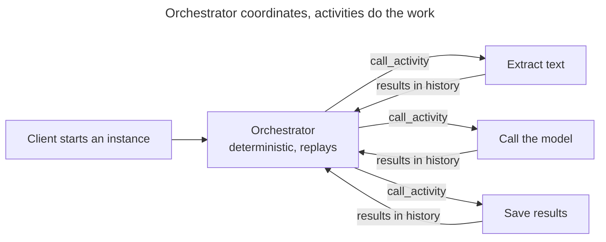
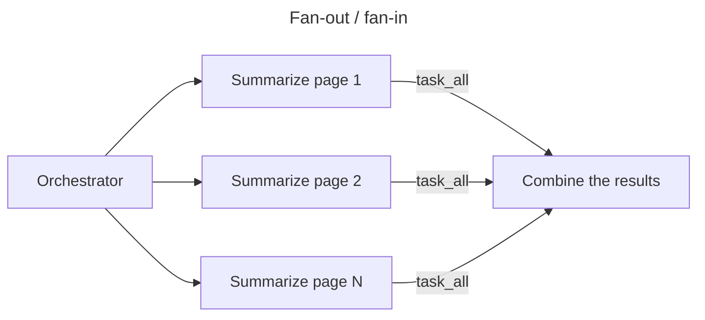
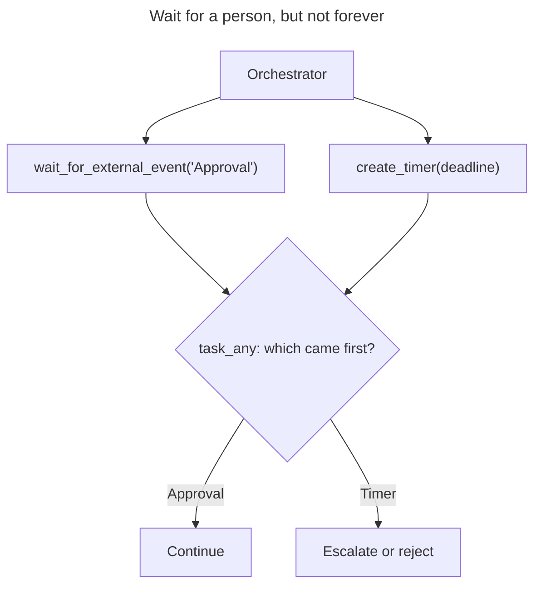
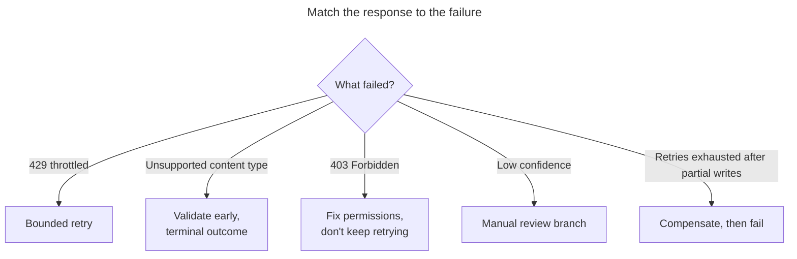

# LP7 · M4: Orchestrate durable AI workflows with Azure Durable Functions

> **Learning path 7:** Integrate backend services for AI solutions · **Skill area 3:** Connect to and consume Azure services · about 77 min on Microsoft Learn  
> Study it interactively at [aryantripathi.dev/ai-200](https://aryantripathi.dev/ai-200/lp-7/orchestrate-durable-functions)

Durable Functions coordinates long-running, multi-step AI workflows with state, retries and human decisions. You'll learn deterministic orchestrators, fan-out/fan-in, human interaction, and error recovery.

**In this lesson**

1. [Separate orchestration logic from activity work](#separate-orchestration-logic-from-activity-work)
2. [Process independent work with fan-out/fan-in](#process-independent-work-with-fan-outfan-in)
3. [Coordinate human approval with external events](#coordinate-human-approval-with-external-events)
4. [Design reliable workflow steps](#design-reliable-workflow-steps)

## Separate orchestration logic from activity work

📘 Microsoft Learn: [Separate orchestration logic from activity work](https://learn.microsoft.com/en-us/training/modules/orchestrate-durable-functions/2-separate-orchestrator-activity-responsibilities)

An **orchestrator** is the **conductor**: it decides what plays next but never plays an instrument. **Activities** are the **musicians**: they call models, read blobs, write databases. The conductor's score is re-read from the top after every restart (replay), so it must give the same instructions every time: no clocks, no random numbers, no direct I/O.

**Key facts**

- Roles: **client** function (start, query, terminate, send events; returns status URLs), **orchestrator** (sequence, branches, parallel tasks, durable waits, aggregation), **activity** (one unit of nondeterministic work: blob reads, model calls, notifications, DB updates), **entity** (small durable state).
- The runtime records every durable action in the **orchestration history** and **replays** the orchestrator after restarts (event sourcing); no checkpoint code needed.
- Orchestrators must be **deterministic**. Safe: local calculations, conditions, loops over stable input, durable task results, `context.current_utc_datetime`, `context.new_uuid()`.
- Avoid in orchestrators: direct HTTP/DB/file/SDK calls, model or embedding calls, random numbers and nondeterministic UUIDs, `datetime.now()`, `time.sleep()`, unscheduled threads or async work, environment-dependent decisions.
- Activities run external work, are distributed across workers and retried by policy; they have **at-least-once** semantics, so side effects must be **idempotent**.
- Keep history small: pass **references** (document ID, blob URL, scores), not documents, prompts, embeddings or model responses. Never put secrets or tokens in inputs or outputs.
- Storage provider: **Durable Task Scheduler** recommended for new apps; Azure Storage provider for existing apps or self-managed storage.
- Replay repeats orchestrator logs; use replay-safe logging or check `context.is_replaying`. Include instance ID and operation ID in activity telemetry.

| In the orchestrator | In an activity |
|---|---|
| context.current_utc_datetime | datetime.now() |
| context.new_uuid() | uuid.uuid4() / random numbers |
| Durable timers (create_timer) | Model calls, blob reads, DB writes |
| Branching on activity results | Azure SDK clients |

> [!WARNING]
> **Exam traps**
>
> - datetime.now() or time.sleep() in an orchestrator breaks replay.
> - Activities can run more than once; make writes idempotent.
> - Durable Task Scheduler is the recommended provider for new apps.

## Process independent work with fan-out/fan-in

📘 Microsoft Learn: [Process independent work with fan-out/fan-in](https://learn.microsoft.com/en-us/training/modules/orchestrate-durable-functions/3-apply-fan-out-fan-in)

Fan-out/fan-in is **"everyone start now, tell me when you're all done"**. Create one task per document, wait for all of them with `task_all`, then summarise. For thousands of items, go in **batches** so you don't swamp the model's rate limits.

**Key facts**

- Use when items don't depend on each other: text extraction, image classification, embeddings per chunk, content moderation.
- Sequential: 20 documents × 5 s ≈ 100 s. Parallel can approach the **slowest** item, if capacity allows. Downstream limits (model, database, storage) may be the real cap.
- Python: build a list of tasks with `context.call_activity(…)` **without yielding each one**, then `yield context.task_all(tasks)`.
- Results come back in the **same order as the task list**. One failure surfaces as a task failure; the orchestrator decides to fail, compensate or route the batch.
- Fan-in stays deterministic and light: return compact fields (document ID, status, confidence, result URL, operation ID), not text, prompts or embeddings. Heavy aggregation → an **AggregateResults activity**.
- **Bound** parallel work with batches (size from model quotas, duration, concurrency, history). Batches don't give an exact requests-per-second limit; never sleep in the orchestrator, use **durable timers**.
- **Sub-orchestrations** split huge workloads (e.g. by policy or month); the parent aggregates child summaries. Start simple; add them when size justifies it.

> [!WARNING]
> **Exam traps**
>
> - Yield each call immediately = sequential, not fan-out.
> - task_all returns results in task-list order, not completion order.

## Coordinate human approval with external events

📘 Microsoft Learn: [Coordinate human approval with external events](https://learn.microsoft.com/en-us/training/modules/orchestrate-durable-functions/4-wait-human-approval-external-events)

The workflow sends a reviewer a request, then **sleeps for free** until either the reviewer answers (an **external event**) or the **deadline timer** rings, whichever comes first. It doesn't hold a worker while it waits, so the wait can last days.

**Key facts**

- An **external event** is a named one-way message to one orchestration instance; wait with `wait_for_external_event("ApprovalResponse")`. Events arriving early are **buffered**.
- Waiting doesn't hold a worker or active invocation, so approvals can take hours or days.
- Notify the reviewer from an **activity**. Payload: decision, reviewer ID, document ID, **approval version**, comment reference.
- The **instance ID** routes the event; store it with the approval record. Protect event endpoints; the ID isn't proof of authorization (use Entra ID and per-document checks).
- Deadline: `context.create_timer(context.current_utc_datetime + …)`, never time.sleep(). Race with `context.task_any([event, timer])`; if the event wins, **cancel the timer**. The orchestrator must wait for or cancel every pending timer before exiting.
- Raise events with the orchestration client binding; the HTTP endpoint returns **202 Accepted**.
- External events are **at-least-once**: dedupe with approval request ID and version; reject outdated versions. Timeout is a **business outcome**: escalate, manual follow-up or reject. Don't poll from the orchestrator.

> [!WARNING]
> **Exam traps**
>
> - If the event wins, cancel the timer; an event task needn't be cancelled when the timer wins.
> - Events can arrive before the orchestrator waits; they're buffered.

## Design reliable workflow steps

📘 Microsoft Learn: [Design reliable workflow steps](https://learn.microsoft.com/en-us/training/modules/orchestrate-durable-functions/5-design-reliable-workflow-steps)

Not every failure deserves a retry. Retry **transient** ones a bounded number of times; send **permanent** and **business** failures down their own path. Make each step safe to run twice (**idempotent**) and, when a later step fails, **compensate** earlier ones instead of pretending to roll back.

**Key facts**

- Failure classes: **transient** (throttling, network blips → bounded retry), **permanent** (invalid input → terminal outcome), **authorization** (don't keep retrying forbidden calls), **timeout**, **business-rule** (low confidence, rejection → explicit branch, not an exception).
- `call_activity_with_retry` with **RetryOptions** (first retry interval in ms, max attempts). Don't stack uncontrolled retry layers (SDK + durable).
- Durable timeouts: race a task against a timer. A winning timer **doesn't cancel** a started activity; ignore late results and keep writes idempotent. Timeout scopes: client request, activity retry window, workflow step, end-to-end deadline.
- Activities run **at least once**: use a stable operation ID (from input or `context.new_uuid()`) as a key, blob name or idempotency key. **Not** uuid.uuid4() inside the activity.
- Store a request hash or document version with results to detect accidental key reuse.
- **Compensation**: new business actions that address earlier side effects (mark invalid, quarantine), idempotent, in reverse order, keeping audit evidence. Rethrow the original failure after compensating.
- Terminal statuses: Completed, Rejected, TimedOut, Compensated, Failed. Telemetry: instance ID, operation ID, document ID, activity, attempt; never log contents, prompts or credentials.

| Failure | Response |
|---|---|
| Model throttled (429) | Bounded retry |
| Unsupported content type | Validate early; terminal outcome |
| 403 Forbidden | Fix permissions; don't retry repeatedly |
| Low confidence score | Business branch (e.g. manual review) |
| Retries exhausted after partial writes | Compensate, then fail |

> [!WARNING]
> **Exam traps**
>
> - uuid.uuid4() inside a retried activity makes every attempt look new.
> - A timer win doesn't stop an activity that's already running.

## Check yourself

- **Practice questions:** [lp7m4 on GitHub](../../practice/lp7m4.md), or [on the site](https://aryantripathi.dev/ai-200/lp-7/orchestrate-durable-functions) with hints and saved progress
- **Cheat sheet:** [Learning path 7](../cheatsheets/lp7.md)
- **Microsoft Learn exercise:** [Build a durable document-processing workflow](https://learn.microsoft.com/en-us/training/modules/orchestrate-durable-functions/6-exercise-build-durable-document-processing-workflow)
- **Hands-on lab:** [labs/](../../labs/README.md) has a lab for this learning path

---

Part of **AI-200 Prep**, a free course by Aryan Tripathi · [aryantripathi.dev/ai-200](https://aryantripathi.dev/ai-200) · Written from the public Microsoft Learn course AI-200T00. Not affiliated with Microsoft.
