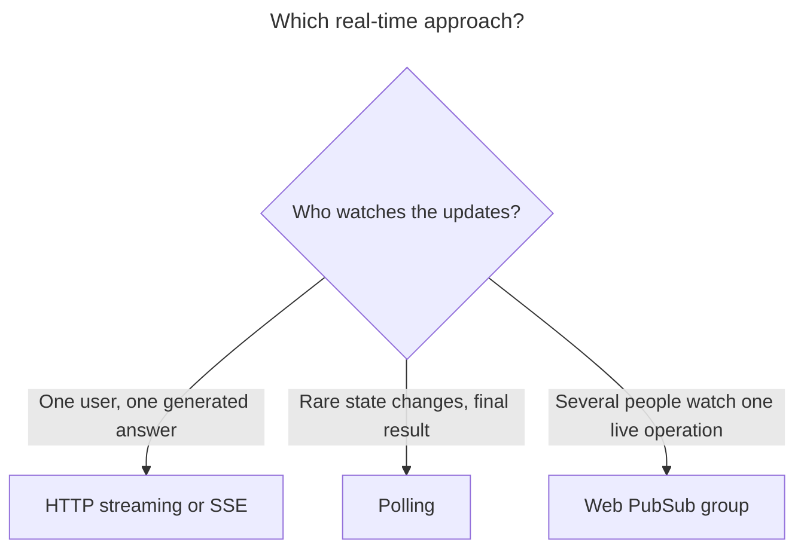
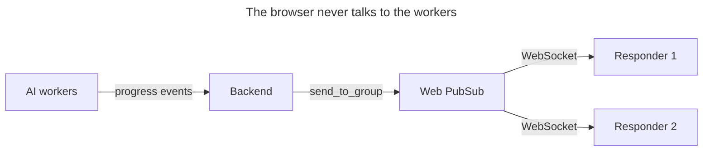
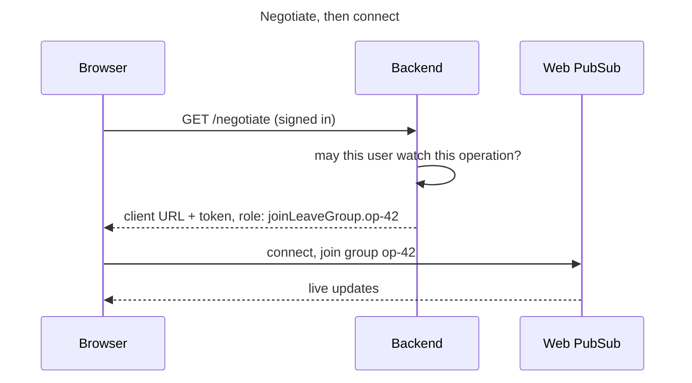
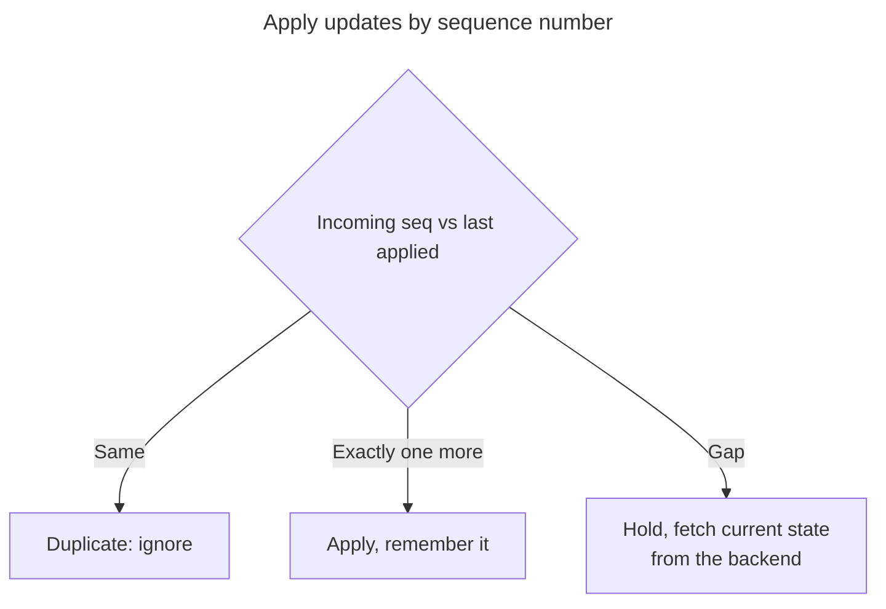

# LP7 · M5: Deliver real-time AI experiences with Azure Web PubSub

> **Learning path 7:** Integrate backend services for AI solutions · **Skill area 3:** Connect to and consume Azure services · about 104 min on Microsoft Learn  
> Study it interactively at [aryantripathi.dev/ai-200](https://aryantripathi.dev/ai-200/lp-7/real-time-ai-web-pubsub)

Some AI work needs live updates for several people at once. You'll learn when Web PubSub fits, how to keep client delivery separate from backend work, how to authenticate connections, publish updates, recover after disconnects and control update volume.

**In this lesson**

1. [Choose a real-time client delivery approach](#choose-a-real-time-client-delivery-approach)
2. [Separate client delivery from backend coordination](#separate-client-delivery-from-backend-coordination)
3. [Negotiate authenticated client connections](#negotiate-authenticated-client-connections)
4. [Publish AI updates to operation groups](#publish-ai-updates-to-operation-groups)
5. [Design reconnection and operation recovery](#design-reconnection-and-operation-recovery)
6. [Batch updates and support slow clients](#batch-updates-and-support-slow-clients)

## Choose a real-time client delivery approach

📘 Microsoft Learn: [Choose a real-time client delivery approach](https://learn.microsoft.com/en-us/training/modules/real-time-ai-web-pubsub/2-choose-real-time-client-delivery)

Pick the simplest pipe that fits: one person waiting for one answer → **HTTP streaming** or **SSE**; rare status changes → **polling**; many people watching the same live job → **Web PubSub** groups.

**Key facts**

- Choose by **direction**, **number of recipients** and **lifetime** of the work. The channel affects delivery, not how reliably the backend processes work.
- **HTTP streaming**: the server writes chunks into one response; tied to that request; proxies or compression can buffer it, so test the real hosting path.
- **Server-Sent Events**: `text/event-stream` with event data, names and IDs; one-way server → browser; **EventSource** reconnects and sends the last ID, but the server must retain events to resume. Commands go through separate authenticated HTTP requests.
- **Polling**: periodic authorized status requests against a durable record; good for infrequent changes or final results; 202 Accepted + status URL + Retry-After; stop after a terminal outcome.
- **Azure Web PubSub**: managed WebSocket connections; a worker publishes once to a **group** of authorized connections; independent of the starting HTTP request. Bidirectional capable, but you needn't expose client broadcasting.
- **Azure SignalR Service** is distinct: hubs, client method invocation, transport negotiation. Web PubSub suits WebSocket apps with their own messaging contract; it isn't a drop-in SignalR replacement.

| Need | Approach |
|---|---|
| One user streams one generated answer | HTTP streaming or SSE |
| Server → browser progress events with IDs | SSE |
| Infrequent state changes, final result | Polling |
| Several responders watch one live investigation | Web PubSub group |

> [!WARNING]
> **Exam traps**
>
> - SSE reconnects automatically, but resume needs server-side retained events.
> - Web PubSub isn't a drop-in replacement for an existing SignalR app.

## Separate client delivery from backend coordination

📘 Microsoft Learn: [Separate client delivery from backend coordination](https://learn.microsoft.com/en-us/training/modules/real-time-ai-web-pubsub/3-separate-client-delivery-backend-coordination)

Web PubSub is the **loudspeaker**, not the **work queue**. The work goes through Service Bus, Event Grid or Durable Functions, the truth lives in a **durable operation record**, and notifications only describe changes already saved.

**Key facts**

- Async request-reply: return an operation ID and status URL; Web PubSub adds live observation, it doesn't replace the **status endpoint**.
- Work path: authenticated API → durable operation record → queue/workflow → worker → AI services. Use durable workflows or an **outbox** so accepted work is never left unscheduled.
- Roles: **Service Bus** buffers work with settlement; **Event Grid** routes state-change events; **Durable Functions** coordinates long steps (publish from an activity); **Web PubSub** sends updates to connected clients.
- A Web PubSub **group** isn't a queue or subscription: publishing to a group doesn't assign work to one reliable worker.
- The operation record is authoritative: **stateVersion** (state revision) and **lastSequence** (watermark of notifications included); they needn't match, but the watermark must be consistent with the snapshot.
- **Persist before notifying**. DB write + publish isn't atomic; a **transactional outbox** with a separate publisher reuses the same event ID and sequence on retry.
- Approvals and cancellations are **backend commands** via authenticated endpoints. Closing a tab doesn't cancel work. A completed report stays completed even if a notification fails.

> [!WARNING]
> **Exam traps**
>
> - Group publish ≠ work assignment.
> - Notify only after the state change is durable.

## Negotiate authenticated client connections

📘 Microsoft Learn: [Negotiate authenticated client connections](https://learn.microsoft.com/en-us/training/modules/real-time-ai-web-pubsub/4-negotiate-authenticated-client-connections)

Before a browser connects, your backend checks **who** the user is and **which investigation** they may watch, then hands back a short-lived access URL allowing them to **join only that group**. The backend's own Azure permission to mint tokens is a separate thing.

**Key facts**

- A **client access URL** = WebSocket endpoint + bearer token. Authorize the operation **before** generating it; identity comes from trusted middleware, never browser-supplied IDs.
- Scopes: **user** (opaque, tenant-qualified ID), **incident**, **operation** (smallest audience). Derive opaque group names by hashing tenant + operation IDs; no secrets or forward slashes in names.
- Receive-only role: `webpubsub.joinLeaveGroup.<group>`. Don't add **webpubsub.sendToGroup** or unrestricted joinLeaveGroup just because samples do.
- Backend identity (Entra ID) needs **…/clientConnection/generateToken/action** and **…/clientConnection/write**; **Web PubSub Service Owner** includes both but is broader; a custom role can be narrower. Publishers need send permissions.
- Return negotiation responses with **Cache-Control: no-store**; keep keys and URLs out of browser bundles and logs.
- **WebPubSubClientCredential** takes a callback that fetches a fresh URL. Register handlers before `open()`; wait for the group join before declaring live delivery ready.
- Token expiry stops **new** connections, not active ones. On access change: deny negotiation, `revoke_permission()` and `remove_connection_from_group()` for tracked connections; a **connect event handler** can check access at each handshake; use short-lived tokens.

| Boundary | Controls |
|---|---|
| Azure RBAC on the backend identity | Can the backend generate tokens and publish? |
| Client token roles | Which groups the browser connection may join |
| Application access checks | Which operations the user may observe |

> [!WARNING]
> **Exam traps**
>
> - Expired token ≠ disconnected client.
> - Never give a viewer webpubsub.sendToGroup.

## Publish AI updates to operation groups

📘 Microsoft Learn: [Publish AI updates to operation groups](https://learn.microsoft.com/en-us/training/modules/real-time-ai-web-pubsub/5-publish-ai-updates-operation-groups)

Use one **hub** for the scenario and one **group** per investigation. Every update is a small envelope with an **event ID** and **sequence number**, so browsers can spot duplicates and gaps, and it's published only **after** it's saved.

**Key facts**

- **Hub** = logical boundary for connections; **group** = subset within a hub. A user may have several connections; group membership isn't a durable audience record.
- Envelope: **schemaVersion**, **operationId**, **eventId** (same across retries), **sequence** (duplicate and gap detection), **type**, **data**.
- Types: `text.batch` (append delta), `progress` (replace snapshot), `approval.requested`, `operation.completed` (resultPath), `operation.failed` (sanitized message). IDs and paths aren't access rights.
- Publish with `send_to_group()` after the durable update; a publish error leaves the notification pending; a crash after send can cause a duplicate.
- Don't treat the last text batch as success; wait for operation.completed. A successful publish doesn't prove browser receipt.
- Client: group broadcasts arrive via **CallbackType.GROUP_MESSAGE** (SERVER_MESSAGE is for direct-to-connection/user). Callbacks may run on other threads: use a lock. Validate payloads; render model output as text, sanitize Markdown-to-HTML.
- Connected ≠ subscribed: `open()`, then `join_group()`, then synchronize from durable state.

> [!WARNING]
> **Exam traps**
>
> - Group broadcasts use GROUP_MESSAGE, not SERVER_MESSAGE.
> - Model output isn't trusted markup.

## Design reconnection and operation recovery

📘 Microsoft Learn: [Design reconnection and operation recovery](https://learn.microsoft.com/en-us/training/modules/real-time-ai-web-pubsub/6-design-reconnection-operation-recovery)

Each investigation's updates are numbered 1, 2, 3… The browser applies only the **next** number, ignores repeats and, when a number is **missing**, fetches a fresh **snapshot** from the status API. The snapshot says "I include everything up to N", and live updates continue from N+1.

**Key facts**

- The SDK's **reliable subprotocol** gives limited **session recovery** for brief interruptions; it isn't a durable event log. Don't add manual acks. A failed recovery → new connection with fresh negotiation and membership. A page reload loses in-memory state.
- Application **sequence** belongs to the operation stream (shared by all observers); the protocol **sequenceId** belongs to one connection session.
- Contiguous sequences: next = previous + 1. Same → **duplicate** (ignore); next → apply; skip → **gap** (hold and fetch state).
- Use a per-operation **lock**; keep network calls outside it; bound the recovery buffer by count and bytes.
- Snapshot **lastSequence** = watermark. **Subscribe first, then request the snapshot**; buffer meanwhile; replace view; drop buffered ≤ watermark; apply newer in order; declare synced only if contiguous.
- Ignore snapshots older than what's displayed (lagging replica).
- **auto_rejoin_groups** rejoins groups the client joined itself; server-assigned or token-assigned groups need backend restoration or a new token.
- A missed final event isn't revealed by later gaps: reconcile after new connections, reloads or unexpected inactivity.

| Last applied | Incoming | Decision |
|---|---|---|
| 14 | 14 | Duplicate: ignore |
| 14 | 15 | Apply; remember 15 |
| 15 | 17 | Gap: hold and fetch state |

> [!WARNING]
> **Exam traps**
>
> - Request the snapshot only after subscribing.
> - Client dedup doesn't make backend processing exactly-once.

## Batch updates and support slow clients

📘 Microsoft Learn: [Batch updates and support slow clients](https://learn.microsoft.com/en-us/training/modules/real-time-ai-web-pubsub/7-batch-updates-support-slow-clients)

Don't send one message per token. Collect fragments and send a **batch** when time, count or size says so (and at the end). Progress can be squashed to the latest value; text can't. Slow browsers fall back to the **durable snapshot**.

**Key facts**

- Flush a text batch on a **time** threshold, **item** count, **size** budget (serialized bytes), or an **operation boundary** (finish, fail, pause for a decision). 100 ms is a starting point to measure, not a guarantee.
- Use a timer or timed queue wait so a short batch flushes during model pauses; flush remaining text before recording completion. Bounded queue + bounded fragment size.
- Overflow by type: **progress** → keep the newest; **text deltas** → preserve order or mark incomplete and restore from durable state; **approvals** and **terminal outcomes** → persisted and discoverable via status.
- Coalescing before assigning sequences keeps streams contiguous; skipping assigned sequences creates gaps.
- Separate receive rate from render rate: bounded view model, controlled redraw cadence.
- Publishing failures: bounded retries reusing event ID and sequence; don't retry authorization errors forever; don't mark a completed AI operation failed because delivery failed.
- Capacity: one group publish fans out to every recipient; measure payload bytes, fragments per batch, time to first visible update, publish failures, reconnects, backlog age.

> [!WARNING]
> **Exam traps**
>
> - Progress can be coalesced; text deltas can't be dropped silently.
> - A delivery failure isn't a model failure.

## Check yourself

- **Practice questions:** [lp7m5 on GitHub](../../practice/lp7m5.md), or [on the site](https://aryantripathi.dev/ai-200/lp-7/real-time-ai-web-pubsub) with hints and saved progress
- **Cheat sheet:** [Learning path 7](../cheatsheets/lp7.md)
- **Microsoft Learn exercise:** [Stream AI investigation updates with Azure Web PubSub](https://learn.microsoft.com/en-us/training/modules/real-time-ai-web-pubsub/8-exercise-stream-ai-investigation-updates)
- **Hands-on lab:** [labs/](../../labs/README.md) has a lab for this learning path

---

Part of **AI-200 Prep**, a free course by Aryan Tripathi · [aryantripathi.dev/ai-200](https://aryantripathi.dev/ai-200) · Written from the public Microsoft Learn course AI-200T00. Not affiliated with Microsoft.
