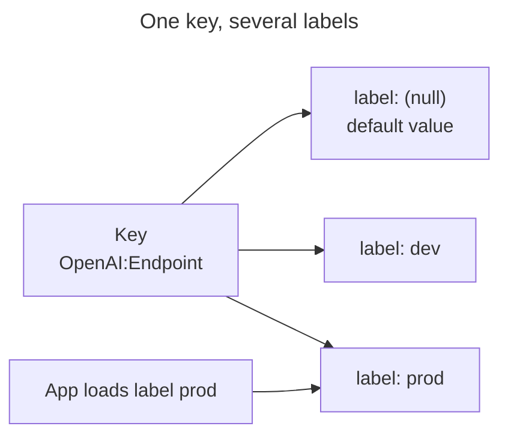
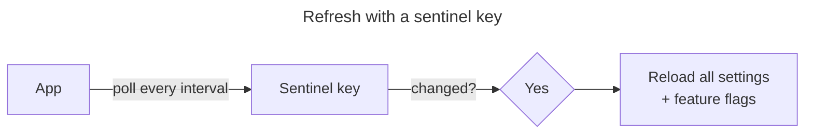
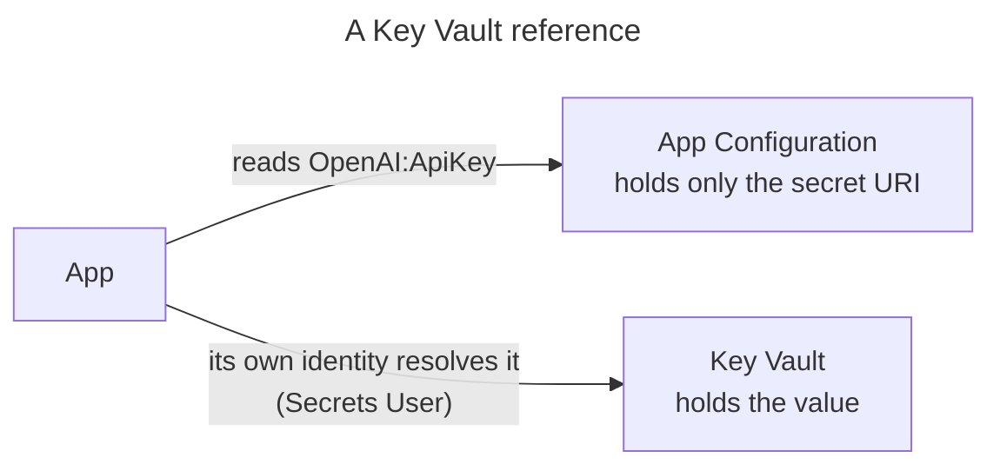
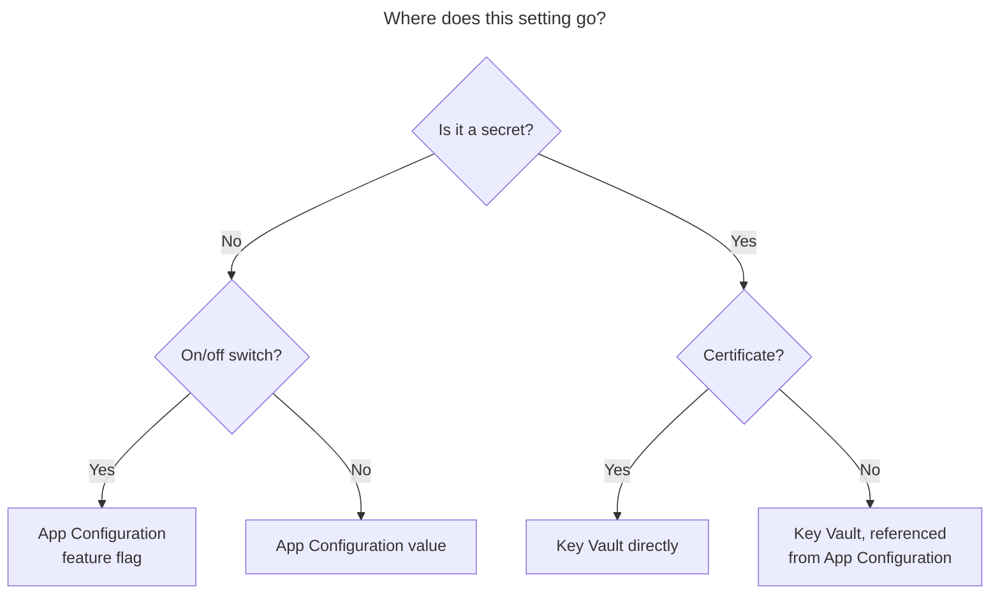

# LP8 · M2: Manage application settings with Azure App Configuration

> **Learning path 8:** Manage application secrets and configuration for AI solutions · **Skill area 4:** Secure, monitor and troubleshoot solutions · about 79 min on Microsoft Learn  
> Study it interactively at [aryantripathi.dev/ai-200](https://aryantripathi.dev/ai-200/lp-8/manage-app-settings-app-config)

App Configuration holds settings and feature flags that change without redeploying. You'll learn to connect and refresh, organize with labels and flags, reference Key Vault secrets, and decide what goes where.

**In this lesson**

1. [Connect to App Configuration from application code](#connect-to-app-configuration-from-application-code)
2. [Organize settings with labels and feature flags](#organize-settings-with-labels-and-feature-flags)
3. [Reference Key Vault secrets from App Configuration](#reference-key-vault-secrets-from-app-configuration)
4. [Decide what to store in App Configuration vs Key Vault](#decide-what-to-store-in-app-configuration-vs-key-vault)

## Connect to App Configuration from application code

📘 Microsoft Learn: [Connect to App Configuration from application code](https://learn.microsoft.com/en-us/training/modules/manage-app-settings-app-config/2-connect-app-configuration)

App Configuration is a **central settings board**. Each setting has a **key** (like `OpenAI:Endpoint`), a value, and optionally a **label** (like Production). The Python **provider** loads the settings you pick into a dictionary, and can refresh them when you change a **sentinel** key.

**Key facts**

- Each setting: **key** (case-sensitive; hierarchy with `:` or `/`), **value** (key + value ≤ **10 KB**), **label** (variants; no label = **null label**, the default), **content type** (e.g. application/json; Key Vault reference types), **tags**.
- `pip install azure-appconfiguration-provider azure-identity`. `load(endpoint=…, credential=…)` returns a dictionary-like Mapping. Endpoint: `https://<store-name>.azconfig.io`.
- By default, load() gets every key with the **null label**.
- Roles: **App Configuration Data Reader** (read key-values, feature flags, Key Vault references) for apps; **App Configuration Data Owner** for operators and CI/CD. Managed identity removes connection strings.
- **SettingSelector**: `key_filter` (prefix, * wildcard) and `label_filter`. With several selectors, the **last one wins** for the same key.
- **trim_prefixes** strips prefixes such as `DocPipeline:` so code uses shorter names.
- Dynamic refresh: `refresh_on=[WatchKey("Sentinel")]` and `refresh_interval` (seconds). A change to the sentinel reloads **all** settings together. You must call **refresh()** yourself; if the interval hasn't elapsed, it returns immediately.

| Property | Notes |
|---|---|
| Key | Case-sensitive; OpenAI:Endpoint |
| Value | Key + value ≤ 10 KB |
| Label | Variant; null label = default |
| Content type | application/json, Key Vault reference |
| Tags | Metadata for filtering |

> [!WARNING]
> **Exam traps**
>
> - No selector → only null-label keys load.
> - Later selectors override earlier ones.
> - refresh() must be called; the provider doesn't refresh on its own.

## Organize settings with labels and feature flags

📘 Microsoft Learn: [Organize settings with labels and feature flags](https://learn.microsoft.com/en-us/training/modules/manage-app-settings-app-config/3-organize-labels-feature-flags)

Same key, different label per environment: `Pipeline:BatchSize` is 10 in Development and 200 in Production. Load defaults first, then the environment's label on top. **Feature flags** are switches you flip at runtime: kill switches, gradual model rollouts, A/B tests.

**Key facts**

- Labels create variants of one key (Development 10, Staging 50, Production 200). **Null label** (`\0`) = default.
- **Composition**: load null-label defaults first, then the environment label; later selectors override earlier ones for the same key.
- Naming: hierarchical keys with a consistent delimiter (OpenAI:Endpoint, CosmosDB:DatabaseName, Pipeline:BatchSize) so components can load `key_filter="OpenAI:*"`.
- Feature flags: name, on/off state, optional filters; stored with prefix **.appconfig.featureflag/** and content type `application/vnd.microsoft.appconfig.ff+json`. They decouple feature lifecycle from deployment.
- Load with `feature_flags_enabled=True`; evaluate with **FeatureManager**.`is_enabled()` (package `featuremanagement`, installed separately).
- `feature_flag_refresh_enabled=True`: flag refresh is **independent** of setting refresh; both happen when you call refresh().
- Patterns: **progressive model rollouts**, **kill switches** (seconds instead of a rollback), **A/B testing**, **staged pipeline activation**.

> [!WARNING]
> **Exam traps**
>
> - Load defaults first, overrides second.
> - Flag changes don't trigger setting refresh, and vice versa.

## Reference Key Vault secrets from App Configuration

📘 Microsoft Learn: [Reference Key Vault secrets from App Configuration](https://learn.microsoft.com/en-us/training/modules/manage-app-settings-app-config/4-reference-key-vault-secrets)

A **Key Vault reference** is a setting whose value is a **pointer** to a secret. The app loads everything through App Configuration, and the provider quietly fetches the secret from Key Vault. The app's identity needs **two roles**: one on each service.

**Key facts**

- A reference's value is a URI to a Key Vault secret; content type `application/vnd.microsoft.appconfig.keyvaultref+json;charset=utf-8`. It supports labels and selectors like any key.
- App Configuration stores only the **pointer**, never the secret value.
- Create in the portal (Configuration explorer → Create → Key Vault reference) or `az appconfig kv set-keyvault --key … --secret-identifier https://…/secrets/openai-api-key`.
- Omit the version in the identifier (recommended) to always resolve the **latest** version; include it to pin.
- Provider: pass `keyvault_credential=DefaultAzureCredential()`; references resolve automatically into the same dictionary.
- Roles: **App Configuration Data Reader** on the store + **Key Vault Secrets User** on each referenced vault. Missing Key Vault access → error naming the vault and secret. `keyvault_client_configs` maps vault URIs to specific credentials.
- **secret_refresh_interval** (seconds) re-resolves secrets independently of `refresh_interval`; takes effect when you call refresh(). Many references → watch Key Vault request volume.

> [!WARNING]
> **Exam traps**
>
> - Two role assignments: Data Reader (store) and Secrets User (vault).
> - secret_refresh_interval is separate from refresh_interval.

## Decide what to store in App Configuration vs Key Vault

📘 Microsoft Learn: [Decide what to store in App Configuration vs Key Vault](https://learn.microsoft.com/en-us/training/modules/manage-app-settings-app-config/5-decide-app-config-vs-key-vault)

Simple test: **could this value alone let someone in?** Yes → Key Vault. No → App Configuration. Then use App Configuration as the **single front door**, with Key Vault references for the secrets.

**Key facts**

- **App Configuration**: non-sensitive settings: labels, feature flags, key-value **snapshots** for point-in-time rollback, dynamic refresh, higher throughput.
- **Key Vault**: secrets, keys, certificates: HSM-backed protection, per-access audit logs, expiration, rotation, soft delete and purge protection.
- App Configuration: endpoint URLs, deployment names, embedding dimensions, batch sizes, retries, timeouts, flags, log levels, queue/container/database names, routing rules.
- Key Vault: OpenAI API keys, connection strings with credentials, storage keys, third-party tokens, TLS certificates, encryption keys, passwords and SP secrets.
- Rotation with audit proof → Key Vault. Operational changes (batch size, new deployment name) → App Configuration. App Configuration RBAC is **store-level**; Key Vault tracks per-object access.
- Recommended: App Configuration as the **single entry point**; secrets via **Key Vault references**; certificates accessed from Key Vault directly.
- Anti-patterns: secrets directly in App Configuration; non-sensitive settings in Key Vault (stricter throttling, no labels or flags); duplicating values in both without references (drift); hard-coding settings in code.

| Setting | Where |
|---|---|
| OpenAI:Endpoint, Pipeline:BatchSize | App Configuration (value) |
| UseNewEmbeddingsModel | App Configuration (feature flag) |
| OpenAI:ApiKey | Key Vault, via App Configuration reference |
| CosmosDB:ConnectionString with key | Key Vault, via reference |
| TLS certificate | Key Vault (direct) |

> [!WARNING]
> **Exam traps**
>
> - Embedding dimensions and deployment names aren't secrets.
> - Duplicating a value in both services invites drift.

## Check yourself

- **Practice questions:** [lp8m2 on GitHub](../../practice/lp8m2.md), or [on the site](https://aryantripathi.dev/ai-200/lp-8/manage-app-settings-app-config) with hints and saved progress
- **Cheat sheet:** [Learning path 8](../cheatsheets/lp8.md)
- **Microsoft Learn exercise:** [Retrieve settings and secrets from Azure App Configuration](https://learn.microsoft.com/en-us/training/modules/manage-app-settings-app-config/6-exercise-retrieve-settings)
- **Hands-on lab:** [labs/](../../labs/README.md) has a lab for this learning path

---

Part of **AI-200 Prep**, a free course by Aryan Tripathi · [aryantripathi.dev/ai-200](https://aryantripathi.dev/ai-200) · Written from the public Microsoft Learn course AI-200T00. Not affiliated with Microsoft.
