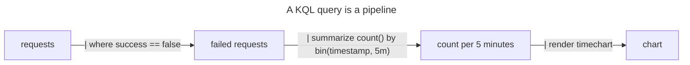
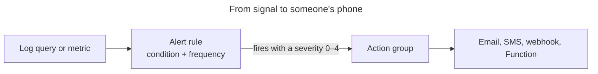

# LP9 · M2: Analyze app telemetry with logs and metrics

> **Learning path 9:** Observe and troubleshoot apps on Azure · **Skill area 4:** Secure, monitor and troubleshoot solutions · about 82 min on Microsoft Learn  
> Study it interactively at [aryantripathi.dev/ai-200](https://aryantripathi.dev/ai-200/lp-9/analyze-telemetry-logs-metrics)

Telemetry only helps if you can ask it questions. You'll learn KQL, failure and performance investigation, dashboards, workbooks, and alerts in Azure Monitor.

**In this lesson**

1. [Write basic KQL queries](#write-basic-kql-queries)
2. [Explore logs for errors and performance](#explore-logs-for-errors-and-performance)
3. [Build dashboards for app telemetry](#build-dashboards-for-app-telemetry)
4. [Create workbooks for interactive analysis](#create-workbooks-for-interactive-analysis)
5. [Set alerts for app failures and anomalies](#set-alerts-for-app-failures-and-anomalies)

## Write basic KQL queries

📘 Microsoft Learn: [Write basic KQL queries](https://learn.microsoft.com/en-us/training/modules/analyze-telemetry-logs-metrics/2-write-basic-kql-queries)

A KQL query is a **pipeline**: start with a table, then each `|` step narrows, reshapes or summarises it. `where` filters, `project` picks columns, `summarize … by bin(timestamp, 1h)` makes hourly groups, and `render timechart` draws it.

**Key facts**

- KQL is used across Azure Monitor, Log Analytics and Azure Data Explorer; queries start with a table and flow through operators separated by **|**. Written in the Log Analytics query editor (IntelliSense, charts).
- Scope: from an Application Insights resource use **requests, exceptions, dependencies**; from a Log Analytics workspace use **AppRequests, AppExceptions, AppDependencies**.
- Tables: requests, dependencies, exceptions, **traces** (log messages), **customEvents**, customMetrics, performanceCounters.
- Common columns: **timestamp**, **operation_Id** (one distributed trace), **cloud_RoleName** (which service), **customDimensions** (property bag), **itemCount** (events a sampled record represents).
- **where** filters (==, !=, >, <); **has** uses the term index (fast); **contains** is a substring match without term index (slower); startswith matches prefixes.
- **project** selects, renames or computes columns. **take** returns arbitrary N rows; **top** returns the first N sorted by a column.
- **summarize** with count(), avg(), sum(), min(), max(), **dcount()** (estimated distinct), count_distinct() (exact, heavier), **percentile()**. **bin(timestamp, 1h)** buckets time.
- **render**: timechart (needs a datetime column), barchart, columnchart, piechart, areachart. Including render keeps the chart when pinning or sharing.

| Operator | Does |
|---|---|
| where | Filter rows |
| project | Pick, rename or compute columns |
| take / top | Any N rows / first N sorted |
| summarize … by | Aggregate per group |
| bin() | Bucket timestamps |
| render | Draw a chart |

> [!WARNING]
> **Exam traps**
>
> - has is faster than contains on large tables.
> - take isn't sorted; top is.
> - Workspace scope uses AppRequests, not requests.

## Explore logs for errors and performance

📘 Microsoft Learn: [Explore logs for errors and performance](https://learn.microsoft.com/en-us/training/modules/analyze-telemetry-logs-metrics/3-explore-logs-errors-performance)

When things break: chart exceptions over time (using **sum(itemCount)** so sampling doesn't hide errors), rank them by type and operation, **join** them to requests on operation_Id, and look at dependency **percentiles** to find the slow downstream call.

**Key facts**

- With sampling, use **sum(itemCount)** instead of count() so totals reflect real event volume.
- Rank: `summarize … by type, operation_Name | top 10 by exceptionCount desc`.
- Correlate failures by **join**ing exceptions with requests on **operation_Id**. Duplicate column names get a suffix (**1**); rename inside the subquery first.
- Dependency latency: `summarize avg(duration), percentiles(duration, 50, 95, 99) by target, type`; averages can hide slow tails.
- Failed dependencies by target, **resultCode**, cloud_RoleName: **429** = rate limiting (adjust throughput or retry), **500** = server-side failure, timeout with no code = network or overload.
- **Failures** view (Investigate > Failures): top 3 response codes, exception types, failed dependencies per operation, samples → end-to-end transaction. **Performance** view: duration distributions (spot **bimodal** patterns).
- Use built-in views to find the area, KQL for joins, custom aggregations, extra dimensions and dashboards.

> [!WARNING]
> **Exam traps**
>
> - count() under sampling undercounts; use sum(itemCount).
> - Joined duplicate columns get a 1 suffix.

## Build dashboards for app telemetry

📘 Microsoft Learn: [Build dashboards for app telemetry](https://learn.microsoft.com/en-us/training/modules/analyze-telemetry-logs-metrics/4-build-dashboards-app-telemetry)

A **dashboard** is the **wall screen**: a few tiles (metrics charts, pinned query results, notes) that refresh on their own and answer "is it healthy right now?". Keep it to 5–10 well-named tiles.

**Key facts**

- Dashboards: tiles from many resources (even across subscriptions); refresh on a **schedule** (not real time); for at-a-glance monitoring. Workbooks are for interactive investigation.
- Metrics charts: Application Insights → Metrics; choose a metric, filter (e.g. cloud_RoleName), split by a dimension, then **pin**.
- Common metrics: server response time, failed requests, dependency failures, server request rate, availability. Aggregation: **average** for latency, **sum** for totals, **max** for worst-case spikes.
- Pin log query results (chart type is preserved). A growing gap between **p50 and p95** means a subset of requests is degrading.
- Share with Share → **Publish**; users need read access to the dashboard **and** the data sources, or tiles show access errors.
- Practices: separate pipeline health and business dashboards, **5–10 tiles**, descriptive titles, a Markdown tile with context and runbook links. For live incidents use Live Metrics or workbooks.

> [!WARNING]
> **Exam traps**
>
> - Dashboard tiles aren't real-time.
> - Access to the dashboard alone isn't enough; viewers need access to the data too.

## Create workbooks for interactive analysis

📘 Microsoft Learn: [Create workbooks for interactive analysis](https://learn.microsoft.com/en-us/training/modules/analyze-telemetry-logs-metrics/5-create-workbooks-interactive-analysis)

A **workbook** is an **interactive report**: pick a time range or service at the top and every query below updates. Start with a summary, let people click a row to drill in, and reveal detail sections only when needed.

**Key facts**

- Workbooks combine text, KQL queries, metrics and **parameters** into interactive reports for troubleshooting and root cause analysis ("why?"); dashboards answer "is it healthy?".
- Open from Azure Monitor, a Log Analytics workspace or Application Insights; a **gallery** of templates (performance, failures, usage).
- Steps render top to bottom: text, query (Logs data source), metrics, parameters. Visualizations: **grid**, chart, **tiles**, map.
- Parameters are referenced as **{TimeRange}**, **{ServiceName}**; changing one re-runs every dependent query.
- Parameter types: **time range**, **dropdown** (from a KQL query or static list; multi-select → `where cloud_RoleName in ({ServiceName})`), **resource picker**.
- **Conditional visibility** shows a step only for certain parameter values. **Grid link actions** open transaction details, another workbook, or **export a parameter** that filters later steps.
- Keep query steps manageable: each re-runs against Log Analytics whenever a parameter changes.

> [!WARNING]
> **Exam traps**
>
> - Multi-select dropdowns need the in operator.
> - Every parameter change re-runs dependent queries.

## Set alerts for app failures and anomalies

📘 Microsoft Learn: [Set alerts for app failures and anomalies](https://learn.microsoft.com/en-us/training/modules/analyze-telemetry-logs-metrics/6-set-alerts-app-failures-anomalies)

Alerts watch while nobody else does. A rule has **what to watch** (scope), **when to fire** (condition), **who to tell or what to run** (action group) and **how urgent** (severity 0–4). Add **smart detection** to catch problems you didn't think to set a threshold for.

**Key facts**

- Alert rule components: **scope**, **condition**, **action group** (reusable), **severity** 0 Critical, 1 Error, 2 Warning, 3 Informational, 4 Verbose.
- **Metric alerts**: evaluate resource metrics at intervals (simple thresholds). **Log search alerts**: run KQL on a schedule; more flexible (joins, percentiles, custom dimensions); more common for AI apps.
- Log search settings: **evaluation frequency** (1 minute to 24 hours), **aggregation granularity** (window), threshold on **table rows** or a value, number of violations before firing.
- Example: failed requests per service `| where failedCount > 10` with 5-minute window and frequency, firing when rows > 0. Prefer **p95** thresholds over averages.
- Action groups: up to **five** per alert rule; email, SMS, push, voice; automated actions: **Azure Function**, **Logic App**, **webhook**, **Automation Runbook**, **Event Hub**. Separate groups by severity; test them in the portal.
- **Smart detection** (machine learning): **failure anomalies** (with cluster analysis of affected users, exceptions, dependencies) and **performance anomalies** (response time, dependency duration, exception volume, gradual degradation). Use it alongside manual rules for SLA thresholds.

| Severity | Meaning |
|---|---|
| 0 | Critical: production-impacting, immediate response |
| 1 | Error: significant functional problems |
| 2 | Warning: may escalate |
| 3 | Informational |
| 4 | Verbose: diagnostic detail |

> [!WARNING]
> **Exam traps**
>
> - Severity 0 is the most urgent.
> - Up to five action groups per alert rule.
> - Smart detection complements, not replaces, SLA alerts.

## Check yourself

- **Practice questions:** [lp9m2 on GitHub](../../practice/lp9m2.md), or [on the site](https://aryantripathi.dev/ai-200/lp-9/analyze-telemetry-logs-metrics) with hints and saved progress
- **Cheat sheet:** [Learning path 9](../cheatsheets/lp9.md)
- **Microsoft Learn exercise:** [Query logs with KQL](https://learn.microsoft.com/en-us/training/modules/analyze-telemetry-logs-metrics/7-exercise-query-logs-kql)
- **Hands-on lab:** [labs/](../../labs/README.md) has a lab for this learning path

---

Part of **AI-200 Prep**, a free course by Aryan Tripathi · [aryantripathi.dev/ai-200](https://aryantripathi.dev/ai-200) · Written from the public Microsoft Learn course AI-200T00. Not affiliated with Microsoft.
